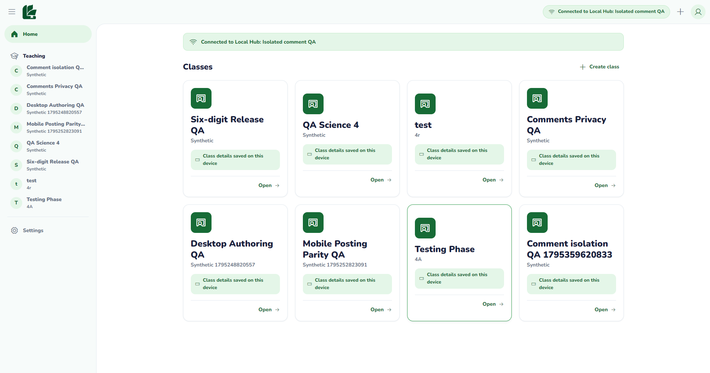
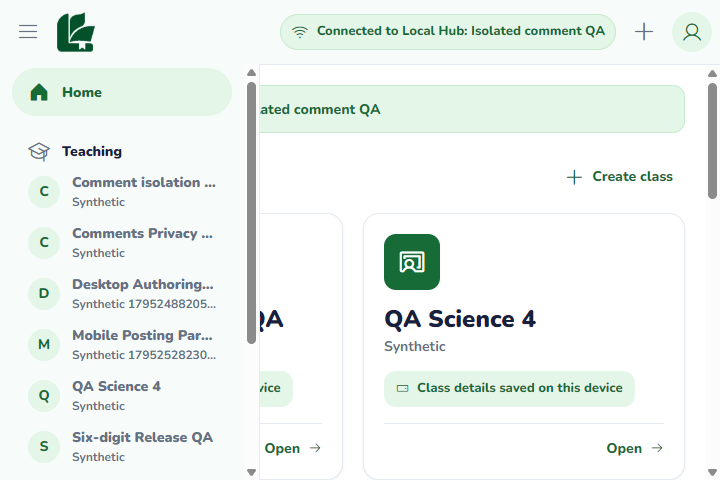
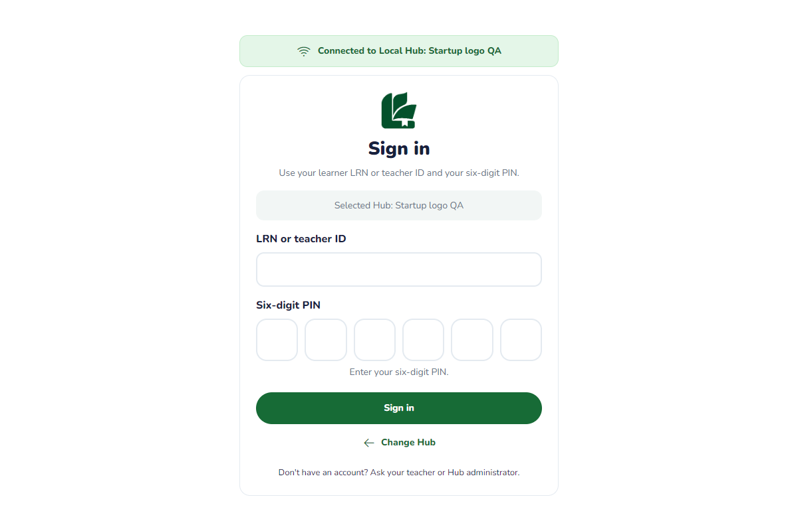
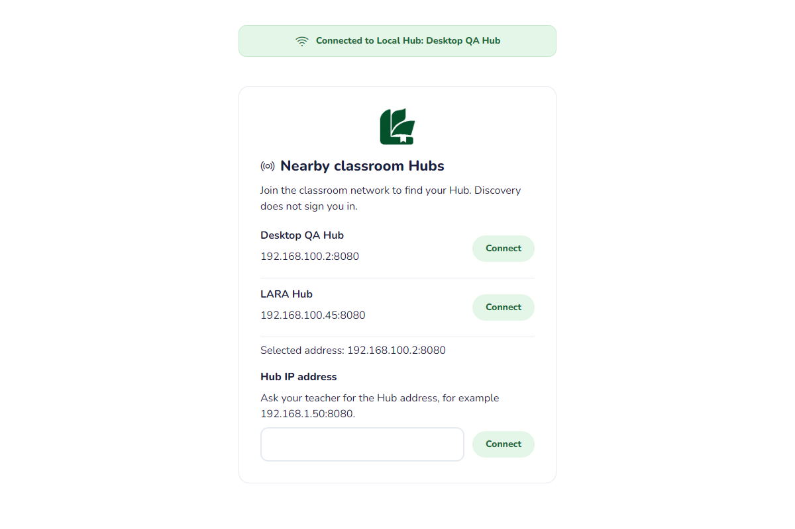
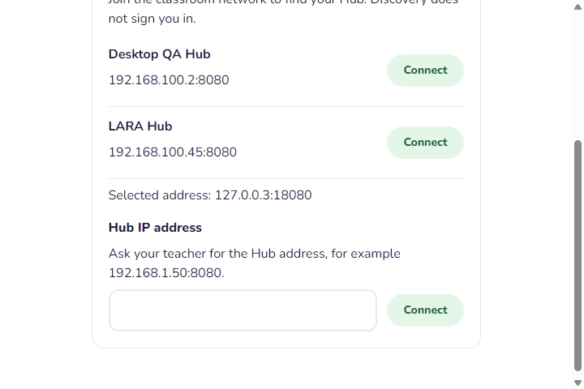

# Supplied Desktop app branding (#410)

The user-supplied `LARA APP LOGO.svg` is preserved byte-for-byte at `src-tauri/icons/lara-app-logo-source.svg`. Its original colors and transparent background are retained. No generated redesign is used.

Tauri's existing icon tool renders the master with `--fit contain` so the 529×555 source fits a square without cropping or stretching. The generated Windows ICO contains 16, 24, 32, 48, 64 and 256 pixel entries. `icon.png` remains the bundled app icon. The header uses the generated 128px PNG at 40×40 CSS pixels with accessible name `L.A.R.A.`; the browser favicon uses the 32px PNG. No new runtime dependency or external resource is needed. `build.rs` tracks both native icon files so an icon-only change refreshes the Windows resource.

To regenerate, from `desktop/`, run `npm run tauri icon -- src-tauri/icons/lara-app-logo-source.svg --fit contain --output <temporary-output-directory>`, then copy the desktop `icon.ico`, `icon.png`, `128x128.png` (header) and `32x32.png` (favicon) to their corresponding existing destinations. Other platforms' generated assets are not used by this Windows change.

Verification:

- 215 frontend tests, lint, TypeScript/Vite production build, native release build, NSIS bundle and offline invariant guard passed.
- Packaged native header verified against the existing local real Hub with synthetic accounts: transparent background, 40px square dimensions, correct accessible name and no clipping at desktop/720px widths.
- The first native build retained the old cached green icon. After adding icon change tracking, extracting the executable's raw Windows icon with `ExtractIconEx` matched the generated supplied-logo ICO pixel-for-pixel.
- Original SVG source checksum matches the supplied file. Only Desktop-owned files changed. No installer upgrade, installed-app replacement, Linux/macOS run or Server/Mobile branding change is claimed. The existing d8eda19 prerelease predates this branding PR.

## Startup branding follow-up (#413)

The sign-in card replaces its generic avatar with the same supplied logo. The startup Hub-selection card displays the logo above its heading. Both use a centered 56px transparent image with accessible name `L.A.R.A.`. The shared ConnectionPage receives an explicit `showLogo` flag from the signed-out shell, so the Settings connection panel keeps its existing layout.

Verification: all 215 frontend tests, lint, production frontend/native builds, normal NSIS bundle and offline invariant guard passed. A separate native QA build with an explicit G-drive WebView `dataDirectory` verified both startup cards, Change Hub navigation, 128px source rendering, centered 56px sizing and 720×480 fit against the existing local real Hub's reachability check. No sign-in or data-changing Hub action was required. The normal installer was saved before making that temporary out-of-repository QA configuration. The user's active app was not closed or replaced. No installer upgrade or new prerelease publication is claimed for this follow-up.

