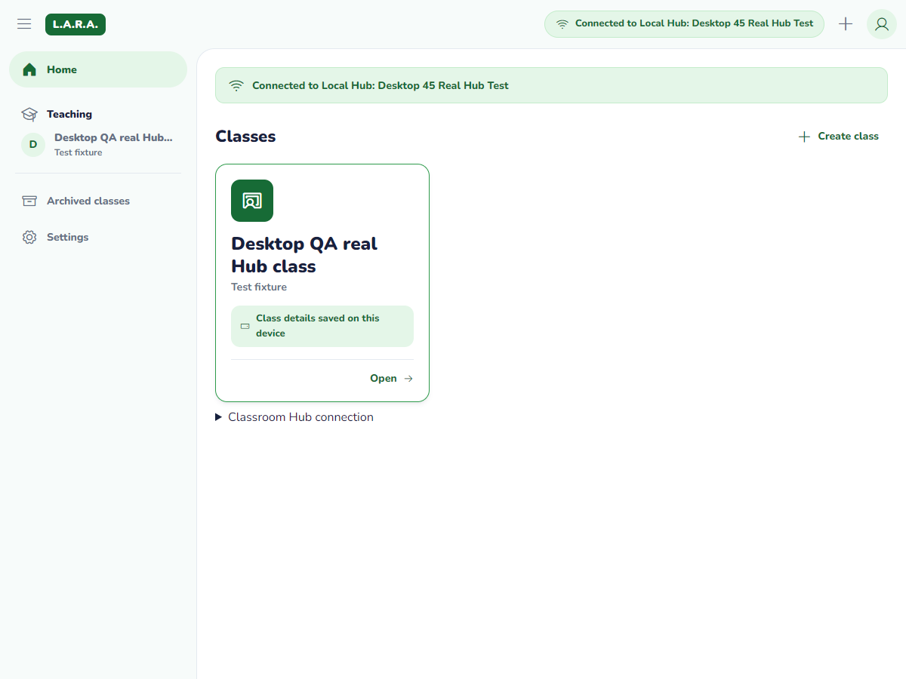
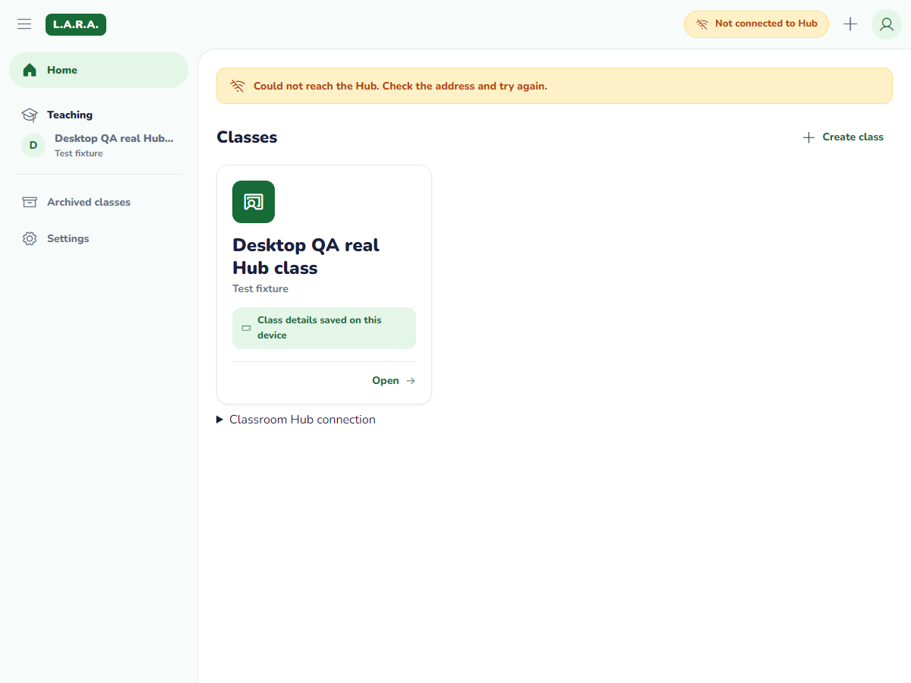
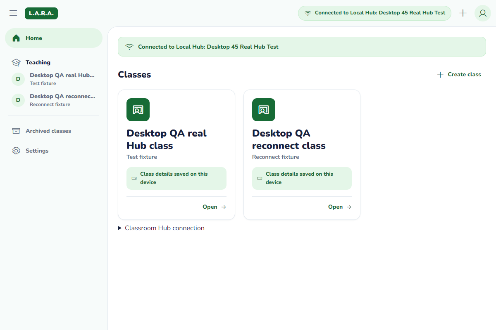

# Desktop 2.1 — accounts and cached Home (#45)

Learners can register and learners/teachers can sign in on the selected LAN Hub, then open their role-specific Home. Previously signed-in profiles and class details reopen offline without a PIN check or network requirement. This is cached access, not a new offline authentication. The admin remains Hub-PC only.

Sources: OpenAPI auth/classroom schemas, the canonical client SQL, Desktop Tech Spec sections 3/6/7/10/13, design-system 5.2/5.12/5.13/9.2/9.3 and the prototype. The team follows announcements [#238](https://github.com/BootlegYouki/L.A.R.A/discussions/238) and the login-rule follow-up on [#194](https://github.com/BootlegYouki/L.A.R.A/discussions/194). These do not authorize changes outside Desktop.

## Files and flow

- `services/api.ts`: existing reachability probe remains credential-free. Account requests use only the selected validated private/loopback Hub and fixed `POST /api/auth/login`, `POST /api/auth/register`, `GET /api/classrooms`. Native HTTP, no cookies, no redirects, ten-second metadata deadline. Never replay a login/register automatically. Rate limits honor `Retry-After`; raw Hub error messages are not rendered.
- `services/auth.ts`: validates and filters public auth/classroom payloads, rejects admin sessions, and bridges the native account commands. Tokens exist transiently in memory for authenticated requests, never in React's persisted state. Native cache/credential calls share the existing 15-second initialization timeout; this bounds UI waiting, not native execution. A cleanup failure cannot hide a confirmed 401.
- `src-tauri/src/account.rs`: keyring-backed credentials and native SQLx account snapshots. Windows Credential Manager, macOS Keychain and Linux Secret Service are selected through target-specific keyring features. If secure storage fails, the current token remains only in session memory and the UI explains that sign-in is not remembered. There is no plaintext token fallback.
- `store/app.ts`: the existing Zustand store now restores an account for the selected Hub, deduplicates matching restores, permits retry after failure and ignores late results from a different context. App additionally hides another Hub's account in the render that changes the address, before effects finish. SQLite/error/retry behavior remains independent of network reachability.
- `LoginPage`: sign-in and learner-only registration. Name and ID are trimmed, registration requires a 12-digit LRN, PIN is four masked digits, teacher accounts come from the Hub admin. Inputs/submission are disabled while a request runs. No PIN persistence or offline PIN verification.
- `HomePage`, `Sidebar`, `ClassroomCard`: teacher Teaching versus learner Enrolled navigation, cached class grid, loading/empty/error states and explicit retry. Class cards open a read-only metadata overview. Enrollment, teacher authoring, Stream and sync remain their later issues; unfinished controls stay disabled and do not pretend to succeed.
- `App.tsx`: handles login/restore/refresh, aborts obsolete requests, preserves cached cards through network failures, and requests sign-in after a real authenticated 401. Reconnect retries safe class reads, never submitted credentials. Hub reachability 401 and expired-session 401 are deliberately different outcomes.

## Native persistence boundary

The five IPC commands are `restore_account_session(hub)`, `save_account_session(hub, session)`, `account_token(hub, userId)`, `save_classroom_snapshot(hub, userId, classrooms)` and `forget_account_session(hub, userId)`. Native code revalidates identities, roles, Hub addresses, ports and payloads rather than trusting JavaScript types.

Account context is SHA-256 of the normalized REST Hub origin and the authenticated user UUID. Hub display-name or advertised WebSocket-port changes do not select a different account cache. Under the platform app-data `accounts/` directory, each context gets its own `account-<hash>.db`, using the exact immutable migrations 1 and 2 and checksummed SQLx migration history. The original `lara_client.db` is not deleted, repurposed or silently imported into an unknown account/Hub. No new contract table or migration is added.

Own public profile/expiry and visible classroom IDs are local `sync_state` values. Only the authenticated user's LRN/ID is stored as their profile. Initial class timestamps describe the local snapshot write, not a claimed Hub creation date; later authoritative sync must not use these as a cursor or freshness gate. No sync cursor is advanced. `db.ts` retains the scaffold database helpers/tests; signed-in snapshots use the isolated native context, not the old global `lara_client.db` query.

Snapshots atomically upsert class metadata and replace the visible-ID list. They do not delete old classes or queued children. Archived classes and explicit non-ACTIVE/missing learner membership are hidden. No enrollment UUID is invented from `GET /api/classrooms`, which does not provide one. #46/#48 will add the contracted enrollment/sync rows.

An atomic nonsecret pointer selects the last user separately for each Hub. A random credential generation binds the SQL profile, session-memory secret and OS keyring entry. Failed OS updates cannot restore an older stored token for a newer profile. Expired tokens are never returned for a request; an expired profile can still supply offline cached data. Confirmed 401 clears the active pointer and current token while retaining cache files/queued work. Forgetting another synthetic test credential cannot select or clear the current account's pointer.

This is local account-context isolation, not server identity verification, encrypted classroom storage, a new sync engine or a remote-Hub feature. New Hub selection never forwards the previous Hub's token.

## Design decisions

- Current design-system class cards never show the class code, overriding #45's older code-tag wording. A Dark Green icon tile and saved-class-details status follow the canonical Home. No teacher names, learner counts, due-work status, download percentage or material availability are fabricated from the class-list endpoint.
- A single labelled password field replaces four visual PIN boxes. It retains masking, paste/autofill, numeric input mode and one clear accessible field; this deliberate login-layout choice is listed in the PR.
- The existing 260px drawer/76px rail, Home structure, bundled Nunito/Phosphor, English dictionary and tokens remain. Connection controls are a reachable disclosure below the main screen, not an offline-blocking modal. Opening a card shows its class banner/name/section and saved metadata, not an invented Stream screen.
- No logout/settings workflow is added ahead of #105. Switch account opens the login form; only successful authentication selects the next context. A failed attempt can return to the prior current account. Old cached files and queued work are not removed.

## Verification — 2026-11-06

Physical development PC: B450M Steel Legend desktop, Microsoft Windows 11 Pro version 10.0.26300, Ethernet. This is not a claim about a school reference PC or budget phone. Source, dependencies, WebView profiles, logs and build artifacts are on G:. Native account databases and OS credentials remain in the standard Windows app-data/credential locations; no original user database was cleared.

Automated, native and production results are listed below. Build artifacts and logs remain under `G:/Codex/LARA/work/`; they are not shipped in the source PR.

| Check | Result |
|---|---|
| Clean staging baseline | 31 Desktop tests passed |
| `npm test` | 45 tests, 11 files passed |
| `npm run lint` | Passed, no lint warnings |
| `npm run build` | TypeScript + Vite passed, 52 modules |
| `cargo test --locked --manifest-path src-tauri/Cargo.toml --lib` | Eight passed; three opt-in tests ignored by default |
| Opt-in `windows_os_credential_round_trip` | Passed; unique synthetic OS credential written/read/deleted |
| `cargo check --locked --manifest-path src-tauri/Cargo.toml --all-targets` | Passed |
| `python scripts/verify_invariants.py` | Passed |
| `python -m unittest discover tests` | 67 tests in 13.097s, OK |
| Production executable build | `npm run tauri -- build --no-bundle` passed; frontend 52 modules/1.31s, optimized native build 34.54s |

Node's existing experimental SQLite warning is not a failed test. Native tests exercise rollback after a forced partial write, retained queued comments/parents, different user and Hub files, malformed identities/membership, expired credentials and memory-only fallback. The two #5 network tests remain opt-in and are not re-labelled as #45 passes.

The independent review found and we reproduced/fixed three cases: a keyring cleanup error masking 401, an unbounded native restore, and classroom retries ignoring 429. Regression tests cover each. Focused re-review found no additional actionable issue. Native operations may still finish after their UI timeout; immutable context and generation checks prevent a late result replacing another account's visible state.

### Actual native click-through

The rebuilt Tauri debug app used the current frontend and real native HTTP/SQL/Windows-keyring commands. Dev inspection used an isolated WebView profile on G: and a loopback debugging port set only on the test process; no shipped debugging permission was added.

- Selected/discovered the local mock Hub; captured sign-in. Wrong PIN shows inline feedback, then teacher login succeeds and shows Teaching plus one real mock class. Open displays its metadata. Learner login shows Enrolled. User text is escaped and class codes are absent from Home.
- Registered a new synthetic 12-digit learner. Their empty Home has no previous teacher/learner class rows. Switched back to the teacher and restored the teacher cache.
- Native restore reports a persisted Windows credential. The synthetic token is absent from localStorage/sessionStorage and scanned account SQLite/JSON files. Only booleans/results were logged, not the token.
- Changed the REST address to an unused account context: old class cards disappear before a login there. Returning to the original Hub restores only its previously selected account. Four 720/1200px and 100/200% root-text combinations have no horizontal overflow. No renderer error was captured in the checked flow.
- Stopped the mock: cached teacher cards stay visible with the offline banner. Closed the whole Desktop process, confirmed exit, and relaunched with the Hub still stopped: same teacher/classes reopen without entering a PIN; OS credential persistence is restored across the process boundary.
- Restarted the mock with fresh server state: the old token gets an authenticated 401; Desktop clears the active account and asks for sign-in instead of calling the reachable Hub offline. Admin login is refused. Six bad synthetic-account attempts produce the server cooldown, visible countdown and disabled submit. Test-created old credentials were removed through the native forget command; cache files were retained.

Screenshots in `screenshots/auth-native-*.png` cover login, registration, teacher/learner Home, empty Home, class overview, wrong PIN, expired session, rate limit and offline/full-process restart.

### Production executable and real Rust Hub

The optimized `release/lara-desktop.exe` ran with embedded `tauri.localhost` assets, not Vite. Production native login/classroom permissions and Windows remembered credentials passed first against the mock. Then the existing real backend was built with `--locked` and started headlessly using `LARA_DATA_DIR=G:/Codex/LARA/work/real-hub-45-data`, `LARA_TEST_SEED=1` and an explicit test Hub name. No Server source or lockfile was edited. Both programs ran on the same physical Windows PC, so this does not prove two-device firewall behavior or WAN isolation.

Teacher and learner login and fresh learner registration passed against the real backend. A teacher-authenticated test setup request created a class only in the isolated server database; this is fixture setup through the existing API, not a claim that the Desktop Create class control is implemented. The production client fetched and cached that real class, while the learner's Home remained empty. Its OS credential persisted.

The real Hub was stopped. After a full production Desktop process exit/relaunch with the Hub still stopped, the same real teacher/class cache and Windows credential reopened without PIN entry. Restarting the same durable Hub data restored authenticated access without a new login. A second isolated server fixture, absent from the client cache before the outage, appeared automatically after the following Hub reconnect. This proves authenticated metadata refreshed, not merely that the pill turned green. Synthetic OS credentials created for the test were removed through the native forget command afterward; existing databases and test cache files were preserved. Only our own test processes were closed.

## Reproduce as an end user

1. From repo root start `python scripts/mock_hub.py`. In `desktop/`, run `npm ci`, `npm test`, `npm run lint`, `npm run build`, then `npm run tauri dev` with native prerequisites installed.
2. Connect to the mock through the existing Hub panel. Sign in as teacher `T-0001` / PIN `1234`: Teaching and Science 4 appear. Open the card, then return Home.
3. Choose Switch account from the account button. Sign in as `123456789012` / `1234`: Enrolled appears. Use New learner to register a fresh synthetic 12-digit LRN/name/PIN; expect an empty Home. Do not use a real learner's identity for testing.
4. Sign back in as the seeded teacher, stop the mock, close Desktop fully and reopen: cached teacher classes remain accessible with the offline banner. Never delete an existing DB to create a clean screenshot.
5. Restarting the mock creates new sessions/accounts and invalidates its old tokens. Expect sign-in to be requested. A production Hub's durable sessions behave according to its own contract.
6. Build the production executable with `npm run tauri -- build --no-bundle`. OS credential persistence must also be tested on each target OS before its package ships.

## Not verified

No new installer package/installation, physical second-PC real-Hub auth, WAN-disconnected run, Linux/macOS credentials/runtime, full screen-reader audit or low-spec performance measurement is claimed. Real-Hub end-to-end auth/class flows belong to the announced Round 2 integration, and classroom WAN/physical checks remain tracked in the integration report. Existing local/native tests do not turn those gaps into passes. Enrollment, roster, sync, class materials, quizzes and AI remain later issues.
