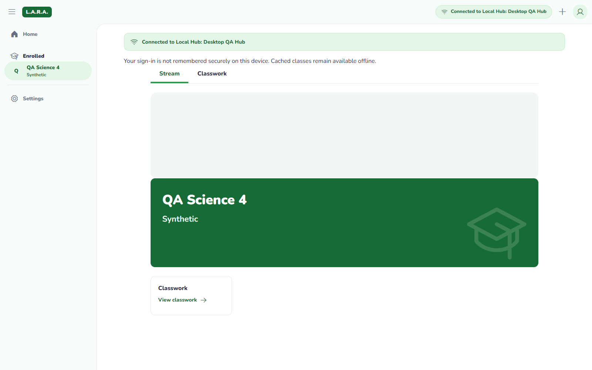
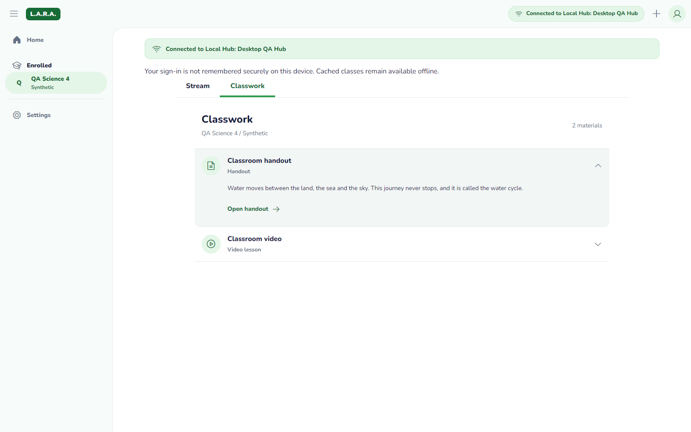
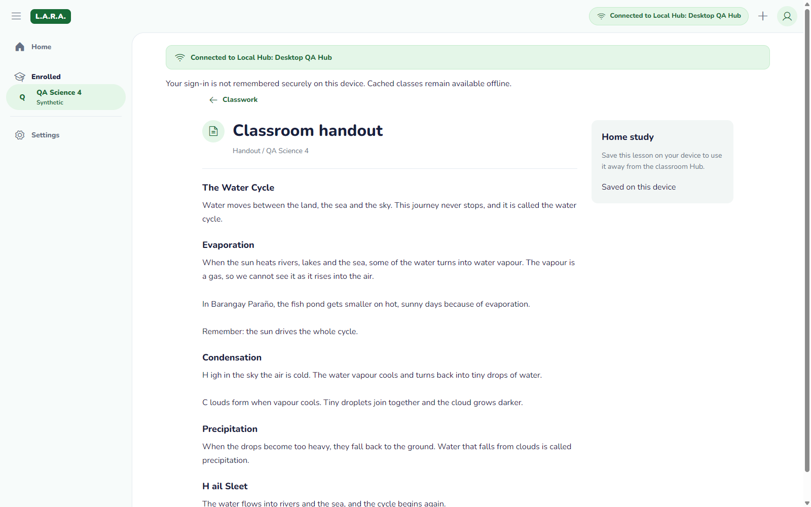
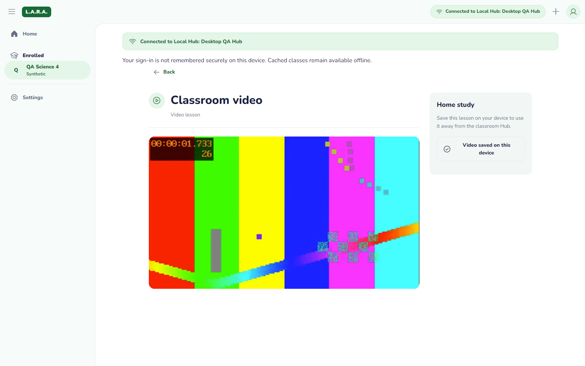

# Classroom-reference class layouts — #375

21 November 2026. Based on staging `241e778`. User supplied Classroom references for Stream, expandable Classwork and an opened assignment/material, and requested layout changes while keeping L.A.R.A.'s theme. This is UI polish within [the freeze](https://github.com/BootlegYouki/L.A.R.A/discussions/297).

## Presentation

Tabs now precede content. Stream keeps the green class banner, a supporting Classwork overview and clearer announcement cards with actual titles/dates/text. Classwork uses a narrower material list with native keyboard-accessible disclosure rows, cached-text previews, material type, saved status and explicit Open handout/Watch video actions.

Opened handouts and videos use a title/content column and a separate Home study action card, stacking on small windows. Existing local handout-save and video download/progress/resume/error/saved behavior stays in place. No networking, native authorization, schema, dependencies or theme tokens changed.

The references include features outside the implemented scope. The UI does not invent author names, due dates, topics, grades, submission/completion actions, comments or Meet/Drive buttons. The supporting Stream card uses the real material count instead of an unsupported Upcoming list. All new wording lives in the English dictionary. This is a deliberate layout adaptation to the existing feature/data scope, not an implementation of the assignment screens shown in the reference.

## Checks

- Regressions failed before implementation for tabs-before-banner, disclosure Classwork and the opened-handout action card. **112 Desktop tests in 22 files**, lint and production build pass.
- Offline invariant scanner and **73 shared Python tests** pass. The shared suite still uses the historical simulator pending #344; native integration below used the actual Rust Hub.
- Windows native app used the changed frontend and unchanged native source; no `desktop/src-tauri` differences from the reused binary. Actual six-digit Rust Hub with isolated synthetic accounts/class/PDF/video, HTTP 8080 and WebSocket 8081.
- Learner real-Hub Stream, quick Classwork navigation/focus, expanded preview, open cached handout, Save for Home, video playback/download and Back: pass. Teacher People/roster access remains available.
- 720px layouts, keyboard tabs and Enter on disclosure rows, 200% Classwork text with reachable Open action, and small-window handout/action-card reflow: pass, no horizontal overflow.
- With the real Hub stopped: cached Stream, expanded Classwork, saved handout detail and saved video playback pass. Reconnection was observed after restarting the same Hub. Final screenshots use a distinct per-Hub account context so the user's concurrent QA exploration cannot alter the verification state.

## Screenshots

| Learner Stream | Expanded Classwork |
| --- | --- |
|  |  |

| Opened handout | Opened video |
| --- | --- |
|  |  |

Additional evidence: [teacher Stream](screenshots/375-teacher-stream.png), [small Classwork](screenshots/375-classwork-small.png), [enlarged text](screenshots/375-classwork-large-text.png), [small handout](screenshots/375-handout-small.png), [offline handout](screenshots/375-handout-offline.png), [offline saved video](screenshots/375-video-offline.png).

## Limits

No new installer/upgrade, Linux/macOS, physical second-PC/WAN, screen-reader audit or repeated interrupted-download stress test is claimed. Secure credential persistence was unavailable in this runtime; cached reading and saved video playback were verified separately. The existing prerelease installer predates this redesign.
