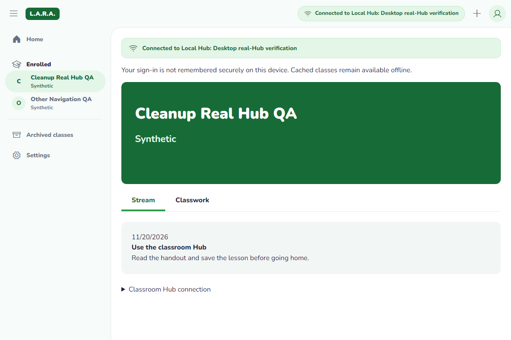
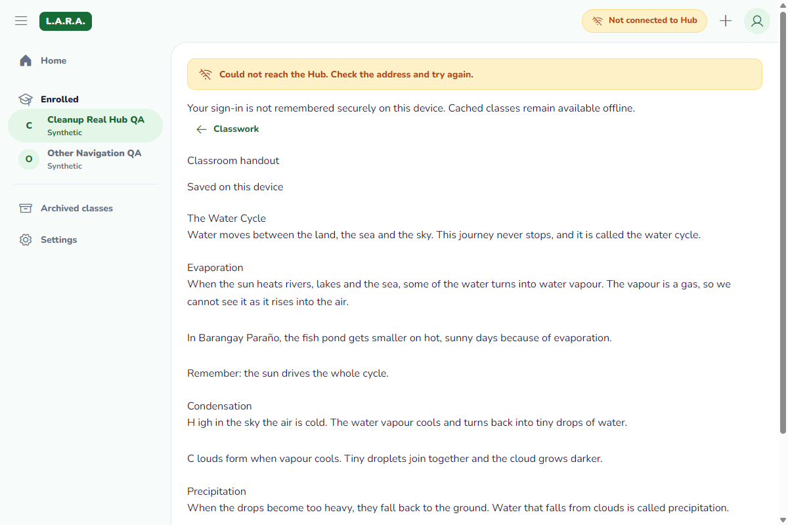
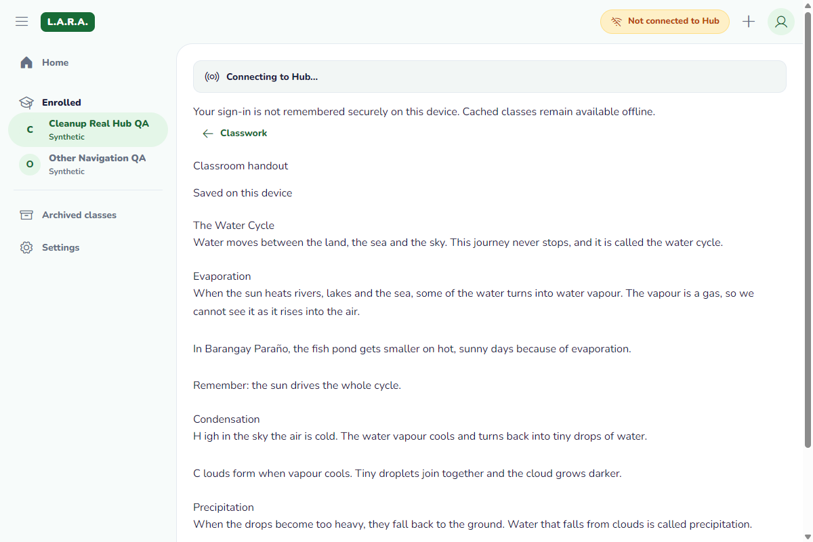
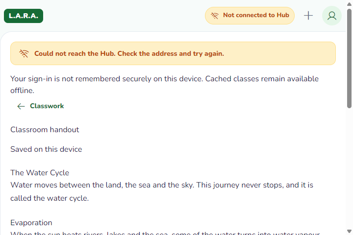

# Class reading polish — #354

20 November 2026. Based on staging `016ec64`; Desktop-only follow-up to the lead's [PR #319 review](https://github.com/BootlegYouki/L.A.R.A/pull/319#issuecomment-6972376487).

Stream announcement titles now use the existing Nunito ExtraBold weight (800). Save for Home permits a handout whose text is already cached when the Hub is unreachable. Missing chunks and an active save still disable the button. The unchanged native command validates the selected account, class membership, material and cached chunks before writing the local saved marker; this change downloads nothing and adds no schema or API.

## Verification

- Regression reproduced before the fix: offline cached-handout Save was disabled. After the fix, all 106 Desktop tests in 22 files pass, including disabled-while-saving and missing-text cases.
- `npm run lint`, `npm run build`, `python scripts/verify_invariants.py` and `python -m unittest discover tests` (72 tests) pass.
- Windows native Tauri app, changed Vite frontend and unchanged native source from staging `54cfbdc` (no `desktop/src-tauri` difference through this base). Real Rust Hub, isolated synthetic dataset, loopback address `127.0.0.65:8080`, WebSocket 8081, separate WebView test profile.
- Learner sign-in and reading the real Hub's announcement/handout pass. Stream title computed font weight is 800; keyboard ArrowRight switches and focuses Classwork.
- Stop the real Hub, wait for the disconnected banner, then save an unsaved handout from cached text: pass. Fully exit and relaunch the native app with the Hub still stopped: saved status and lesson text persist.
- Emulated 720×480 viewport has no horizontal overflow in the saved handout view. Screenshots visually inspected; this is viewport emulation, not a physical display-size test.

| Stream title | Saved with Hub stopped | Full offline restart | Small viewport |
| --- | --- | --- | --- |
|  |  |  |  |

## Limits

The current server still uses its legacy four-digit seed; this does not verify draft #348 or resolve server #339. The runtime reported secure sign-in persistence unavailable; cached-content persistence was verified, not the OS credential store. Shared Python tests still include the historical simulator pending #344; real-Hub native results above are separate. No Linux/macOS, new installer, separate-PC or physical WAN-disconnection test was performed for this small UI fix.
