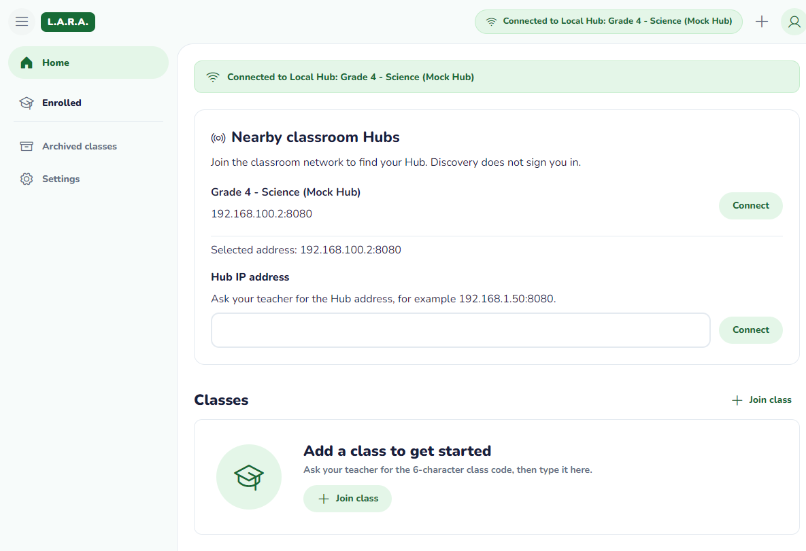
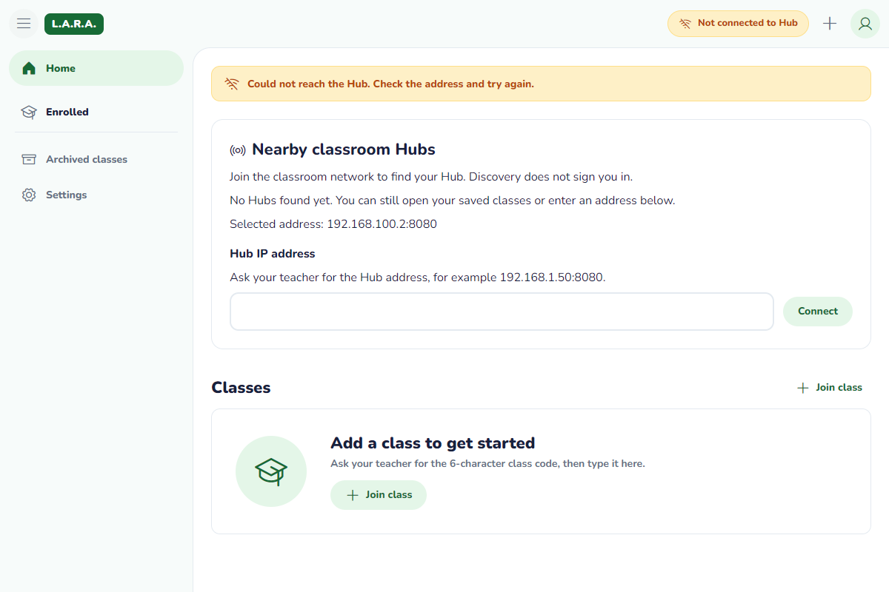

# Desktop English-only cleanup — #225

The Lead's English-only decision (#223) removes the remaining Filipino UI infrastructure after #40. This change stays in Desktop and does not change routes, discovery, Hub settings, SQL migrations or classroom queries.

## Files and data flow

- `src/i18n/en.json` is the single resource dictionary. `src/i18n/index.ts` exports the typed `t` lookup object and `Dictionary` type; App passes that dictionary to existing components. `fil.json`, the `Language` type, dictionary switching and unused switch labels are removed.
- `src/store/app.ts` retains loading/error/ready, cached classrooms, deduplicated reads and retry. The language field was the only persisted store field, so its Zustand persistence wrapper is removed too. Classroom data still comes from SQLite; nonsecret Hub addresses still use `services/settings.ts` and its separate `lara-desktop-hub` key.
- The old `lara-desktop-preferences` browser key is ignored, not deleted. It contains no classroom database or credential data. Old language selections cannot hydrate UI status or classroom rows; unavailable browser storage does not affect this store.
- App retains `document.documentElement.lang = 'en'`. There is no language control in the top bar or elsewhere. Unused `.language-button` styles are removed; existing layout, design tokens, bundled assets and control sizes remain.
- Store, shell and discovery UI tests now exercise English only. The Desktop guide, README, Tech Spec and current manual instructions match the rule. Older screenshots and test reports are explicitly historical rather than silently rewriting prior test results.

## Verification — Windows, 2026-11-05

| Check | Result |
|---|---|
| Clean staging baseline | 31 Desktop tests passed |
| Regression before implementation | New no-language-state assertion failed on the old store as expected |
| `npm test` | 9 files, 31 tests passed |
| `npm run lint` | Passed, no lint warnings |
| `npm run build` | Strict TypeScript passed; Vite 47 modules, built in 2.72s |
| `python scripts/verify_invariants.py` | All offline invariants passed |
| `python -m unittest discover tests` | 66 tests in 25.568s, OK |

Node's experimental SQLite warning is from the existing test runtime, not a test failure. No dependencies or lockfiles changed. Source, test profiles and temporary files are on G:; Windows retains the existing native SQLite database in its standard app-data directory. No database or user data was cleared.

### Actual Tauri window

The unchanged native debug host from #40 ran against the current #225 Vite frontend. Its isolated WebView2 profile was placed on G:, with a loopback debugging port enabled only for that test process; no shipped capability/configuration changed.

1. In the test profile, seeded the retired preference key with `language: fil`, a stale ready state and a synthetic `STALE_PREF_CLASS` row. Reloaded the frontend. It rendered English with zero language controls, did not display that row, opened the native SQL empty state without a database error, and kept the old preference ignored.
2. Folded/unfolded the drawer and verified `aria-expanded` updates. Checked 720/1200px widths at 100/200% root text size: all four combinations had no horizontal document overflow. No renderer errors were captured in this flow.
3. Started `scripts/mock_hub.py`; the native app connected through the existing `/api/classrooms` probe (401 observed in mock log). English Home, empty Classes and connection banner remained visible.
4. Stopped only the task mock Hub; the pill became Not connected, the candidate expired and Home/Classes/manual entry remained visible without a blocking modal.

The screenshots below are current #225 native WebView captures, excluding the OS title bar. They show no language control. The prototype top-bar/Home structure is preserved; this cleanup adds no new layout deviation. Existing #40 connection panel remains.

## Reproduce

Run the automated commands above. Start the mock Hub from repo root, then `npm run tauri dev` in Desktop. Verify English navigation, top bar, manual address form and connection banner with no language toggle. Stop the mock and confirm Home stays usable. For legacy-preference testing use a disposable WebView profile; do not clear an existing database or preferences to manufacture a clean result.

## Limits

These screenshots verify the native development frontend, not a newly built installer. Physical two-PC/WAN-disconnected, Linux/macOS, signed-in classroom snapshots and a full assistive-technology audit were not repeated for this dictionary/store cleanup. Existing #40 approval remains separate evidence; the Lead moved the WAN-disconnected integration check to QA 1.1. No auth, sync, transport or installer behavior was added by #225.
