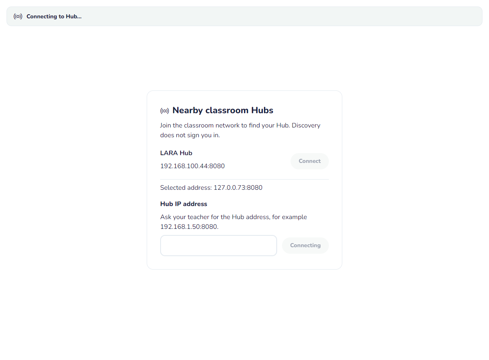
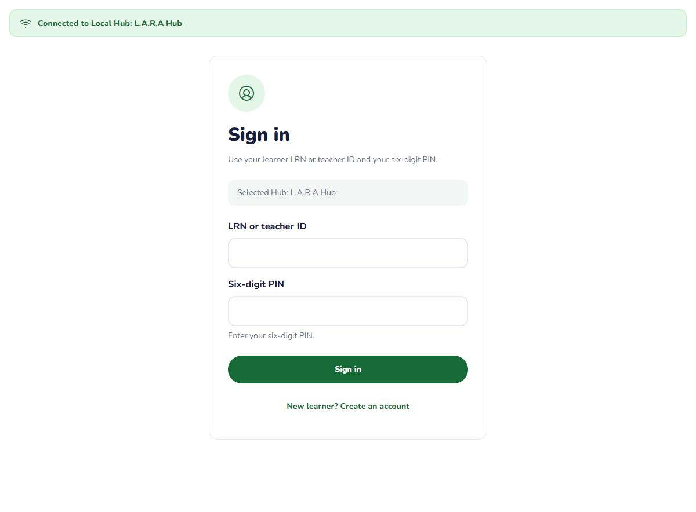
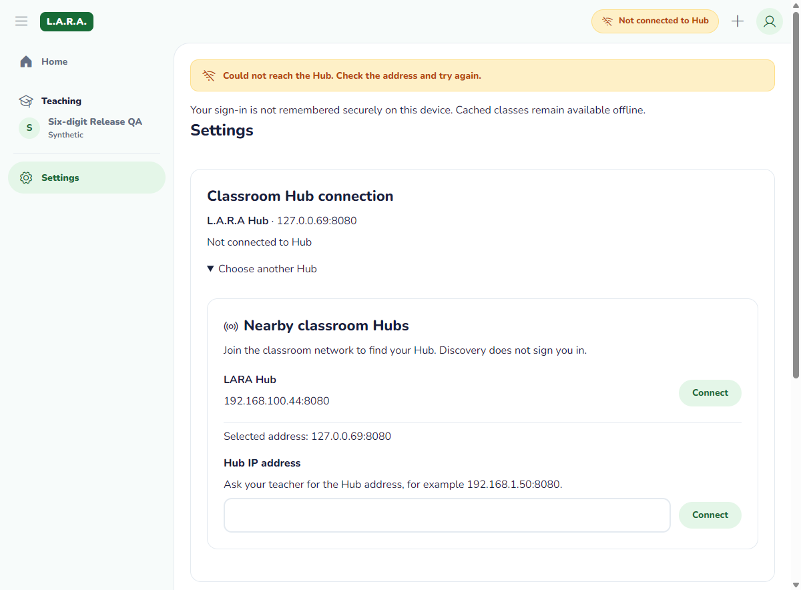
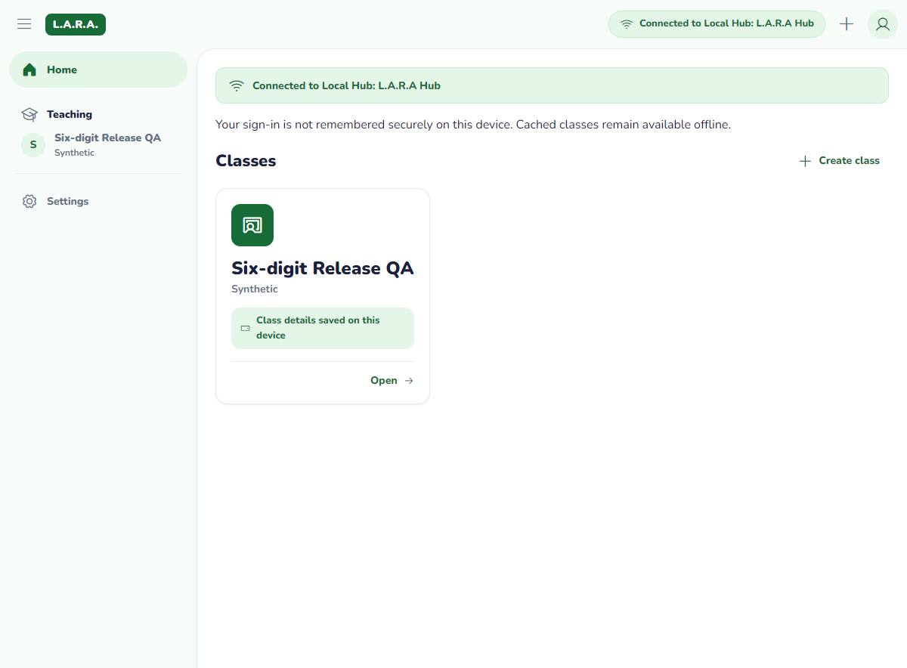
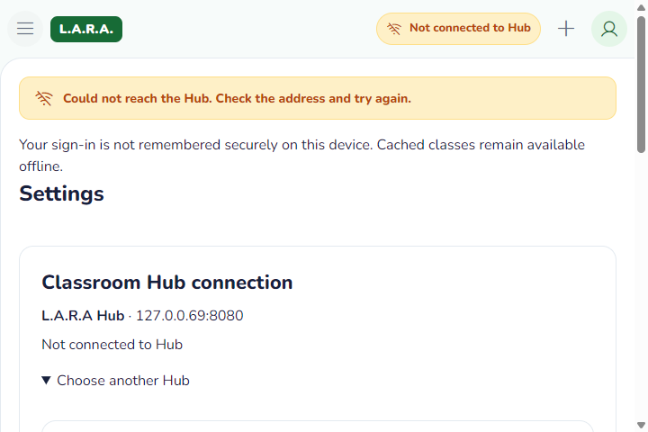
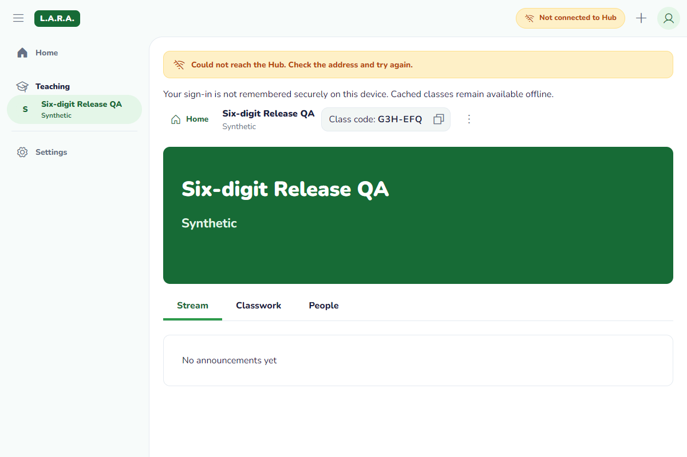

# Standalone authentication and Settings Hub controls — #369

21 November 2026. User-requested UI follow-up during the [bug/UI freeze](https://github.com/BootlegYouki/L.A.R.A/discussions/297), based on latest staging `02e6bec` plus the six-digit Desktop fix #348 (`370e620`). Merge #348 first; this change does not implement another PIN rule.

## Behavior

- An uncached startup shows the existing Hub discovery/manual connection controls first. When connection succeeds, standalone sign-in appears with the Hub status banner and centered six-digit form. There is no app top bar or sidebar during sign-in/registration/account switching.
- A cached account can still open saved classes while the Hub is stopped. Account-switch Cancel returns to the cached app; no cached rows are erased to obtain the new screens.
- Signed-in Hub controls are only in the existing Settings → Classroom Hub connection → Choose another Hub section. Remove the repeated disclosure below Home/class pages. The login page contains no Hub connection disclosure or picker. The pre-login startup selector uses the same centered 480px maximum width as the login card.
- Remove Archived classes from the sidebar and Home. Keep archived records, class archive behavior and native authorization unchanged; this is presentation removal, not data deletion.
- Keep the menu button usable below 760px. Its existing toggle opens/closes the small-window sidebar so Settings remains reachable; previously the stylesheet hid both menu and drawer.

## Verification

Regressions failed before their corresponding changes: unsigned navigation, archive shortcut, connection-before-login, Settings-only controls and archived Home rendering. After changes, **111 Desktop tests in 22 files**, lint and production frontend build pass. Offline invariant scanner and **73 shared tests** pass. Shared tests still contain the historical simulator pending #344; native checks below used the real Rust Hub.

Native Windows Tauri test used the changed frontend and unchanged native source (no `desktop/src-tauri` difference from the reused test binary). Real Hub built from staging `02e6bec`, isolated synthetic data, loopback HTTP 8080/WebSocket 8081, dedicated WebView profile and per-Hub account contexts.

- With Hub stopped and a new uncached context: connection screen, no credentials or app navigation. Restart the same real Hub: the screen advances to standalone sign-in automatically. Six-digit teacher sign-in fetches the actual synthetic class.
- Sign-in, registration layout, invalid four-digit input, keyboard ID→PIN focus, account switching/Cancel, Home without archives and Settings Hub picker: pass.
- The startup selector is centered horizontally and vertically at 480px maximum width, matching the login card. Native bounds checks pass at 1200×884, 800×1200, 900×900 and 1600×700; at 720×480 and 200% text, content remains reachable by scrolling rather than clipping. Its 720×480 layout has no horizontal overflow. Login at 720×480 emulated viewport and 200% root text: no horizontal overflow in login; fields remain reachable by scrolling. At the small viewport, keyboard Enter toggles the menu and Settings Hub controls remain reachable.
- Stop Hub, fully exit/relaunch native app: cached class still opens offline. The normal close request did not finish within five seconds; the verified isolated test process was then terminated and relaunched. No installed production app or user database was modified.

## Evidence

| Connect first | Standalone sign-in | Settings Hub controls |
| --- | --- | --- |
|  |  |  |

| Home without archives | Small-window Settings | Cached class after offline restart |
| --- | --- | --- |
|  |  |  |

Additional screenshots: [registration](screenshots/369-register.png), [validation](screenshots/369-login-error.png), [small login](screenshots/369-login-small.png), [enlarged text](screenshots/369-login-large-text.png).

## Limits

Windows native frontend verification does not establish Linux/macOS, physical WAN isolation, an installed release-package upgrade, or screen-reader behavior. Secure credential persistence was unavailable in this task runtime; cached access passed, but no OS secure-store claim is made. The previously uploaded `desktop-six-pin-370e620` installer predates this UI fix.
