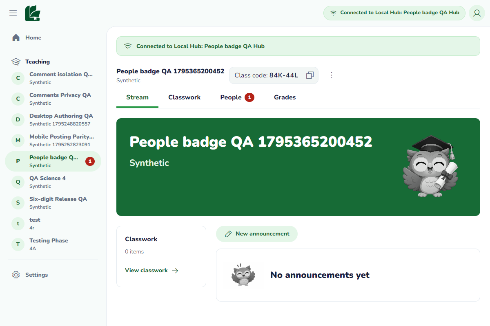
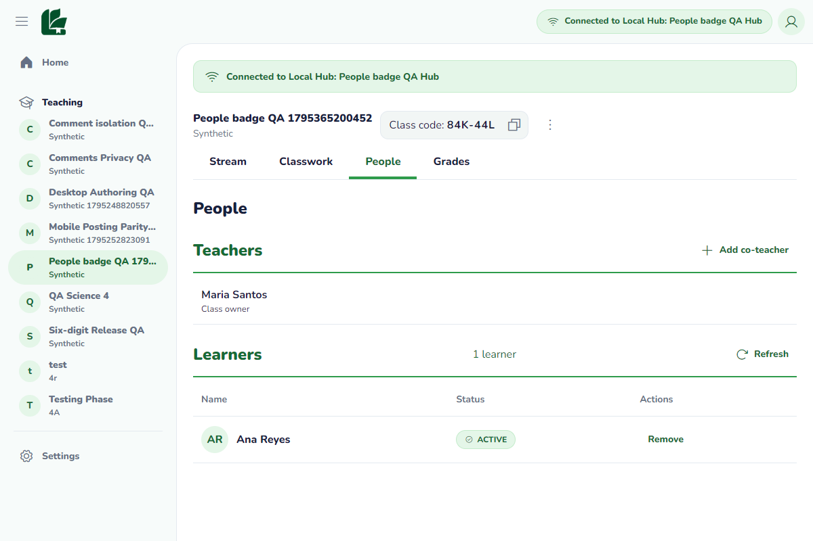

# Pending requests on People (#417)

People now displays the same red pending-request count as the class sidebar. It derives the count from the selected class's cached roster, using the existing PENDING status and badge style, and updates through the existing roster refresh/sync path. Only teachers who can manage the active class see it; other classes, tabs and learners do not inherit it. Accepting/rejecting a request removes it from the count; viewing People alone does not clear an unresolved request.

The regression failed for the missing badge before implementation. All 217 frontend tests, lint, production TypeScript/Vite build, isolated native release build and offline invariant guard pass. The regression covers active/pending filtering, selected-class scope, both resolved statuses and student visibility.

Native verification used the existing local real Hub, synthetic accounts and an explicitly separate WebView profile. After opening the synthetic class as teacher, another client joined with its code. Sidebar and People both displayed 1 automatically, while Stream/Classwork/Grades had no badge. Accepting in the native People panel cleared both counts without restart. The badge was vertically aligned with its tab. The teacher signed out after the check. No Server/Mobile/API change, installed-app replacement, new normal installer or prerelease is claimed.

