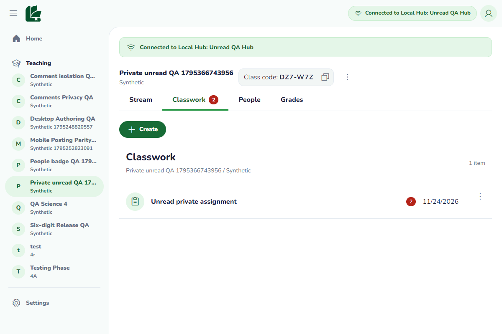
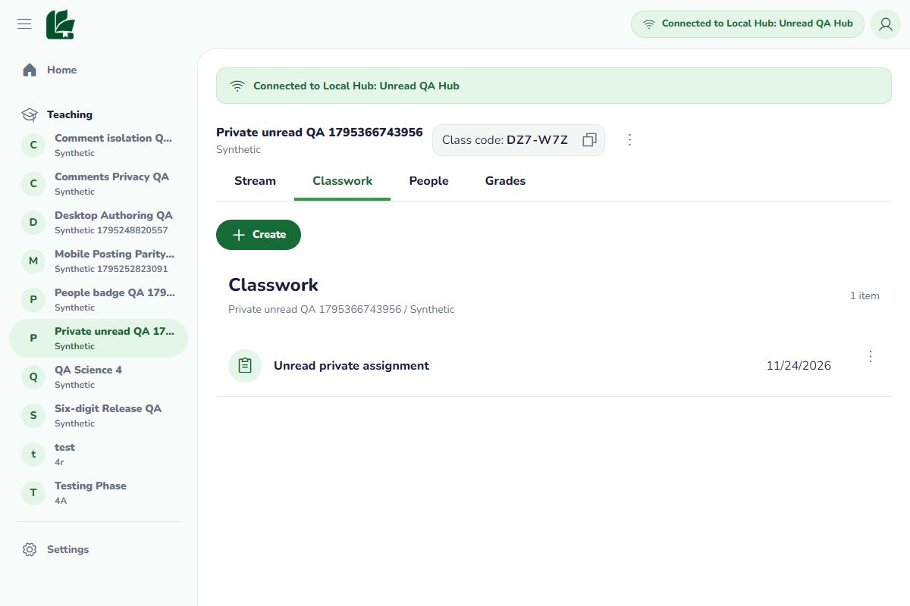
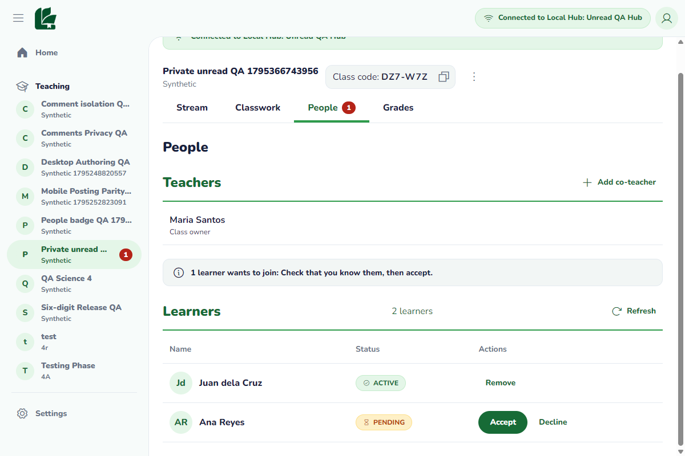

# Unread learner private comments (#420)

Teacher Classwork now shows the unread learner-message count on its tab, each affected assignment and that assignment's learner work cards. Opening a learner's visible private thread marks only the learner-authored comment IDs rendered there. Teacher replies do not count; reading one learner does not clear another. The pending-join notice in People has 24px vertical margins.

Read receipts are local to this desktop's existing Hub/account SQLite database, in a namespaced per-class sync_state metadata key. They are not sent to the Hub and do not mark comments read on other devices. Existing learner comments initially count as unread until opened on this desktop. Exact IDs, rather than a latest timestamp, preserve unread status for late offline messages. Native commands require the selected teacher account and visible class; every marked ID must belong to the specified assignment/learner. Merges/pruning are transactional, and deleted-message markers are pruned on a later mark. Only active learner threads contribute to the visible counts. No shared schema or Server route changes are needed.

The visible teacher class uses the existing coalesced sync every five seconds, with visibility/running guards and existing sync backoff. Only the unread summary is refreshed after polling or a successful local receipt. Assignment data, files, grades and comment drafts are not reloaded by this path. Hidden/private-recipient-unmounted threads do not deliver read callbacks. Browser/account changes retain the existing thread remount/epoch guards.

## Verification

- Native and UI regressions failed before implementation. Final checks: 221 frontend tests; 61 native tests passed (3 existing opt-in skips); 92 shared tests; lint, offline invariant guard, TypeScript/Vite production build and native release QA build passed.
- The native regression covers teacher/class/learner scope, teacher replies, invalid IDs/targets, removed enrollment and older offline IDs. Service/UI tests cover native account arguments, hidden thread/read callback cancellation, learner visibility, badge updates and existing file/grade/draft/page-refresh isolation.
- Real-Hub native QA used the existing local Hub, synthetic accounts and an explicit separate WebView data directory. Two learners' private messages produced tab/assignment count 2 and individual learner counts 1. Opening one thread cleared only its learner's count. A teacher reply did not add unread work. A subsequently pushed learner message with created_at 0 became unread correctly.
- Live updates during an unsent teacher draft produced zero read_assignment_work/read_class_content calls; the draft, focus and learner DOM node stayed unchanged. Three thread reads and five count reads were observed during the check.
- After closing and restarting the full QA process, only the two genuinely unread messages remained. Reading each learner's thread cleared its own count, and the assignment/tab badges disappeared after both were read. Secure sign-in persistence was not claimed: the QA account signed in again after restart.
- Native CSS verified 24px margins above/below the join notice. Independent read-only review found no critical or actionable privacy, correctness or lifecycle findings.

No installed-app replacement, new normal installer, prerelease publication or Linux/macOS verification is claimed. The user's current app was left in place. This covers assignment private comments, not general announcement unread tracking or Hub-wide cross-device receipts.

