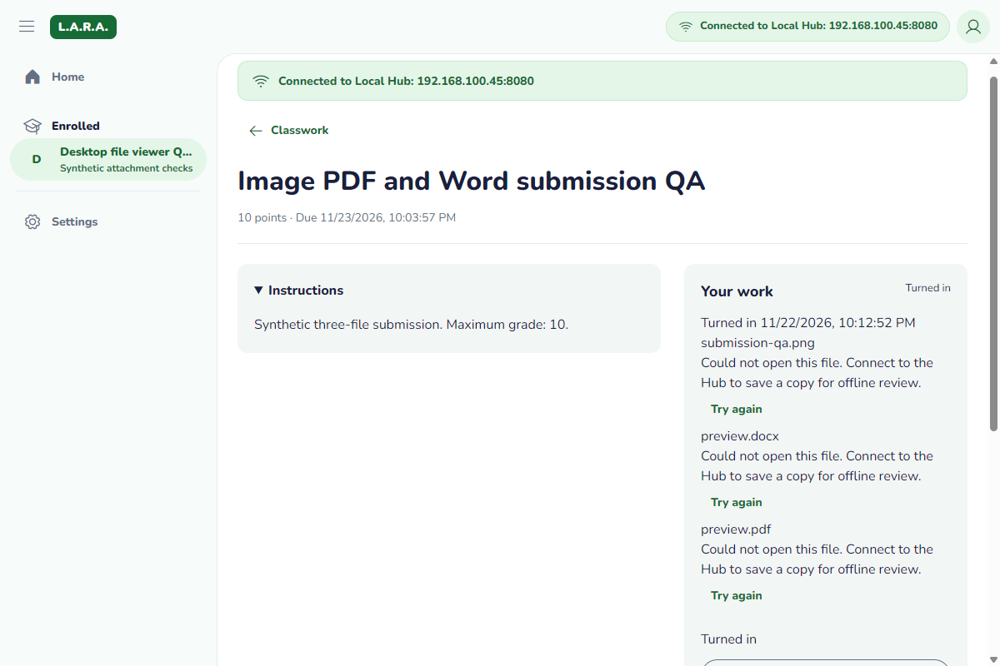
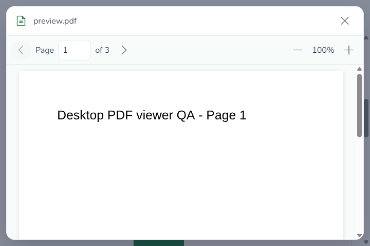
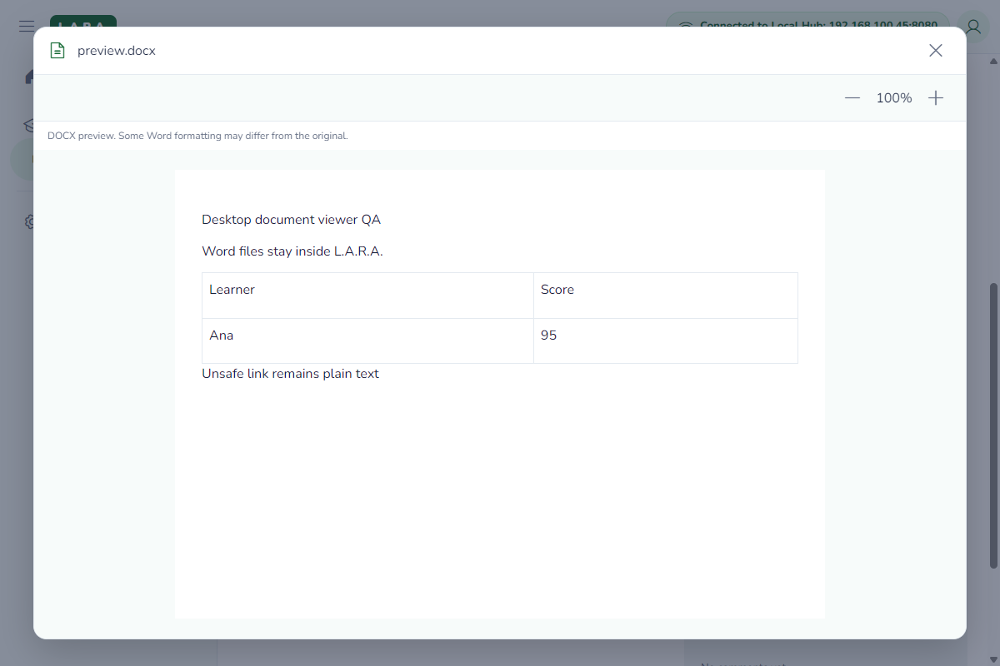
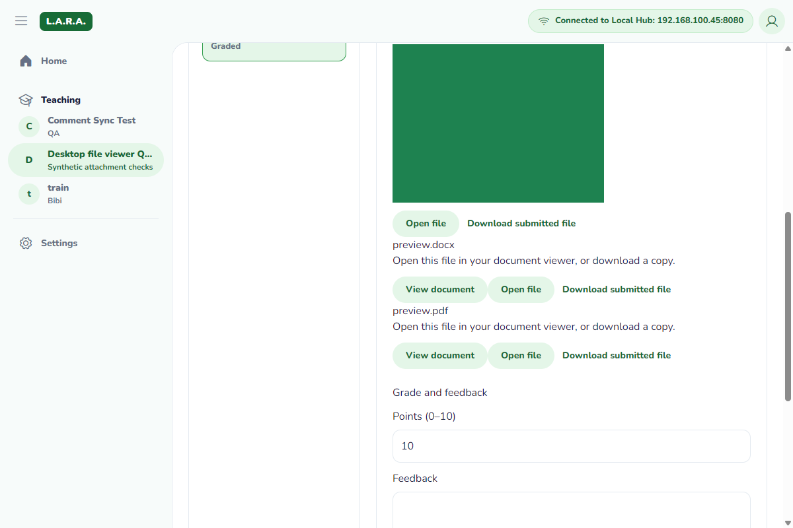

# Assignment files, document previews and comments — 22 Nov 2026

Desktop-only changes for #407, draft PR #408. Base: staging b860308. No Server, Mobile, contract or shared-rule files changed.

## Behavior

- Submitted images open in a Radix dialog with Close/Escape and focus restoration. Download never replaces the app page.
- PDF and DOCX files open inside a centered, bounded dialog. The compact fixed toolbar exposes Close, PDF page selection and zoom; only the document area scrolls. PDF pages render on canvas, with bundled workers/fonts. Word previews preserve text, lists, tables and supported images; formatting can differ from Word. External Word references and active HTML are disabled/sanitized.
- Open file remains an optional system-viewer fallback. Download creates a new copy in Downloads without overwriting other files. Native commands resolve authorized account-scoped files, never a client-provided filesystem path.
- Learners select/remove up to five attachments, 250 MiB total. Native staging streams 64 KiB chunks, validates all files, flushes payloads and job metadata, then atomically queues one ordered batch. Retries retain the submission ID and turn-in time. Older single-file queued jobs remain readable. The Hub receipt must match all ordered filenames/types.
- Teacher grades show and enforce 0–maximum in the editor and service, including when the assignment maximum changes while editing. Saves use the contracted versioned `/grade-edit` route with `expected_updated_at` and narrow native HTTP permissions. Quiz scores are calculated by the Hub; Desktop has no manual quiz-grade editor.
- Open visible comment threads request the existing coalesced sync every five seconds while connected, preserving drafts and sync backoff. Closing a thread removes its timer.

## Verified

Packaged Windows custom-protocol app, using the updated separate-PC QA Hub supplied by the user:

- Native learner UI selected image/PDF/DOCX, removed/re-added one, then turned in all three. Hub metadata confirmed exact order: image, DOCX, PDF. The teacher saw all three.
- Teacher entered 11 on a 10-point assignment: Save disabled. Exact 10 saved through native `/grade-edit`; a fresh Hub read confirmed score 10.
- PDF text rendered; Next page moved to page 2 of 3; zoom changed canvas size; Close/Escape returned to the assignment.
- Final-executable downloads for all three indexed attachments matched the original bytes. Cached native PDF reads with `offline: true` also matched the original.
- DOCX text/table rendered. A hostile `javascript:` hyperlink in the synthetic fixture became plain text, with no active link/script/iframe.
- At 720×480, the bounded dialog and Close stayed visible, and PDF width adapted to the available space.
- Earlier checks in the same PR verified byte-identical image/PDF downloads, native system-viewer opening, live public/private comments with draft retention, and Hub-stopped cached PDF/history access.
- 210 frontend tests, 59 native tests (3 opt-in skips), 92 shared tests, lint, the offline invariant guard and production build pass. Native tests cover source/account permissions, MIME/ZIP bounds, replacement-cache cleanup, batch receipt ordering and writable-handle flushing on Windows.

## Limits

Windows native behavior is verified; Linux/macOS runtime behavior is not. `.doc` is outside the current upload contract; `.docx` is supported. In-app document preview is bounded to 64 MiB; DOCX archives are limited to 128 MiB expanded and 4096 entries, and PDF canvas/image allocation is bounded. Larger valid submissions retain the system-viewer/download fallback. Full cold-start remembered authentication could not be established in the tool runtime because secure credential persistence was unavailable; this change does not modify authentication. No new installer was installed or published, and this PR is not merged.

## Screenshots

