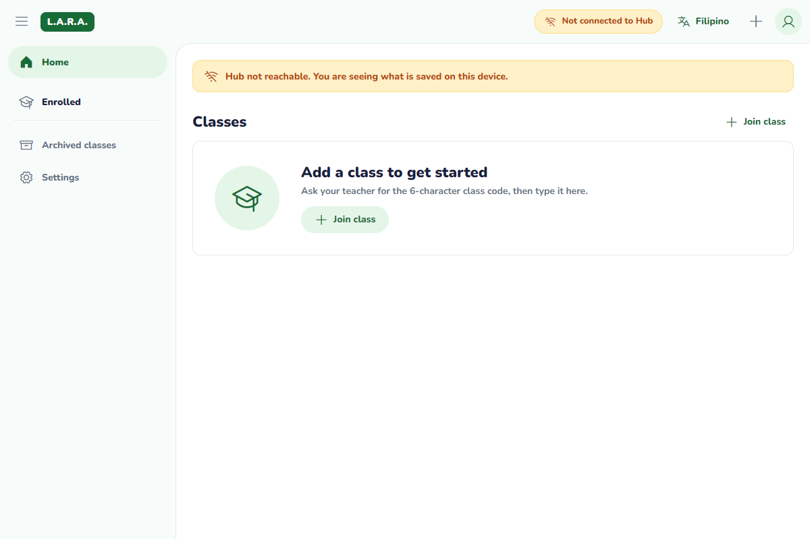
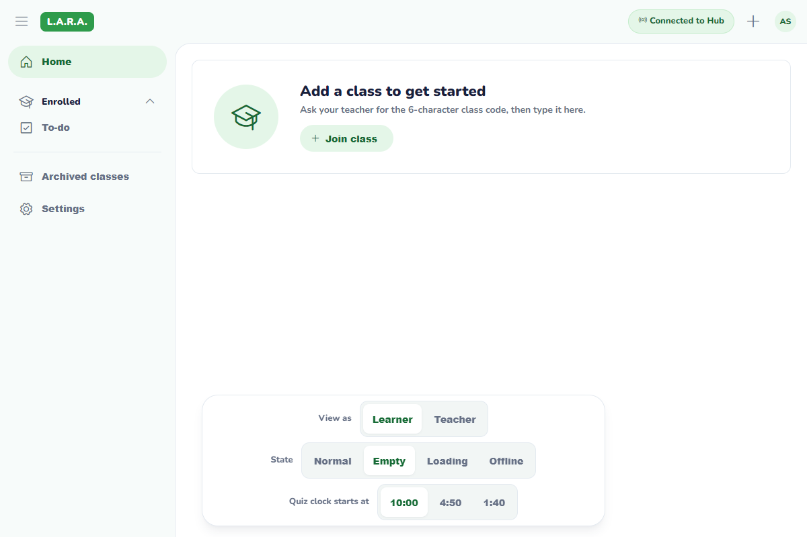
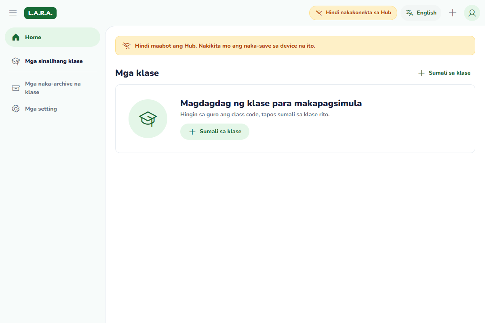

# Desktop scaffold verification — #29, prototype correction

Verified on Windows 2026-10-26, after restoring the reverted #161 code. Only desktop/ changes are included. The approved spec from #162 remains intact.

## Automated checks

| Check | Result |
|---|---|
| `npm run lint` | Passed, zero lint warnings |
| `npm test` | 4 files, 14 tests passed (9 existing + 5 shell-state tests) |
| `npm run build` | Strict TypeScript and Vite production build passed |
| `cargo check --manifest-path src-tauri/Cargo.toml` | Passed |
| `cargo build --manifest-path src-tauri/Cargo.toml` | Passed; generated the native executable used below |
| `python scripts/verify_invariants.py` | Passed |
| `python -m unittest discover tests` | 66 tests, 11.020 seconds, OK |

Warnings: Node 22 emits the expected experimental node:sqlite warning in tests. Rust incremental-cache hard links are unsupported in this environment and fall back to file copies; no Rust compile error. Shared tests emit socket ResourceWarnings. An initial shared run failed because its temporary directories were outside the allowed workspace; rerunning with TEMP/TMP on G: passed all 66 tests. No shared tests were modified.

Shell tests verify English/Filipino empty UI, inactive join actions, safe loading/error states with retry, absence of fake classes/roadmap text, and escaping of cached class names. Existing tests prove schema parity, SQLite reopen preservation/foreign keys, account filtering, stalled-open timeout/retry, deduplicated loading and language state.

## Native app checks

Built the real `lara-desktop.exe` and ran it with the Vite dev server. The app was inspected through its development WebView2 debugging endpoint (loopback, enabled only in the test process environment; no shipped config change). Screenshots are of the actual Tauri webview, not a browser mock of the SQL plugin.

- Real SQL plugin opened its existing database and reached the empty Home state with no Hub process; no blocking network dialog.
- Measured client viewport: 1200 x 800 CSS pixels. Top bar: 64px; open drawer: 260px; sheet starts at (260, 64); top-left radius: 24px.
- Every measured button was at least 40px tall; drawer items were 48px. No horizontal overflow.
- Menu toggled 260px drawer to 76px rail and updated `aria-expanded`, then reopened correctly.
- English/Filipino changed headings, notice, navigation, help and button labels. The app process exited and the native executable was launched again: Filipino remained selected and the offline SQLite empty state reopened. Returned to English after testing.
- Keyboard Tab reached Skip to content; Enter moved focus to main content.
- WebView viewport checks at 720, 760 and 1200px in both languages found no horizontal overflow; the drawer hides below 760px. These are responsive layout checks, not evidence of mobile support.

## Same-size prototype comparison

Both captures are 1200 x 800 CSS pixels in the same WebView2 rendering engine, excluding the OS titlebar. The reference is the unmodified `design-system/prototype.html`, served locally, with its Empty control selected. Prototype controls remain visible to identify the reference state. See intentional differences in [scaffold.md](scaffold.md#prototype-correction-after-163): the Lead explicitly requests a Classes heading and offline banner in the real app, whereas the reference Empty state hides that heading and retains its demo connected pill.

| Actual native app — English, no Hub | Prototype — Empty reference |
|---|---|
|  |  |

## Reproduce manually

1. In desktop/: `npm ci`, `npm run lint`, `npm test`, `npm run build`, then `npm run tauri dev` with native Tauri prerequisites installed. No seed account is required for #29.
2. Keep the Hub stopped. Confirm the amber pill/banner, Classes heading and empty state. Plus/Join, Archived and Settings must be inactive; there is no fake successful enrollment/navigation.
3. Click the menu to fold/unfold the drawer. Use keyboard Tab/Enter for the menu, language button and skip link. Check visible focus.
4. Choose Filipino, close the whole application, reopen it, confirm Filipino and the local empty state; switch back to English.
5. From design-system/, run `python -m http.server 1430 --bind 127.0.0.1`; open `/prototype.html`, choose Empty and compare at the same client dimensions. Do not delete an existing database to manufacture an empty screen.
6. From repo root run `python scripts/verify_invariants.py` and `python -m unittest discover tests` (Python + PyYAML).

## Not verified

- Physical classroom router with WAN cable unplugged, real Hub integration or low-spec hardware performance.
- Linux/macOS launch and release installers. The previous lead's Linux check does not prove this revision's native UI on Linux.
- Full manual contrast/screen-reader audit. Keyboard skip/menu behavior and measured sizes were checked; tokens/fonts/icons remain canonical.
- Production release executable launch: native checks used a debug build with the dev webview. Production frontend build passed, but installers are outside #29.
- Signed-in native cached-class cards: sign-in/sync are later issues. Query isolation and SQLite persistence are tested with synthetic temporary databases.
- Discovery, accounts, enrollment, sync, materials, quizzes and AI are outside this scaffold. The static offline status intentionally does not claim a working connection.
- Filipino wording awaits teammate review.

Source, dependencies, screenshots and build caches are on G:. Windows keeps the small runtime SQL database and WebView state in the app's standard C: data folders, with explicit access granted for testing.

## Design review corrections (2026-10-26)

- The badge uses the existing Dark Green token with white text, rather than the prototype's Primary Green fill: measured contrast improves from 3.56:1 to 6.58:1, meeting the fixed 4.5:1 requirement. This intentional deviation changes no shared token.
- Font sizes/explicit text line heights use rem. The top bar keeps its normal 64px size and can grow/wrap when text is enlarged; controls retain minimum desktop target sizes.
- The selected Home glyph uses Phosphor Fill, while other navigation glyphs remain Regular.
- The narrow layout keeps the Hub pill's words visually visible alongside the wifi-slash icon; it no longer hides them.

Native WebView2 checks passed all 18 combinations: English/Filipino, 100%/150%/200% root font size, and 720/760/1200px viewport widths. Text size was increased through the document root in the test session, not by changing system settings. Checks asserted no horizontal document overflow against clientWidth (excluding the vertical scrollbar), visible Hub words inside the pill, a filled Home icon, the badge's actual computed background, proportional heading font size, and the normal 64px top bar. Screenshots were refreshed after these fixes. This does not replace a full assistive-technology audit.

