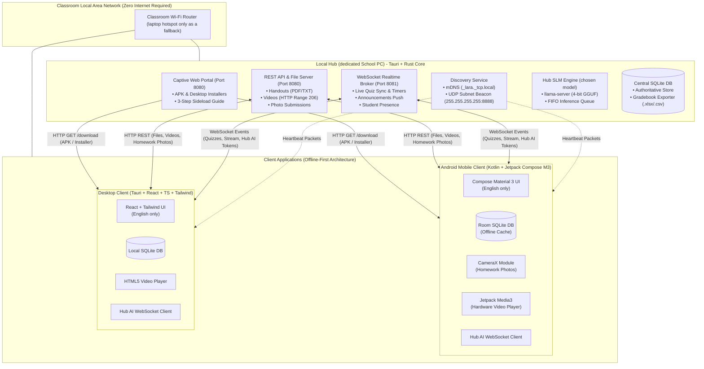
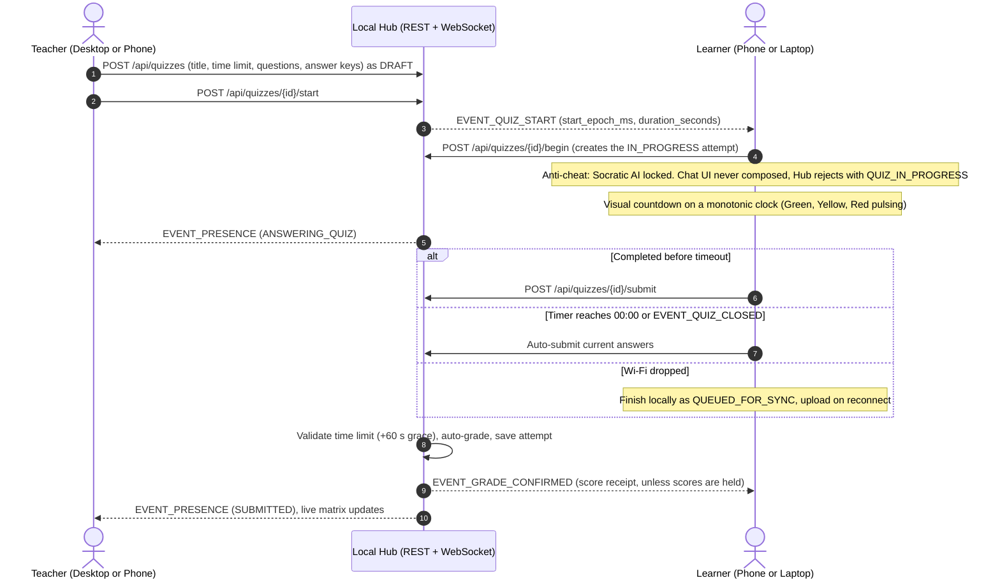
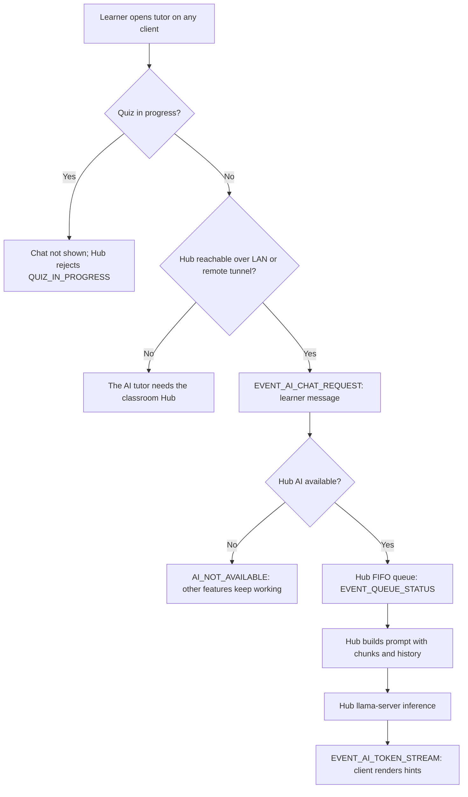
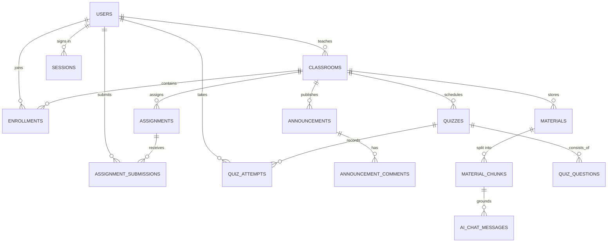
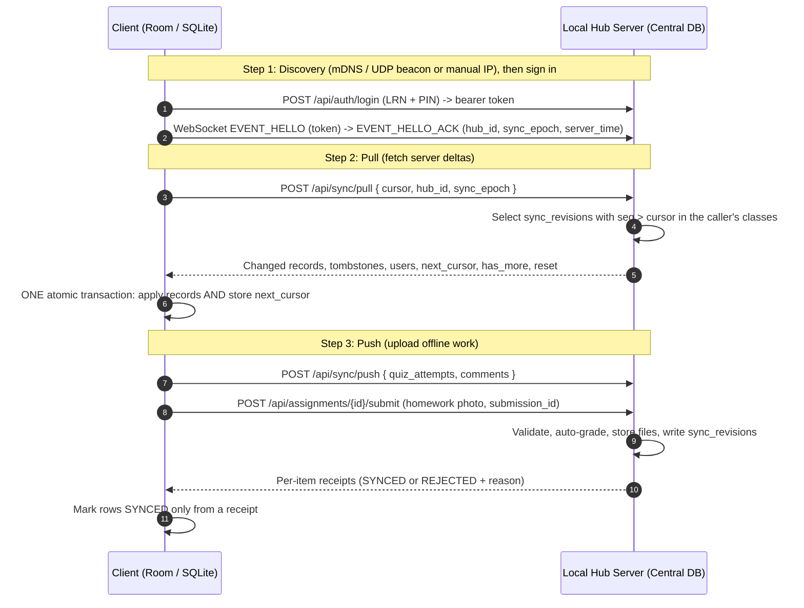

# Product Requirements Document (PRD)

> **How to use this PRD:** it is the single source of *product behavior*. API shapes, events and the database live in [`../contracts/`](../contracts/) and win if they differ; visual rules live in [`design-system.md`](../design-system/design-system.md). Team Tech Specs describe *how* to build and must not redefine behavior here. Documentation map: [`README.md`](./README.md).


**Project Title:** Offline LAN-Based Classroom Management System with Hub Socratic SLM Tutor and Paperless Assessment Engine
**Working Codename:** L.A.R.A. 
**Document Version:** 1.6.1
**Last Updated:** 2026-11-05
**Change Summary:** The tutor declines Filipino and Taglish messages in English, 2026-11-05
**Target Release Date:** Academic Year 2026–2027 Capstone Cycle 
**Target Environment:** Philippine Public Schools (DepEd Grades 1–12: elementary, junior and senior high), Rural Campuses, and Zero-Internet Classrooms 

---

## 1. Executive Summary & Context

### 1.1 Project Overview
L.A.R.A. is a zero-internet, local-area-network (LAN) classroom management platform engineered as an offline alternative to Google Classroom. It pairs an offline-first learning management system (LMS) with a Hub-hosted language model for Socratic tutoring. Small models tested in issue #73 failed to provide reliable guidance without leaking answers or refusing everything. The current candidate is **Qwen3-30B-A3B-Instruct-2507, pruned REAP-15B-A3B, Q4_K_M**, on a 16 GB Hub. Final model and hardware selection depend on the evaluation pass marks in section 10, following `rules/socratic-ai-guardrails.md` section 5; this is not a claim that the candidate has passed.

The system operates across three interconnected applications:
1. **Local Hub (Server):** A standalone desktop application (Tauri + Rust) running on a dedicated, always-on school PC wired to the router (Windows or Linux). One Hub serves all teachers, and its window is an admin console (accounts, port health, USB export and backup). It acts as the local source of truth, hosts a captive download portal with visual onboarding, brokers WebSocket events, manages file submissions, and runs an SLM inference server.
2. **Mobile Client (Android):** A native Android application (Kotlin + Jetpack Compose + Material 3) running offline-first on learners' phones and on teachers' phones (a teacher can do on the phone everything they can do on desktop), with local Room (SQLite) storage, camera homework capture, English interface strings in resources, and Hub AI streaming.
3. **Desktop Client:** A cross-platform desktop application (Tauri + React + TypeScript + Tailwind) for student laptops, lab PCs and teachers. It has the same learner and teacher features as the mobile app, laid out for a large screen.

### 1.2 The Philippine Context & Research Motivation
* **High Smartphone Penetration vs. Absent Connectivity:** IDC and Canalys (2024) market reports demonstrate that Transsion Holdings (Infinix, TECNO, itel) dominates the Philippine smartphone market with a 37.3% share, followed by realme (13.3%) and Xiaomi. More than 50% of shipped phones are entry-level devices under $100 (~₱3,500–₱5,500). Filipino learners commonly have physical access to these household smartphones. However, persistent mobile data costs, lack of campus broadband, and rural network dead-zones render cloud-based LMS solutions (Google Classroom, MS Teams, Canvas) unusable.
* **Teacher Financial & Logistical Burden:** Public school teachers routinely shoulder out-of-pocket expenses for paper and printing to produce daily worksheets, weekly formative tests, and quarterly summative assessments. A paperless, offline LAN assessment engine removes recurring reproduction expenses.
* **Hardware Realities (The RAM Bottleneck):** The vast majority of student devices feature 3GB or 4GB of physical RAM. Because Android and vendor UI skins occupy 1.8GB–2.2GB, usable app headroom is strictly ~800MB–1.2GB. The Hub runs inference for every client, keeping model memory off phones and laptops.
* **Pedagogical Alignment:** Mainstream commercial LLMs provide answers outright, eroding critical thinking. L.A.R.A.’s embedded SLM is engineered with strict Socratic system prompts, guiding learners step-by-step using teacher-provided materials without divulging final answers.

---

## 2. Core Personas & Use Cases

### 2.1 Primary Personas
* **Teacher Maria (Grade 4 Science & Math Teacher):**
 * Uses the desktop app on a modest Windows/Linux laptop and the mobile app on her phone.
 * Works on the classroom's standard TP-Link Wi-Fi router (no internet WAN required). The Hub runs on the school PC; a laptop hotspot is only a fallback when the router isolates clients. The school admin creates her account.
 * Creates class sections, distributes digitized modules and educational videos, conducts paperless quizzes, reviews homework photo submissions, and exports gradebook sheets directly to a USB flash drive.
* **Learner Juan (Grade 4 Learner):**
 * Uses a family-owned budget Android phone (e.g., realme Note 50 or Infinix Smart 8 with 3GB/4GB RAM).
 * Connects to the classroom Wi-Fi, downloads the app directly from the Hub's web portal following a 3-step visual guide, joins with a Class Code, downloads lesson materials and videos, takes timed paperless quizzes, snaps photos of handwritten math homework to submit, and gets English Socratic guidance from the AI tutor.
 * Takes his phone home where classroom content remains available offline and the tutor requires a reachable Hub.
* **School Admin (ICT coordinator or principal's designee):**
 * Installs and runs the Hub on the school PC, creates teacher accounts, resets forgotten PINs, checks port health, and keeps the USB backup.

---

## 3. System Architecture & Network Topology



### 3.1 Network Discovery & Connection Lifecycle
1. **Zero-Configuration Discovery:**
 * **mDNS / Zeroconf:** Local Hub advertises service as `_lara._tcp.local` on port 8080.
 * **UDP Broadcast Beacon:** Hub broadcasts a lightweight JSON beacon every 3 seconds to subnet broadcast address (`255.255.255.255:8888`):
 ```json
 {"app": "lara", "version": "1.2.0", "name": "Grade 4 - Room 102", "ip": "192.168.1.50", "http_port": 8080, "ws_port": 8081}
 ```
 * **Manual IP Fallback:** Client provides a manual connection field where learners/teachers can enter the host IP shown on the Hub GUI (e.g., `192.168.1.50:8080`) or save the Hub's remote URL. Discovery is LAN-only; clients try a saved remote address only after LAN discovery fails.
2. **Captive Distribution Portal with Visual Sideloading Guide (HTTP):**
 * Hub serves a responsive HTML landing page at `http://<hub-ip>:8080/download`.
 * Hosts:
 * `L.A.R.A.-Student.apk` (Android client)
 * `L.A.R.A.-Desktop-Setup.exe` / `.deb` (Desktop client)
 * **3-Step Visual Installation Guide on Web Portal:**
 * *Step 1:* Tap the large **"Download L.A.R.A. (Android)"** button.
 * *Step 2:* When prompted by Android browser, tap **Settings** Toggle on **"Allow from this source"**.
 * *Step 3:* Tap **Install**, open L.A.R.A., and register with your full name, 12-digit LRN and 4-digit PIN (`full_name`, `lrn_or_id`, `pin` in `POST /api/auth/register`).
3. **Data Communication Protocols:**
 * **HTTP/1.1 REST (Port 8080):** Large binary transfers (APKs, PDF handouts, MP4 video streams, student homework photo submissions) with HTTP Byte-Range support for video streaming (`Range: bytes=X-`).
 * **WebSocket (Port 8081):** Real-time bidirectional event bus (announcements push, live quiz synchronization, automated timeout enforcement, instant grade delivery, and Hub-assisted SLM token streaming).

### 3.2 Remote/Suspension Mode (the one sanctioned exception to LAN-only)
* An admin may opt a Hub into reachability from outside the school network, for use while classes are suspended (typhoons, holidays) and learners are away from the LAN. Disabled by default; enabled per-Hub from the admin dashboard.
* Transport is a **Cloudflare Tunnel** (`cloudflared`), run as a Hub-managed child process exactly like `llama-server`. Cloudflare terminates TLS and relays bytes to the Hub; the Hub never opens an inbound port or port-forwards on its own. This is the only path off the classroom LAN.
* Accounts, bearer-token auth, the REST/WebSocket contract and the sync cursor are unchanged over the tunnel — there is no separate remote-only auth tier or route set.
* Full remote classroom access: stream, materials, assignments, grades, homework submission, private comments, the AI tutor, and quizzes.
* **Quiz timing exception:** `EVENT_QUIZ_START`'s live, tick-by-tick synced countdown is classroom-LAN-only. A remote client instead runs its own local countdown anchored to the `started_at` it fetches from the Hub. The Hub remains the sole timing authority: the existing `submitted_at - started_at <= limit + 60s` server check still decides whether a submission is on time, exactly as it already does for an in-school disconnection.
* Offline-first persistence (section 6) still applies over the tunnel: queued writes still flush as `QUEUED_FOR_SYNC`. Never describe this as "going online" in product copy — it is still "the Hub", just reached from off the school's LAN.
* This is the only sanctioned exception to the Zero Internet Dependency guardrail (section 8, NFR 1): no other feature may add an internet call, telemetry, or a third party in the data path beyond the Cloudflare Tunnel itself.

---

## 4. Functional Specifications

### 4.1 Module 1: Offline Identity & Class Enrollment Gate
* **FR-1.0 Admin-Created Teacher Accounts:** A single Hub admin creates teacher accounts; teachers never self-register. Learners may self-register. The admin is not a teacher and has no classes (Hub console requirements in section 4.6).
* **FR-1.1 Self-Registration:** Students register locally upon first connecting to the Hub by providing: full name, 12-digit Learner Reference Number (LRN), and a 4-digit PIN through `POST /api/auth/register` (`full_name`, `lrn_or_id`, `pin`). Successful registration opens a learner session.
* **FR-1.2 Class Code Entry:** Learners join a subject by entering a 6-character uppercase code (no 0/O/1/I; shown as XXX-XXX) generated by the teacher (e.g., `K7M-4QX`).
* **FR-1.3 Teacher Verification Gate:**
 * The client strips the display hyphen and sends the code to `POST /api/classrooms/join`. A new request creates a `PENDING` enrollment; pending learners cannot access class content. The Hub sends `EVENT_JOIN_REQUEST` to the class teachers.
 * The teacher's interface alerts: *"Juan Dela Cruz (LRN: 123456789012) wants to join Grade 4 - Science."*
 * Teacher has one-click actions: **Accept** or **Decline**.
 * The teacher approves or rejects through `POST /api/classrooms/{id}/approve` or `/reject`. The learner receives `EVENT_JOIN_APPROVAL` with status `ACTIVE` or `REJECTED`; approved class content is fetched through REST and delta sync. Missed events are recovered through sync, not a separate class key.
* **FR-1.4 Class Management:** Teachers create classes with a name and section through `POST /api/classrooms`; the Hub generates the Class Code. The owner can rename or archive the class through `PATCH /api/classrooms/{id}` (an archived class is read-only and keeps its grades), and add or remove co-teachers through the classroom teachers routes. A co-teacher can do everything in the class except rename, archive or manage teachers. Class teachers view the enrollment roster and its statuses through `GET /api/classrooms/{id}/roster`. Removing an active learner through `/remove` sets enrollment to `REMOVED`, sends `EVENT_JOIN_APPROVAL` with that status, and revokes access while keeping submissions and scores on the Hub.
* **FR-1.5 Forgotten PINs:** The Hub admin resets a learner's or teacher's PIN to a new 4-digit PIN through `POST /api/admin/users/{id}/reset-pin`. The contract provides no teacher or learner self-service PIN reset.
* **FR-1.6 Shared Devices:** Each signed-in account has its own local database, mirror and sync cursor, as required by `rules/database-and-sync.md` section 2. Signing into another account never exposes or overwrites the first account's data; queued work survives until its owner signs in again.

### 4.2 Module 2: Stream & Announcements
* **FR-2.1 Teacher Broadcasts:** Teachers post text announcements, agenda items, or urgent notices, and can edit or delete them. Posting requires a reachable Hub; when it is unreachable, Post is disabled with an explanation. Comments can queue offline.
* **FR-2.2 Comment Moderation:** Teachers can enable or disable student commenting per post to prevent distractions.
* **FR-2.3 Offline Persistence:** All stream items are cached in the client’s local SQLite database for viewing outside the school network.
* **FR-2.4 Attachments:** A teacher can attach files to an announcement.

### 4.3 Module 3: Classwork, Handouts, Videos & Homework Submissions
* **FR-3.1 Document Uploads:** Teachers can upload PDFs, Word documents (DOCX), and images. `POST /api/materials` caps material uploads, including handouts and videos, at 250 MB.
* **FR-3.2 Automated Text Chunking (Hub Side):** Upon document upload, the Hub automatically extracts plain text and splits it into structured chunks. This metadata is bundled with the document so student phones avoid heavy PDF parsing. Files with no extractable text (scans, photos) have no chunks, so the tutor says it cannot help with that file.
* **FR-3.3 Video Upload & Byte-Range Streaming:**
 * Teachers can upload educational video files (MP4 / WebM encoded in H.264, max file size capped at 250MB).
 * Hub serves videos via HTTP `206 Partial Content`.
 * Learners can stream directly over Wi-Fi with instant seeking or tap **Save for Home Study** to download to local storage.
 * Android client uses **Jetpack Media3 (ExoPlayer)** with hardware acceleration; Desktop uses HTML5 `<video>`.
* **FR-3.4 Bandwidth Rate-Limiting:** Hub enforces a per-client streaming limit (max 2.0 MB/s) to prevent classroom Wi-Fi router congestion during simultaneous video playback.
* **FR-3.5 Homework Assignments & Camera Photo Submission:**
 * Teachers can post assignments with title, instructions, due date, maximum points, optional topic, and `allow_late` (default false). The late-submission setting controls whether work is accepted after the due date.
 * **In-App Camera Capture:** Learners can take a photo of handwritten worksheets, drawings, or math calculations directly inside the Android app, with a document framing guide and JPEG compression under 800 KB. Learners can also attach an image or document file.
 * **Offline Queuing:** If completed at home without Wi-Fi, the photo submission is stored locally with status `QUEUED_FOR_SYNC`. When the Hub becomes reachable over the classroom network or its saved remote address, the submission uploads automatically.
 * **Grade and Feedback Visibility:** Learners see their score and the teacher's feedback once homework is graded, and it stays available offline.
 * **Teacher Grading Interface:** Teachers list submissions for an assignment through `GET /api/assignments/{id}/submissions`, open an image or document through `GET /api/submissions/{id}/file`, and record a score and feedback through `PATCH /api/submissions/{id}`. The file is accessible only to the owning learner and class teachers.
 * **Submit and Resubmit:** `POST /api/assignments/{id}/submit` uploads a file with a client-generated `submission_id` reused for offline retries. The optional `turned_in_at` is the learner device's epoch-millisecond time when Turn in was pressed; the Hub clamps future values to its current time and uses its arrival time when the field is missing. With a due date and `allow_late` false, an effective turn-in time after the deadline is refused with `409 LATE_SUBMISSION`; an offline submission pressed before the deadline remains eligible when it later reaches the Hub. The Hub records effective turn-in time as `submitted_at` and actual receipt time as `received_at`. A byte-identical SHA-256 retry with the same submission ID returns the stored submission unchanged, including after grading or the deadline. Before grading, a different file replaces the existing submission; after grading, it is refused with `409 ALREADY_GRADED`. A queued submission refused for either reason becomes `REJECTED`, explains the reason to the learner, and is not retried indefinitely. There is one submission per learner per assignment; no unsubmit or separate teacher return action is provided.

* **FR-3.6 Fixing Mistakes:** Teachers can edit and delete materials and assignments after posting. A deleted assignment disappears for everyone and from the gradebook, but its submissions and grades are kept on the Hub, never destroyed.
* **FR-3.7 Topics:** Teachers group materials, assignments and quizzes under topics (for example "Unit 1: Plants"). Deleting a topic keeps its work.
* **FR-3.8 Assignment Attachments and Private Comments:** A teacher can attach files to an assignment. A learner and the class teachers can exchange private comments on one assignment; classmates never see them, and comments written offline are queued.
* **FR-3.9 To-do:** Learners see the work they have not turned in yet, soonest due date first, on Home ("Due soon") and in a To-do list. It is built from data already on the device, so it works offline.

### 4.4 Module 4: Paperless Assessment Engine (Quizzes)



* **FR-4.1 Quiz Authoring:**
 * Teacher defines Title, Instructions, and a **Global Quiz Time Limit** (e.g., 20 minutes for 15 questions).
 * Supported question types:
 1. *Multiple Choice* (single answer).
 2. *True or False*.
 3. *Identification / Short Answer* (case-insensitive string matching, trimmed whitespace, optional teacher-defined synonyms).
 * Teachers set positive integer points per question (default 1) and may supply an optional `image_url`. A dedicated question-image upload flow is not specified (section 11).
 * Option to shuffle question order per learner; grading uses `question_id`, never display position. The contract does not provide option shuffling.
 * V1 permits one attempt per learner per quiz, with no retakes; only one quiz per classroom may be active at a time.
* **FR-4.2 Timed Learner Experience:**
 * On the classroom LAN, a countdown anchored to the Hub start event runs on a monotonic clock with the Hub clock offset from the WebSocket handshake. Remote countdowns follow FR-4.10. The timer appears at the top of the screen with visual color cues (Green; Yellow at 5 minutes; Red and pulsing at 2 minutes).
 * Questions are presented in clean, easy-to-read cards with large tap targets (minimum 56dp).
* **FR-4.3 Anti-Cheating & AI Lockout:**
 * **Strict AI Lock:** From creation of the learner's `IN_PROGRESS` attempt through `POST /api/quizzes/{id}/begin` until submission, the tutor chat is never mounted or composed. Any visible AI navigation is disabled with an explanation; the entry point itself remains an open decision.
 * **Server-Side Rejection:** The Hub rejects AI requests from a learner with any `IN_PROGRESS` attempt with HTTP 403 / `QUIZ_IN_PROGRESS`, or `EVENT_ERROR` with the same code over WebSocket.
* **FR-4.4 Auto-Submit on Timeout:** When the countdown reaches `00:00`, input locks and current answers submit automatically, or queue if the Hub is unreachable. A teacher may also close the quiz through `POST /api/quizzes/{id}/close`; the Hub auto-submits and grades in-progress attempts and broadcasts `EVENT_QUIZ_CLOSED`.
* **FR-4.5 Disconnection Resilience:** If classroom Wi-Fi drops during an active quiz, the timer continues locally. The test completes and is saved locally with a `QUEUED_FOR_SYNC` state. As soon as the learner reconnects to the Hub, the test submits automatically with the recorded finish timestamp.
* **FR-4.6 Instant Auto-Grading:** Objective questions are graded instantaneously upon receipt by the Hub. Teacher can configure whether learners see their score immediately or only after the teacher closes the assessment; closing the quiz is what releases held scores.
* **FR-4.7 Result History:** Learners can see their own past quiz scores on the device, including offline. Scores the teacher is still holding stay hidden.
* **FR-4.8 Editing a Quiz:** A teacher can change a quiz's questions, answers and settings while it is still a draft. Once started it is locked so scores stay fair.
* **FR-4.9 Teacher Monitoring:** Teachers on desktop and mobile see the live and final results matrix through `GET /api/quizzes/{id}/results`: one row per learner with `NOT_STARTED`, `IN_PROGRESS` or `SUBMITTED`, and score/total points when available. `EVENT_PRESENCE` supplies connection and quiz progress hints; REST remains authoritative.
* **FR-4.10 Remote Quizzes:** Learners can start or resume remotely using the same accounts and quiz routes. The client fetches `started_at` from the Hub and runs a local countdown from it and the duration, rather than relying on classroom-LAN timer pushes. The Hub validates `submitted_at - started_at <= limit + 60s`; AI lockout, score release and offline queueing remain the same (section 3.2 and `rules/quiz-and-anti-cheat.md`).

### 4.5 Module 5: Gradebook & Export
* **FR-5.1 Gradebook Dashboard:** Teachers can view a consolidated spreadsheet-like matrix of all students, their quiz scores, and homework grades.
* **FR-5.2 One-Click Gradebook Export:**
 * Exports **Excel (.xlsx) and CSV** files: one row per learner, one column per assignment and quiz (points earned, maximum in the header) and a total. Like Google Classroom, L.A.R.A. records points only; each teacher applies their own grading system, so there are no DepEd categories, quarters or weights.
 * `POST /api/export/class-record` exports a class in `XLSX` or `CSV` format, either to a mounted USB `target_path` or as a download when that path is omitted. The UI location for initiating USB export on the Hub or teacher client is an **(open decision)**; see `design-system/design-system.md` section 9.16. No client-side filesystem access is implied by a Hub path.

### 4.6 Module 6: Hub Administration, Backup & Restore
* **FR-6.1 First-Run Admin Setup:** On the Hub PC, `POST /api/admin/setup` accepts a full name and 4-digit PIN to create the single `ADMIN-0001` account with role `ADMIN`. Setup is local-only and returns `ADMIN_EXISTS` once configured. Later access uses `/api/auth/login`; admin login is restricted to the Hub PC and disallowed through the remote tunnel. The admin is never synced to a client.
* **FR-6.2 Account Administration:** The console lists accounts through `GET /api/admin/users` and creates teacher or learner accounts through `POST /api/admin/users` with ID/LRN, full name, role and PIN. Forgotten PINs use the admin reset route (FR-1.5). Account deactivation is a data-preservation rule, but its management workflow is not yet contracted (section 11).
* **FR-6.3 Hub Operations:** The console shows port health for HTTP 8080 and WebSocket 8081, supports USB export and backup, and lets the admin opt into Remote/Suspension Mode per section 3.2. These are Hub console responsibilities under `AGENTS.md`; this PRD adds no new health or tunnel API routes. The export UI location remains an open decision (FR-5.2).
* **FR-6.4 Backup:** `POST /api/backup` writes a `.lara-backup` snapshot to the selected `target_path`, such as a mounted USB location, and returns its filename and SHA-256 checksum.
* **FR-6.5 Restore:** `POST /api/restore` restores a `.lara-backup` archive from `source_path` after verifying its checksum. Restore increments `sync_epoch`; clients rebuild their mirrors on the next sync while preserving queued and rejected local work, per `rules/database-and-sync.md` section 3.3.

---

## 5. Socratic AI Tutor System (L.A.R.A. AI)

### 5.0 The Hub Always Has the AI; Using It Is Optional
The Hub is installed with the AI model. Every phone, laptop and lab PC uses it through the Hub WebSocket stream, shared through a first-in-first-out queue. Using the tutor is optional; nothing else in L.A.R.A depends on it.

The small models tested in #73 leaked answers or refused everything. The current REAP-15B-A3B Q4_K_M candidate needs about 11 GB RAM on a 16 GB Hub; its final selection depends on passing the evaluation. The pilot runs inference only on the Hub, with no model download or inference on phones or laptops (decision of 2026-11-02).

When the Hub is unreachable, clients show "The AI tutor needs the classroom Hub" and may display past chats from local `ai_chat_messages`. Every other feature keeps working offline. With Remote/Suspension Mode, the tutor works through the Hub tunnel.

If the Hub's model file is missing or fails to load, its dashboard shows the problem and it reports `AI_NOT_AVAILABLE`; clients show "AI is not available right now", and every other feature keeps working. During a quiz, clients never show the chat and the Hub rejects requests with 403 / `QUIZ_IN_PROGRESS`.

### 5.1 Pluggable Hub SLM Architecture & Candidate Model Benchmarking
The Hub inference engine uses **GGUF models with `llama-server` from `llama.cpp`**. Candidates and model selection follow `rules/socratic-ai-guardrails.md` section 5. Only the Hub loads `contracts/ai/socratic_system_prompt.txt` unchanged, selects lesson chunks per section 3.1 and includes the last 3 exchanges for this learner and material, within the history budget, per section 3.2. Those rules define chunk selection and history trimming; this PRD does not redefine them. Clients send the learner's message and render the stream.

### 5.2 Hub-Only Execution Logic



### 5.3 English Interface & Persona Design
* **Interface Language:** Mobile, desktop and the Hub window are English only, with no language toggle. All user-facing strings live in Android `values/strings.xml` or the English JSON dictionary for desktop and the Hub window; never hardcode them in UI components.
* **Socratic Persona:** "L.A.R.A. AI", a friendly, patient, and encouraging guide for Grades 1 to 12. It uses the same Socratic behavior at every grade level, with no grade setting or grade-specific prompt. Each reply gives one small clue followed by one leading question, never the final answer.
* **Reply Language:** L.A.R.A. AI works in English only. When the learner writes in Filipino or Taglish, it does not answer and replies with "I can only help in English. Please ask your question again in English." (the small models tested could not work in Filipino without leaking answers).
* **Interaction Trigger:** The tutor entry point on phone and desktop, such as a tab or Material Viewer button, is an **(open decision)** (`design-system/design-system.md` section 9.16). Quiz lockout applies wherever it is placed.
* **Grounding:** Hints use only selected text chunks from the active teacher-provided lesson and show their lesson grounding reference (`grounded_chunk_id`). When the lesson does not cover the question, the tutor says so and points the learner back to the lesson. If no text is extractable, it explains that the lesson text is unavailable; it never fills the gap from general knowledge.

* **System Prompt:** one file, [`contracts/ai/socratic_system_prompt.txt`](../contracts/ai/socratic_system_prompt.txt), loaded unchanged only by the Hub. It is not copied here so it cannot drift.

### 5.4 Hub Inference Queue
To prevent the Hub PC from overloading when multiple low-RAM devices request hints simultaneously:
* Hub configures `llama-server` with **2–4 parallel inference slots**.
* Additional requests enter a **FIFO Queue**.
* `EVENT_QUEUE_STATUS` supplies real-time queue position, estimated wait and a message, displayed in English in the interface.
* The queue is bounded: when full, the Hub returns `EVENT_ERROR` / `AI_QUEUE_FULL` with a kind retry message. Slot capacity is based on measured Hub performance so inference does not starve quizzes or video streaming.

---

## 6. Offline-First Data Architecture & Synchronization

### 6.1 Database Schema (Entity-Relationship Model)

> **The schema is defined only in [`contracts/schema/server_master.sql`](../contracts/schema/server_master.sql) and [`contracts/schema/client_offline.sql`](../contracts/schema/client_offline.sql).** This section shows relationships only so it cannot drift from the SQL.



Server-only tables: `sessions`, `sync_revisions` (the change ledger), `hub_meta` (hub id and sync epoch). Client-only table: `sync_state`. Learner mirrors never store PIN hashes, other people's LRNs or answer keys; teachers may receive LRNs in their authorized class roster (see `rules/database-and-sync.md`).

### 6.2 Delta-Sync Protocol Lifecycle



* **Cursor:** a monotonic integer (`sync_revisions.seq`), never a timestamp, because the offline Hub clock can be wrong. A `hub_id` or `sync_epoch` mismatch makes the client do a full resync (`reset`), preserving all `QUEUED_FOR_SYNC` and `REJECTED` rows while rebuilding its mirror. Restore and tombstone pruning increment the epoch.
* **Receipts:** A queued item becomes `SYNCED` only after the Hub acknowledges it. A rejected item stays visible as `REJECTED` with a kind explanation, is not automatically retried, and is never silently deleted (`rules/database-and-sync.md` section 3).
* **Conflict Policy:** Server is authoritative for classroom metadata, class rosters, and official quiz score calculations. Client is authoritative for its own locally initiated drafts and homework photos.

---

## 7. Technology Stack Specifications

| Layer | Technology | Rationale |
| :--- | :--- | :--- |
| **Mobile Client** | **Native Android (Kotlin + Jetpack Compose)** | Compose Material 3 components themed with the L.A.R.A tokens; lowest RAM footprint on 3GB/4GB Transsion/realme phones; native CameraX integration for homework photos; Hub AI token streaming. |
| **Mobile Local DB** | **Android Room (SQLite)** | Compile-time SQL validation, robust migrations, native coroutine/Flow support. |
| **Desktop Client** | **Tauri + React + TypeScript + Tailwind CSS** | Ultra-lightweight binary (~15MB installer vs ~120MB Electron), low memory overhead on student laptops & lab PCs; styled with the L.A.R.A design tokens; uses the Hub WebSocket stream for all tutor requests. |
| **Local Hub (Server)** | **Tauri + Rust Backend (Axum, Tokio, SQLx)** | Native admin console window for the school admin (accounts, port health, USB export and backup); high-concurrency async I/O; low idle CPU/RAM usage; direct USB flash drive export. |
| **Server Local DB** | **SQLite (via SQLx)** | Zero-config, single-file ACID storage embedded directly in the Hub. |
| **Realtime Protocol** | **WebSockets (Rust Axum / Tokio)** | Low-latency state sync, quiz countdown coordination, and token streaming. |
| **SLM Runtime** | **`llama.cpp` / `llama-server`** | Highly optimized CPU/GPU GGUF inference; supports 4-bit quantization and multi-slot continuous batching. |
| **Design System** | **L.A.R.A Design System** (Compose Material 3 and Tailwind components themed with the L.A.R.A tokens; Nunito; Phosphor icons) | Accessible components, high legibility, large targets (52dp on phones, 56dp primary actions and quiz options, 40px buttons on desktop), a fixed brand palette (no dynamic color), English strings in resources. |

---

## 8. Non-Functional Requirements & Guardrails

1. **Zero Internet Dependency:** The system must function 100% locally across an isolated Wi-Fi router or peer hotspot with no uplink to the global internet, except through the one sanctioned Remote/Suspension Mode tunnel (section 3.2), which an admin must explicitly enable per Hub.
2. **Crash Prevention on Budget Hardware:** The mobile app must never allocate more than 250MB of heap RAM on 3GB/4GB devices. Tutor inference runs only on the Hub.
3. **Low-Latency Quiz Sync:** Submissions and timer events must register with the Hub within <300ms across 40 concurrent connected devices.
4. **Resumable Transfers:** Video downloads and playback use HTTP Range requests to continue from the last received byte. The contract does not promise byte-resumable handout or installer downloads or multipart homework uploads; homework retries use the same submission ID. Clients do not download models.
5. **Gradebook Export:** Hub must export the class record of learners, quiz scores and homework grades to `.xlsx` / `.csv` (FR-5.2).
6. **Privacy and Authorization:** The Hub checks roles and class membership on every protected operation, including through the tunnel. Learners receive only their own grades, submissions and private threads. PIN hashes and server file paths never reach clients; answer keys and synonyms never reach learner payloads; another learner's LRN is visible only to authorized class teachers through the roster. Never log PINs, tokens, LRNs or homework file contents. User deactivation and classroom/assignment archiving preserve graded records.
7. **Accessible Offline UI:** Every screen provides an offline state, empty state and loading skeleton without blocking access to cached work. All interface strings are English and stored in resources. Use bundled Nunito and Phosphor assets, design tokens, minimum 52dp phone targets (56dp primary actions and quiz options) and 40px desktop buttons; status uses text and icons as well as color.

---

## 9. Scope Boundaries (In-Scope vs. Out-of-Scope)

### In-Scope (Capstone Target):
* Offline local Wi-Fi / hotspot operation (no internet required), plus opt-in Remote/Suspension Mode for reachability off the school LAN (section 3.2).
* Local Hub standalone desktop application with captive download portal and 3-step sideloading guide.
* Native Android client (Material 3) with CameraX homework photo capture.
* Desktop client (Tauri + React).
* English-only interface with strings in resources; tutor replies in English for the pilot.
* Offline Class Code enrollment with manual teacher approval gate.
* Google Classroom's classwork features: topics, attachments, private comments, To-do, editing and deleting posts, co-teachers, archiving a class.
* The same teacher features on desktop and on the phone.
* Stream announcements with teacher comment controls.
* Downloadable materials (PDF/images) and streaming/offline educational video (MP4).
* Timed paperless quizzes with instant auto-grading for objective questions.
* Hub-only Socratic AI tutor with a model chosen by the AI evaluation.
* Strict AI tutor lockout during active quizzes.
* Gradebook export to USB flash drives or download; UI entry point remains open.
* Hub admin account management, PIN resets, port health, backup and checksum-verified restore.
* Delta synchronization and offline-first persistence.

### Out-of-Scope (Future Enhancements):
* Long-distance mesh networking (e.g., LoRa or Bluetooth multi-hop between classrooms).
* Integration with cloud services (Google Drive, Firebase, DepEd central cloud) — the Cloudflare Tunnel in section 3.2 is a transport relay, not a cloud service integration; it stores and processes nothing.
* AI auto-grading of handwritten photos or essays (all subjective homework grading remains manual for the teacher).
* Live video conferencing / video calls.
* Google Classroom features that need the internet or are outside the pilot: Meet, Drive, Calendar, guardian summaries, rubrics, grade categories, scheduled posts and learners posting to the stream (learners comment only).

---

## 10. Capstone Evaluation & Defense Metrics

| Objective | Evaluation Metric | Target Benchmark |
| :--- | :--- | :--- |
| **Offline Independence** | Complete classroom cycle with WAN cable unplugged | 100% operational (zero failures due to lack of internet). |
| **Paperless Cost Savings** | Simulated quiz & worksheet cycle vs printed test papers | 100% reduction in paper and reproduction costs. |
| **Mobile Stability** | RAM consumption on 3GB/4GB Android devices | Heap usage < 250MB; zero OOM crashes during Hub-assisted AI mode. |
| **Tutor Answer Safety** | Replies that never give the final answer | At least 95%. |
| **Tutor Grounding** | Replies grounded in the lesson, including correct refusal and relevant long-lesson chunk selection | At least 90%. |
| **Socratic Guidance** | One clue and one leading question, building on the learner's response in follow-ups | At least 80%. |
| **Tutor Reply Language** | English replies at the learner's level; Filipino/Taglish inputs get the English-only decline line | At least 90%. |
| **Inference Latency** | Time to first token on the proposed Hub with 2 learners at once | Under 10 seconds for 95% of requests. |
| **Quiz Sync Accuracy** | Grade calculation and submission reliability | 100% accuracy in score recording across 40 simultaneous submissions. |
| **Homework Photo Upload** | Upload success rate over local Wi-Fi | 100% across 40 concurrent submissions with offline queueing. |
| **Resilience to Disconnects** | Unannounced Wi-Fi disconnection mid-quiz | 0% data loss; automatic submission upon reconnect. |
| **Usability (SUS Score)** | System Usability Scale survey administered to teachers | SUS score >= 80.0 (Grade A / Excellent usability). |
| **Software Quality (ISO 25010)** | Evaluation across Functional Suitability, Reliability, Usability | Mean Likert score >= 4.50 / 5.00 across all dimensions. |
| **Disaster Recovery** | Database restore from USB backup after sudden power loss | 100% data recovery with zero corrupted records. |
| **Day 0 Deployment** | Standalone installer (.exe/.deb) setup on a fresh Hub PC | Complete installation in < 3 minutes with zero CLI commands. |

The tutor pass marks above come from [issue #73](https://github.com/BootlegYouki/L.A.R.A/issues/73), set before scoring. They are acceptance targets, not achieved results. Model selection requires the fixed evaluation on actual Hub hardware before the chat UI is built, following `rules/socratic-ai-guardrails.md` section 5. Two developers score replies independently and blind to the model; report agreement and label results **developer-scored**, not educator-validated. Final model and Hub hardware remain subject to that evidence and the Lead's decision.

---

## 11. Open questions

These gaps need a Lead decision or coordination; they do not authorize unsupported behavior. The design system leaves the two UI placements below to the implementing team to propose and report, rather than requiring a Lead decision before screen work.

* **Account deactivation:** The schema has `is_active` and the rules require deactivation instead of deletion, but the contract has no deactivation/reactivation route. Who can perform it, and what happens to existing sessions and client access?
* **Late quiz joining:** The contract supports beginning an active quiz and gives its start time, but does not explicitly settle admission after the teacher's start or the time available to a late joiner. Decide without changing the existing authoritative timing check. One attempt per learner is already settled for v1.
* **Quiz option shuffling:** Only question-order shuffling is contracted. Should option shuffling be added in a future contract change?
* **Question image uploads:** Questions already support an optional `image_url`; how teachers upload and attach a question image is not specified. Per-question points are already supported and are not an open decision.
* **Shared-device recovery after a Hub reset:** Separate databases per account are already required. QA observed HTTP 409 “Account unavailable” after a Hub reset; what recovery should be offered if a saved account no longer exists on that Hub, while protecting its queued work?
* **Tombstone retention:** Pruning and epoch reset are defined, but how long should deletion tombstones be retained before pruning?
* **Privacy consent and data retention:** What learner/guardian consent process and retention periods apply to accounts, homework photos, grades, chat history and backups, within the rule that graded records must not be deleted?
* **USB export location (open decision):** Where should users initiate export in the Hub console and teacher clients? The contract already supports a mounted USB path or a download; the design system leaves UI placement open (section 9.16).
* **AI Tutor entry point (open decision):** Should phone and desktop reach the tutor through a tab, a Material Viewer button or another entry? Follow `design-system/design-system.md` section 9.16 and retain quiz lockout everywhere.
