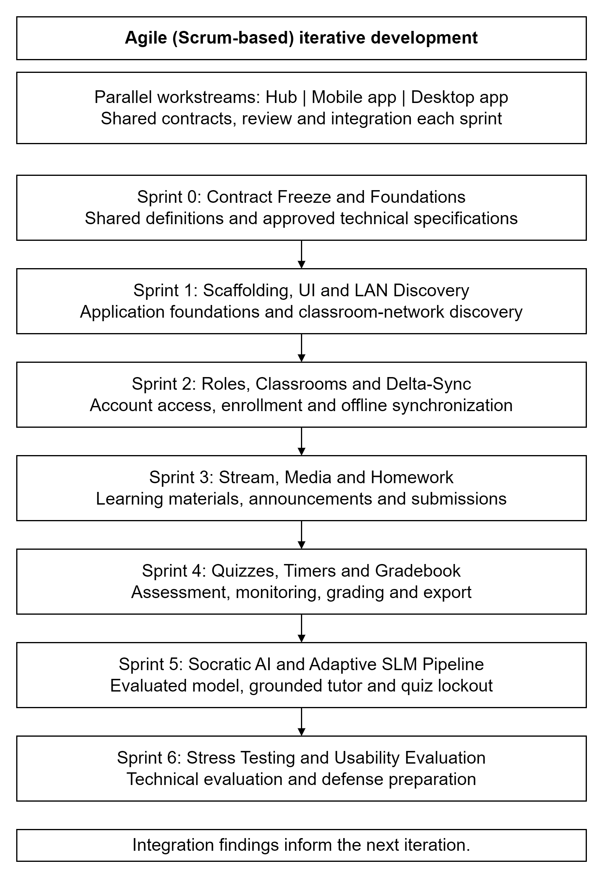

# 3.1.1 Research Design

The study adopts a descriptive-developmental research design, using an Agile (Scrum-based) iterative development model. The developmental component concerns the design and construction of L.A.R.A., an offline classroom platform for Philippine public schools. The descriptive component concerns the evaluation of its functionality, reliability and usability through technical testing and the evaluation instruments described in the succeeding methodology sections. The proposed pilot involves a public school in the Philippines and one class of about 40 Learners; this description identifies the intended deployment setting rather than a confirmed school or completed respondent sample.

*Figure 3.x. Agile development model comprising Sprint 0 and six subsequent sprints, with parallel Hub, Mobile app and Desktop app workstreams and integration at each sprint boundary.*

The development model consists of seven numbered stages, Sprint 0 through Sprint 6. The three teams work in parallel within each sprint and use shared interface definitions to keep their components compatible. Each team completes its assigned work through review before integration. Integration findings inform refinements in the next iteration.

**Sprint 0: Contract Freeze and Foundations.** The teams establish the common request and response definitions, event formats, database structures and technical specifications. These definitions serve as the reference for subsequent development. A mock Hub provides consistent reference behavior while the components are developed independently.

**Sprint 1: Project Scaffolding, UI Foundations and LAN Discovery.** The teams establish the application foundations, local storage and shared interface styling. Discovery allows the access applications to locate the Hub on the classroom network, with manual address entry as a fallback. Integration checks application startup and discovery without requiring an external network connection.

**Sprint 2: Roles, Classrooms, Shell UI and Delta-Sync.** This stage introduces account access, role-based navigation, classroom creation, class-code enrollment and Teacher approval. Local mirrors and incremental synchronization support continued access to saved classroom information when the Hub is unavailable. Integration checks that access permissions and queued work remain consistent across both access applications and the Hub.

**Sprint 3: Stream Feed, Media Player and Camera Homework UI.** Development covers announcements, classwork topics, learning materials, video access and homework submission. The Mobile app supports photo capture, while the Desktop app supports file-based submission. Integration examines content delivery, locally saved learning resources and preservation of submissions during disconnection.

**Sprint 4: Paperless Quiz Engine, Timer UI and Gradebook.** The teams implement quiz preparation, timed participation, objective grading, Teacher monitoring and the gradebook. Completed work remains recoverable after interruption, and the AI tutor is unavailable during an active quiz attempt. Export supports USB storage at the Hub and download to the Teacher's device.

**Sprint 5: Socratic AI Chat UI and Adaptive SLM Pipeline.** The optional tutor is integrated with the approved lesson-grounding and response constraints. It offers a clue and a guiding question instead of a final answer. Model selection follows evaluation; capable devices may use an installed local model, while other devices use the Hub. Classroom functions do not depend on tutor availability.

**Sprint 6: Stress Testing, Usability Evaluation and Defense Preparation.** The teams conduct classroom-network stress tests, offline-recovery checks, device-resource measurements and accessibility evaluation. The planned evaluation includes Teacher usability and software-quality instruments. Results and measurements are reported in Chapter IV rather than treated as established outcomes in this methodology.
