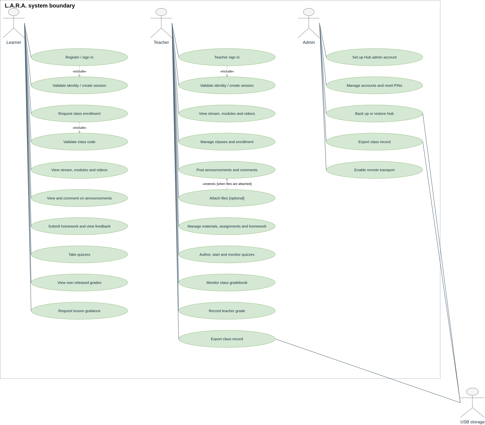

# 3.2.1.1 Use Case Diagram

The use case diagram presents the L.A.R.A. system boundary and the functions available to its Learner, Teacher and Admin actors. Learners and Teachers use the Mobile app or Desktop app, while the Admin uses the Hub console. USB storage is an external destination for class-record export and Hub backup files. Optional remote access uses the same Hub services through a Cloudflare Tunnel; the tunnel does not act as an account or data-store actor.

*Figure 3.x. Use case diagram showing the role-based interactions of Learners, Teachers and the Hub Admin with L.A.R.A.*

Solid connectors show actor participation. The «include» connector from account access to identity validation represents the required validation and session creation during registration or sign-in. The optional file attachment behavior «extends» announcement posting only when a Teacher adds a file. Class-code validation is included in a Learner's enrollment request; approval remains a later Teacher action and is not modelled as an included step. The Learner and Teacher share access to class materials, videos and assignment-specific private comments; their other permitted actions differ by role. Teachers review class performance through the gradebook, while Learners see only their own released grades and feedback. The contract supports class-record export for a Teacher or Admin, to a download or a mounted USB path. USB storage is also used by the Admin for backup and restoration.

The class-record export and Hub backup use cases are distinct: export creates a class spreadsheet, whereas backup creates a Hub archive. Starting an assessment and creating an attempt are separate contract operations; grading and score release follow submission and quiz settings. An active quiz attempt locks the tutor. These are required constraints and therefore do not use «extend». The figure includes only behavior supported by the current product requirements and API contract; it does not represent unsupported self-service PIN recovery, language selection, or local model inference.

| Use case | Actor(s) | Contract-grounded outcome |
|---|---|---|
| Register / sign in | Learner | Learners register or sign in using Hub authentication. |
| Validate identity / create session | Learner | The Hub validates learner credentials and creates or verifies a session. |
| Request class enrollment | Learner | Submit a class code and wait for a class Teacher's approval. |
| Validate class code | Learner | Validate the class code as part of an enrollment request. |
| View stream, modules and videos | Learner | Read class stream and learning materials; stream or save videos. |
| View and comment on announcements | Learner | Read announcements and add comments when commenting is enabled. |
| Submit homework and view feedback | Learner | Submit work and view the learner's own score and feedback. |
| Take quizzes | Learner | Complete one timed attempt and view released scores. |
| View own released grades | Learner | View only the learner's own released quiz and homework results. |
| Request lesson guidance | Learner | Send a lesson-related question to the Hub; tutor access is locked during an active quiz attempt. |
| Private comment on assignment | Learner | Exchange a private comment in an assignment thread visible only to that Learner and the class Teachers. |
| Teacher sign in | Teacher | Sign in through Hub authentication. |
| Validate identity / create session | Teacher | The Hub validates teacher credentials and creates or verifies a session. |
| View stream, modules and videos | Teacher | Read class stream and learning materials; stream videos. |
| Manage classes and enrollment | Teacher | Create and manage classes, view rosters, and approve, reject or remove enrollment requests as permitted. |
| Post announcements and comments | Teacher | Create announcements and manage their comment settings. |
| Attach files [optional] | Teacher | Attach a file to an announcement when desired. |
| Manage materials, assignments and homework | Teacher | Provide materials and assignments, review submissions, and record grades and feedback. |
| Author, start and monitor quizzes | Teacher | Author quizzes, start or close them, and monitor results. |
| Monitor class gradebook | Teacher | View the class gradebook matrix. |
| Record teacher grade | Teacher | Enter a score and feedback for a homework submission. |
| Export class record | Teacher, USB storage | Export a class record as XLSX or CSV to a download or mounted USB target path. |
| Private comment on assignment | Teacher | Exchange a private comment in an assignment thread visible only to the Learner and class Teachers. |
| Set up Hub admin account | Admin | Create the single Hub Admin account during local first-run setup. |
| Manage accounts and reset PINs | Admin | Create accounts and reset learner or teacher PINs. |
| Back up or restore Hub | Admin, USB storage | Write a backup archive to a selected path or restore an archive after checksum verification. |
| Export class record | Admin, USB storage | Initiate Hub class-record export to a download or mounted USB target path. |
| Enable remote transport | Admin | Opt in to the approved Hub tunnel configuration for Remote/Suspension Mode. |

*Table 3.x. Contract-supported use cases and participating actors.*
