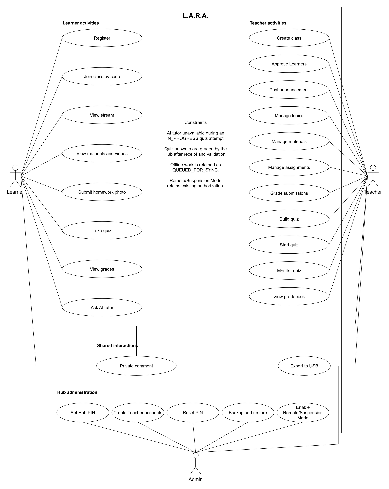

# 3.2.1.1 Use Case Diagram

The UML use case diagram presents the proposed whole-system responsibilities of L.A.R.A. and the interactions of its three human actors: Learner, Teacher and Admin. Its single system boundary encompasses the Hub, Mobile app and Desktop app. The figure represents approved functional requirements rather than evidence that every capability has already been implemented.

*Figure 3.x. Whole-system UML use case diagram of L.A.R.A., showing Learner, Teacher and Admin interactions.*

The Learner accesses classroom resources, submits work, participates in quizzes and requests grounded Socratic guidance through the Mobile app or Desktop app. The Teacher manages classes, learning activities, assessment and grade records through either access application. The Admin performs account and maintenance operations at the Hub. Solid lines indicate actor participation and do not specify execution order or data-flow direction. Private comment is associated with both the Learner and Teacher because the contract permits a private exchange on an assignment. The Admin also participates in Export to USB through the Hub console, consistent with the context diagram and the export contract.

| Use Case | Actor | Short Description |
|---|---|---|
| Register | Learner | Create a Learner account at the Hub using the required identity details and PIN. |
| Join class by code | Learner | Request enrollment using the Teacher's class code; access awaits Teacher approval. |
| View stream | Learner | Read class announcements and locally cached stream content. |
| View materials and videos | Learner | Open lesson resources, stream videos from the Hub or view resources saved for offline study. |
| Submit homework photo | Learner | Submit an assignment image captured in the Mobile app or attached as a file; offline submissions are queued. |
| Private comment | Learner, Teacher | Exchange assignment-specific private comments between the Learner and class Teachers. |
| Take quiz | Learner | Begin an available timed attempt, answer questions and submit; an attempt begun while connected can continue during disconnection. |
| View grades | Learner | View personal homework scores, feedback and released quiz scores, including cached history. |
| Ask AI tutor | Learner | Request a lesson-grounded clue and guiding question in the selected language, subject to availability and quiz lockout. |
| Create class | Teacher | Create a class and obtain its enrollment code. |
| Approve Learners | Teacher | Review and approve or decline pending enrollment requests. |
| Post announcement | Teacher | Publish classroom announcements with supported attachments. |
| Manage topics | Teacher | Organize classwork under topics and maintain those groupings. |
| Manage materials | Teacher | Add and maintain lesson documents, images and videos. |
| Manage assignments | Teacher | Create and maintain assignments, instructions, due dates, points and attachments. |
| Grade submissions | Teacher | Review homework, assign points and provide feedback. |
| Build quiz | Teacher | Create and edit draft questions, answer keys and assessment settings before the quiz starts. |
| Start quiz | Teacher | Start a draft quiz for the class. |
| Monitor quiz | Teacher | Observe participation and submission status and close the quiz through the supported controls. |
| View gradebook | Teacher | Inspect consolidated assignment points and quiz scores for the class. |
| Export to USB | Teacher, Admin | Export an authorized class record in XLSX or CSV format; the Hub console supports writing it to mounted USB storage. |
| Set Hub PIN | Admin | Establish the Admin PIN during first-run Hub setup. |
| Create Teacher accounts | Admin | Create Teacher accounts; Teachers do not self-register. |
| Reset PIN | Admin | Reset a forgotten account PIN through the authorized Hub administration operation. |
| Backup and restore | Admin | Create a Hub backup archive and restore a checksum-verified archive. |
| Enable Remote/Suspension Mode | Admin | Opt into the Hub's approved remote transport for continuity during class suspension. |

*Table 3.x. Use cases and participating actors within the L.A.R.A. system boundary.*

Automated grading is internal Hub behavior following receipt and validation of quiz answers. It is described within Take quiz rather than introduced as an additional actor goal. An offline completion can remain queued until reconnection, so the diagram does not assert immediate grading during every local completion. AI lockout is a constraint: Ask AI tutor is unavailable while the Learner has an `IN_PROGRESS` quiz attempt; the interface does not compose the chat, and the Hub rejects requests with `QUIZ_IN_PROGRESS`. Neither this restriction nor the sequence between quiz activities constitutes an `<<extend>>` or `<<include>>` relationship. No such relationships are asserted in this diagram.

The human actor names match Section 3.2.1.2. That context diagram models exchanges with the Hub and additionally depicts USB Drive as an external storage entity. The use case diagram instead places the whole platform inside its boundary and retains the three human actors specified by Issue #173. The Hub is part of the system, not a fourth actor. USB storage is the destination of export and backup operations, rather than an additional human role. The optional remote transport does not introduce another actor or change account authorization.

**Manuscript review notes.** The current `POST /api/export/class-record` contract permits a mounted USB path or a download to the Teacher's device when `target_path` is omitted. The diagram retains the required Export to USB goal; this does not imply that the Mobile app can select a Hub USB drive through an undocumented drive-listing operation. The Mobile technical specification, particularly Section 14 question 10, still prohibits phone export and describes `target_path` as required. That lower-level restriction conflicts with the current contract and the context diagram's download description.

[ASK LEAD: Should the outdated Mobile export restriction be recorded as a manuscript review note while the diagram follows the contract?]

Remote/Suspension Mode is an approved Admin capability in the PRD and networking rules. Its inclusion does not assert that a remote-mode configuration API or Mobile configuration screen exists; no such endpoint is specified in the reviewed OpenAPI contract. Desktop review required by Issue #173 remains pending and is not implied by terminology alignment.

**Project source notes.** Use cases follow [Issue #173](https://github.com/BootlegYouki/L.A.R.A/issues/173), [PRD Sections 4 and 5](../../PRD.md), [OpenAPI](../../../contracts/openapi.yaml), the [WebSocket event contract](../../../contracts/events/README.md) and [quiz rules](../../../rules/quiz-and-anti-cheat.md). Remote transport follows [networking rules, Section 5](../../../rules/networking-and-lan.md). Terminology follows the [context diagram](3.2.1.2-context-diagram.md), [root glossary](../../../AGENTS.md#8-glossary) and [Mobile technical specification](../../../mobile/docs/TECH_SPEC.md). The editable source is [use-case.drawio](diagrams/use-case.drawio).
