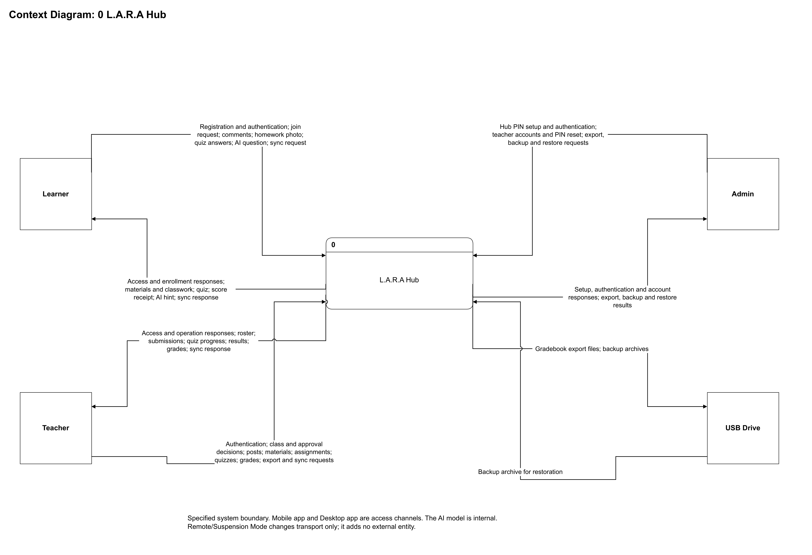

# 3.2.1.2 Context Diagram

The context diagram presents the L.A.R.A Hub as a single process, **0 L.A.R.A Hub**, and identifies the information exchanged with the Learner, Teacher, Admin, and USB Drive. It represents the specified system boundary in the REST and WebSocket contracts and the product requirements, rather than a claim that every function is already implemented. The Mobile app and Desktop app provide access to the Hub; they are not separate external entities in this logical model.

*Figure 3.x. Context diagram of the L.A.R.A Hub. Editable source: [context-diagram.drawio](diagrams/context-diagram.drawio). The PNG is exported with an opaque white background.*

The Learner supplies registration and authentication details, a class-code join request, comments, homework submissions, quiz answers, synchronization requests, and AI questions; the Hub returns access and enrollment responses, classroom content, quiz information, permitted score receipts, synchronization responses, and grounded AI guidance. The Teacher supplies class and enrollment decisions, announcements, materials, assignments, quiz definitions and controls, homework grades, and export requests; the Hub returns rosters, submissions, quiz progress, grades, and operation responses. The Admin supplies the first-run PIN setup, authentication, teacher-account and PIN-reset instructions, and export, backup, and restore requests; the Hub returns account and operation responses. The Hub writes gradebook exports and backup archives to the USB Drive and reads backup archives for restoration. The AI model operates within the Hub boundary. Remote/Suspension Mode changes only the REST and WebSocket transport through the Hub's opt-in Cloudflare Tunnel; it introduces no additional entity, account tier, or data repository.

Source basis: [REST contract](../../../contracts/openapi.yaml), [WebSocket contract](../../../contracts/events/README.md), [PRD sections 2.1, 3, 4, and 6](../../PRD.md), and [AGENTS.md sections 3.4 and 3.5](../../../AGENTS.md). The repeated entity and flow labels are decomposed in [Section 3.2.1.3](3.2.1.3-data-flow-diagram.md).

Open question:

- [ASK LEAD: The export contract permits a response-body download when target_path is omitted, while server/docs/TECH_SPEC.md section 14, question 6 proposes USB-only export. Confirm whether that contract-supported alternative remains in scope. This diagram depicts the required USB path without asserting that it is the contract's only export destination.]
