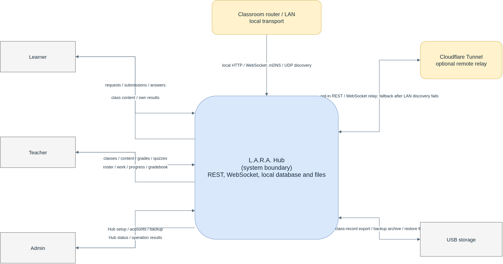

# 3.2.1.2 Context Diagram

The context diagram shows the L.A.R.A. Hub as the system under study and the external actors and storage that exchange data with it. The Mobile app and Desktop app are access clients used by the Learner and Teacher; the classroom router supplies local network transport. Admin operations take place at the Hub console. USB storage receives exported class records and backup archives and may supply an archive for restoration. During an approved Remote/Suspension Mode, the optional Cloudflare Tunnel relays the same Hub traffic without becoming a system of record.

*Figure 3.x. Context diagram of the L.A.R.A. Hub and its external actors, storage and optional remote transport.*

| External entity | Information sent to the Hub | Information returned by the Hub |
|---|---|---|
| Learner | Registration and sign-in details, class-code request, comments, homework file, quiz answers, synchronization requests and lesson question | Enrollment state, authorized class content, materials, quiz data, own score and feedback, synchronization receipts and tutor stream |
| Teacher | Sign-in, class and enrollment decisions, announcements, materials, assignments, grading, quiz authoring and control, export request | Class roster, learner submissions, quiz progress and results, gradebook, class content and operation receipts |
| Admin | First-run setup, account operations, export, backup and restore requests, and Hub configuration | Account and Hub status, operation results, and downloadable or stored export and backup files |
| USB storage | Backup archive selected for restoration | Exported class record or backup archive written to the selected path |
| Classroom router / LAN | Carries local HTTP and WebSocket traffic between clients and Hub | Carries Hub responses and LAN discovery advertisements to clients |
| Optional Cloudflare Tunnel | Relays encrypted remote REST and WebSocket traffic when explicitly enabled | Relays responses from the same Hub routes and services |

*Table 3.x. Context-level data exchanges with the L.A.R.A. Hub.*

The diagram groups request and response traffic at the system boundary. It does not show database tables or internal processing; those appear in the data-flow diagrams. The tunnel is optional and does not alter the account, authorization or synchronization contracts.
