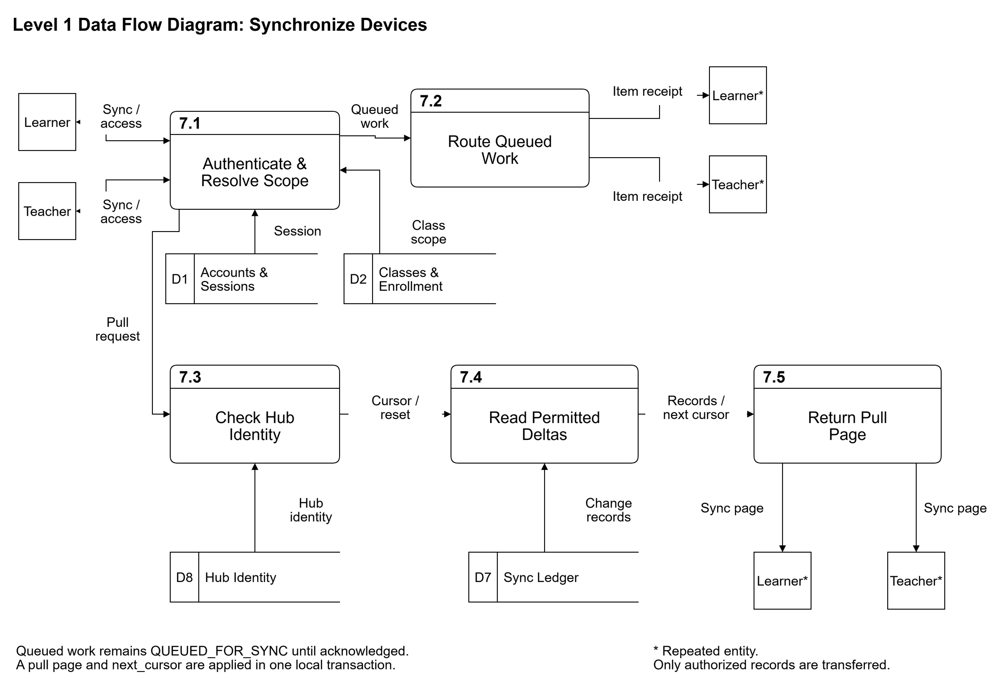

# 3.2.1.3 Data Flow Diagram

The data flow diagrams decompose **0 L.A.R.A Hub** into seven logical processes derived from the contract's route groups. Gane-Sarson notation distinguishes numbered rounded-rectangle processes, square external entities, and numbered open-ended data stores. Each arrow identifies transferred data rather than a navigation step. The diagrams describe the specified design; the current quiz and synchronization routes remain scaffold implementations in the examined Hub code.

*Figure 3.x. Level 0 data flow diagram of the L.A.R.A Hub. Editable source: [dfd-level-0.drawio](diagrams/dfd-level-0.drawio). The PNG is exported with an opaque white background.*

**1.0 Manage Accounts & Enrollment.** This process handles learner registration, authentication and logout, first-run Admin setup, teacher-account creation and PIN reset, class creation and management, co-teacher membership, and enrollment decisions. The route groups are `/api/auth/*`, `/api/admin/*`, and `/api/classrooms*`. D1 Accounts & Sessions supplies identity and session records; D2 Classes & Enrollment supplies class ownership and enrollment state. Accepted changes that clients must receive generate D7 Sync Ledger entries in the same transaction. `EVENT_JOIN_REQUEST` and `EVENT_JOIN_APPROVAL` communicate enrollment changes. The stored status is `PENDING`, followed by the relevant contract-defined decision; the diagram does not adopt the PRD's informal `PENDING_APPROVAL` label as a database value.

**2.0 Manage Stream.** The `/api/announcements*` routes receive Teacher announcements and permitted Learner or Teacher comments. The process checks class access against D2 Classes & Enrollment, reads and updates D3 Stream, and records visible changes in D7 Sync Ledger. `EVENT_ANNOUNCEMENT_PUSH` carries announcement notifications. Attachments are managed through 3.0 Manage Classwork and associated by the existing `materials.announcement_id` column. Learners comment on permitted announcements; they do not author announcements.

**3.0 Manage Classwork.** The `/api/topics*`, `/api/materials*`, `/api/assignments*`, and `/api/submissions*` routes manage topics, lesson metadata and chunks, assignment attachments, homework uploads, private comments, and Teacher grading. D5 Classwork contains the associated records, D2 Classes & Enrollment supplies access scope, and D7 Sync Ledger records visible changes. File bytes remain in Hub-managed storage rather than in an invented database table; the diagram labels file-bearing flows but does not equate a stored path with file content. The specified video transfer uses HTTP Range responses and the per-client bandwidth limit. Private-comment access is limited to the relevant Learner and class Teachers. Homework photo uploads use the multipart assignment-submit route, including a client-generated `submission_id` for repeatable retries.

**4.0 Run Quizzes.** The `/api/quizzes*` routes and quiz events support authoring, activation, attempt creation, answer submission, objective grading, closing, and score release. The process reads access scope from D2 Classes & Enrollment, reads and updates D4 Quizzes, and writes revisions to D7 Sync Ledger. Learner-facing question responses omit answer keys. A persisted `IN_PROGRESS` attempt is also the basis for the AI lockout decision used by 6.0 Socratic AI Tutor. Figure 3.x below expands this process.

**5.0 Gradebook, Export & Backup.** This process reads class and points records through D2 Classes & Enrollment, D4 Quizzes, and D5 Classwork. `POST /api/export/class-record` produces `.xlsx` or `.csv` gradebooks. `POST /api/backup` writes a `.lara-backup` archive, and `POST /api/restore` reads an archive and verifies its checksum before restoration. Backup and restore span all eight logical stores and Hub-managed files; the level 0 diagram shows a separate labelled connection to every store. Restoration updates the epoch in D8 Hub Identity so clients can detect that a full resynchronization is required. USB Drive is an external source and destination for these files, not a database table. The export contract also defines a download alternative when `target_path` is omitted; the unresolved USB-only proposal is identified in Section 3.2.1.2.

**6.0 Socratic AI Tutor.** `EVENT_AI_CHAT_REQUEST` supplies a Learner question, material reference, and language. D2 Classes & Enrollment determines permitted classroom access, D4 Quizzes provides the active-attempt state, D5 Classwork supplies grounding chunks, and D6 Tutor History stores Hub-assisted conversation records. The internal model runtime uses the shared prompt from `contracts/ai/socratic_system_prompt.txt`, a bounded FIFO queue, and the specified inference slots. It returns queue updates and grounded hints through `EVENT_QUEUE_STATUS` and `EVENT_AI_TOKEN_STREAM`; it does not provide final answers. An `IN_PROGRESS` attempt yields `EVENT_ERROR` with `QUIZ_IN_PROGRESS`. Missing lesson coverage prompts a return to the lesson, and an unavailable model yields `AI_NOT_AVAILABLE` while other Hub functions remain available. `/api/model` and `/api/model/file` provide model metadata and optional model-file transfer, rather than an invented REST chat route. The model choice remains subject to evaluation.

**7.0 Synchronize Devices.** `POST /api/sync/push` accepts queued quiz attempts, stream comments, and private comments and returns an item receipt. It passes those records to their owning domain processes for access checks and validation; quiz answers follow the same grading rules as direct submission. `POST /api/sync/pull` uses D7 Sync Ledger and D8 Hub Identity to retrieve permitted changes from D1 through D5 and to produce `next_cursor`, `has_more`, `reset`, and tombstones. D6 Tutor History has no corresponding collection in the current `SyncPullResponse`; it is therefore not drawn as a pull input. `QUEUED_FOR_SYNC` describes client state and is not a master-table column. Figure 3.x below expands the synchronization boundary.

The logical stores group the master schema without adding or duplicating tables.

| Data store | Master tables |
|---|---|
| D1 Accounts & Sessions | `users`, `sessions` |
| D2 Classes & Enrollment | `classrooms`, `classroom_teachers`, `enrollments` |
| D3 Stream | `announcements`, `announcement_comments` |
| D4 Quizzes | `quizzes`, `quiz_questions`, `quiz_attempts` |
| D5 Classwork | `topics`, `materials`, `material_chunks`, `assignments`, `assignment_submissions`, `private_comments` |
| D6 Tutor History | `ai_chat_messages` |
| D7 Sync Ledger | `sync_revisions` |
| D8 Hub Identity | `hub_meta` |

*Table 3.x. Logical data stores derived from the 19 tables in the Hub master schema.*

*Figure 3.x. Level 1 decomposition of 4.0 Run Quizzes. Editable source: [dfd-level-1-run-quizzes.drawio](diagrams/dfd-level-1-run-quizzes.drawio). The PNG is exported with an opaque white background.*

Subprocess **4.1 Author & Activate Quiz** receives Teacher definitions and start instructions, stores the quiz, and produces the permitted question payload and `EVENT_QUIZ_START`. **4.2 Begin Attempt & Establish Lockout** receives the Learner's begin request and stores the `IN_PROGRESS` attempt. **4.3 Receive Answers & Validate Timing** accepts direct answers, `EVENT_QUIZ_SUBMIT`, or queued answers from 7.0 Synchronize Devices. Answer selection occurs locally in the access application; no per-answer upload endpoint is implied. Offline completion remains `QUEUED_FOR_SYNC` on the device until delivery. The Hub checks the recorded finish interval against the duration plus the specified 60-second grace period. **4.4 Auto-Grade & Persist Attempt** compares accepted answers with the Hub's keys and stores the result and revision atomically. **4.5 Close Quiz & Release Scores** handles Teacher closure, initiates grading of remaining attempts, and releases held scores. **4.6 Enforce AI Lockout** reads attempt state and supplies a permit or `QUIZ_IN_PROGRESS` rejection decision to 6.0 Socratic AI Tutor. The AI subprocess is internal; it is shown as an adjacent process at the level 1 boundary. Score receipts, Teacher results and presence, and synchronization receipts are labelled separately. Remote clients use a local countdown anchored to the Hub-provided start time rather than relying on classroom-LAN timer coordination.

*Figure 3.x. Level 1 decomposition of 7.0 Synchronize Devices. Editable source: [dfd-level-1-synchronize-devices.drawio](diagrams/dfd-level-1-synchronize-devices.drawio). The PNG is exported with an opaque white background.*

Subprocess **7.1 Authenticate & Resolve Scope** resolves the session and class access. **7.2 Route Queued Work** dispatches pushed attempts and comments to 4.0 Run Quizzes, 2.0 Manage Stream, and 3.0 Manage Classwork; it receives their validation outcomes and returns per-item `SYNCED` or `REJECTED` receipts. Each owning process commits its record and revision together. The separate multipart homework upload goes to 3.0 Manage Classwork rather than into the JSON push body. **7.3 Check Hub Identity & Epoch** detects a new Hub or restored state. **7.4 Read Permitted Deltas** reads `seq` values after the cursor and resolves the permitted current records and tombstones. **7.5 Return Pull Page** packages the records with `next_cursor`, `has_more`, `reset`, `hub_id`, `sync_epoch`, and `server_time`. The Learner's or Teacher's access application applies the entire page and `next_cursor` in one local transaction; a failure retains the previous cursor. A reset preserves queued local work, and a receipt is required before local work is marked `SYNCED`. These local persistence rules are boundary annotations, not additional Hub processes or stores. The cursor is an integer sequence position; `server_time` serves clock-offset calculation only.

Source basis: [master schema](../../../contracts/schema/server_master.sql), [REST contract](../../../contracts/openapi.yaml), [event schemas](../../../contracts/events/), [database and synchronization rules](../../../rules/database-and-sync.md), [quiz rules](../../../rules/quiz-and-anti-cheat.md), [AI rules](../../../rules/socratic-ai-guardrails.md), [PRD sections 3, 4, and 6](../../PRD.md), and [Hub technical specification sections 6, 7, and 14](../../../server/docs/TECH_SPEC.md). The implemented-status qualification follows [quiz routes](../../../server/backend/src/routes/quizzes.rs), [sync routes](../../../server/backend/src/routes/sync.rs), and [database documentation](../../../server/docs/database_sync.md). The shared names were posted in the [issue coordination comment](https://github.com/BootlegYouki/L.A.R.A/issues/172#issuecomment-6484374218).

Open questions:

- [ASK LEAD: Confirm the manuscript's authoritative quiz timing anchor when quizzes.started_at and quiz_attempts.started_at differ. The submission contract accepts started_at, while server/docs/TECH_SPEC.md section 14, question 17 proposes a persisted Hub anchor. The diagram retains the documented interval check without choosing an unresolved precedence.]
- [ASK LEAD: Confirm the synchronization treatment of newly approved and removed learners described in server/docs/TECH_SPEC.md section 14, question 3. The diagrams retain contract-defined scope and reset behavior without claiming that the proposed visibility repair is implemented.]
