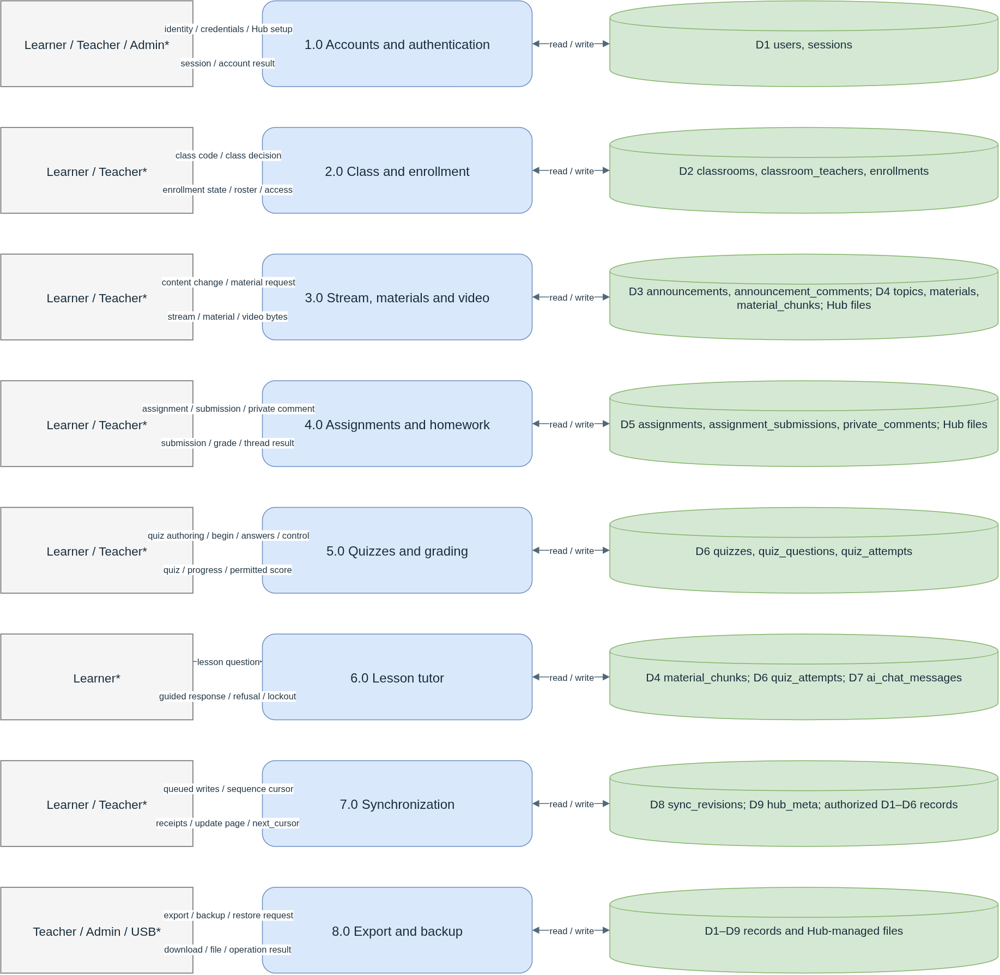
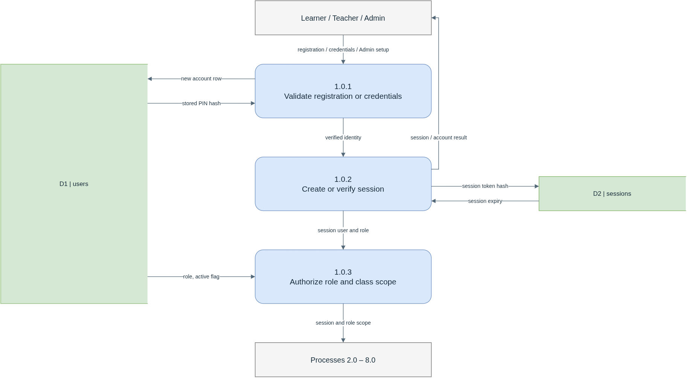
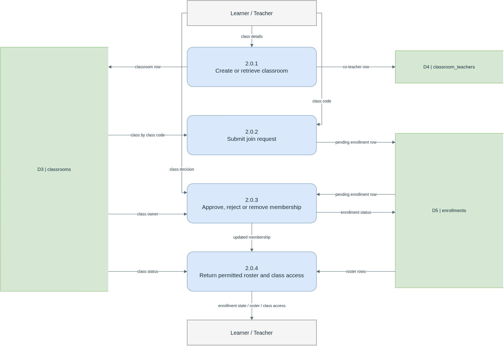
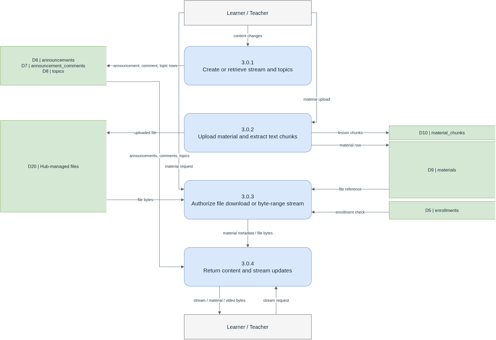
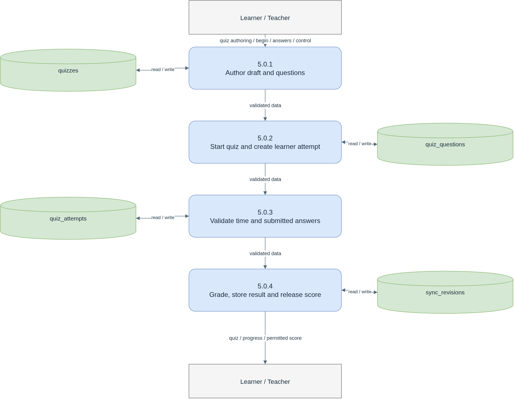
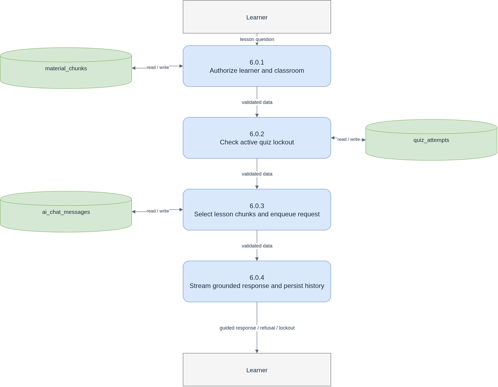
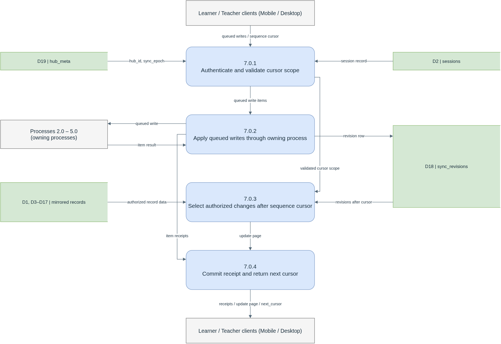
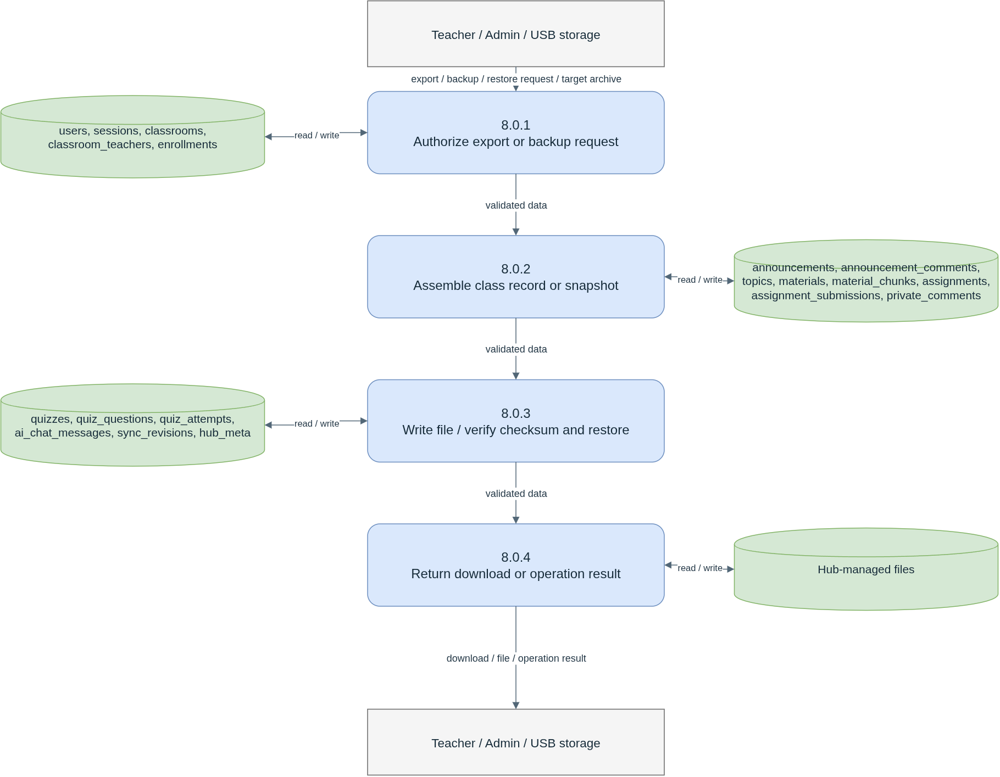

# 3.2.1.3 Data-Flow Diagrams

The context diagram in Section 3.2.1.2 is the Level 0 view: it treats the L.A.R.A. Hub as one process and shows exchanges across the system boundary. The Level 1 diagram decomposes that process into eight interconnected processes, draws each external entity once, and names data stores with DFD open-ended rectangles and IDs mapped to actual tables in `contracts/schema/server_master.sql`. Each Level 2 diagram expands one Level 1 process and preserves its external actor flows and data-store identifiers. The Level 1 diagram uses two-headed actor links for request-and-response exchanges; its process table names the individual inputs and outputs. Labeled process-to-process arrows show the cross-module data flows. Each Level 2 diagram retains its parent process actor exchanges and store IDs.

*Figure 3.x. Level 1 data-flow diagram showing the Hub processes, external entities and contract data stores.*

| Process | Main input and output at the system boundary | Contract tables and files |
|---|---|---|
| 1.0 Accounts and authentication | Learner, Teacher or Admin credentials and setup details; returns session or operation result | `users`, `sessions` |
| 2.0 Class and enrollment | Learner class-code request and Teacher class or decision; returns enrollment state, class access and roster | `classrooms`, `classroom_teachers`, `enrollments` |
| 3.0 Stream, materials and video | Teacher content changes and Learner/Teacher reads; returns announcements, comments, material metadata, downloads and video ranges | `announcements`, `announcement_comments`, `topics`, `materials`, `material_chunks`, Hub-managed files |
| 4.0 Assignments and homework | Teacher assignment and grading changes; Learner file submissions and private comments; returns assignment data, own thread and feedback | `assignments`, `assignment_submissions`, `private_comments`, Hub-managed files |
| 5.0 Quizzes and grading | Teacher quiz authoring and control; Learner attempts and answers; returns quiz state, progress and permitted score | `quizzes`, `quiz_questions`, `quiz_attempts`, `sync_revisions` |
| 6.0 Lesson tutor | Learner lesson question; returns a streamed guided response or a refusal/lockout result | `material_chunks`, `quiz_attempts`, `ai_chat_messages`, Hub model process and queue |
| 7.0 Synchronization | Mobile/Desktop queued writes and cursor; returns receipts, authorized updates and next sequence cursor | `sync_revisions`, `hub_meta`, and the affected classroom tables |
| 8.0 Export and backup | Teacher export request, Admin backup/restore request, or USB archive; returns a download, file or operation result | Classroom tables, `hub_meta`, Hub-managed files and USB target path |

*Table 3.x. Level 1 processes, boundary flows and contract-backed data stores.*

## Level 2 decompositions

### 1.0 Accounts and authentication

*Figure 3.x. Level 2 decomposition of account creation, session validation and authorization.*

The Hub validates registration or sign-in details against `users` (writing a new account row on registration, reading the stored PIN hash on sign-in), then creates or verifies a session, writing the hashed bearer token to `sessions` and reading its expiry. The session's user and role then pass to authorization, which re-reads the role and active flag from `users` and returns the session and role scope to the other processes. PIN hashes remain Hub-side.

### 2.0 Class and enrollment

*Figure 3.x. Level 2 decomposition of classroom and enrollment operations.*

Classroom creation writes `classrooms` and, for co-teachers, `classroom_teachers`. A Learner's join request looks up the class by code in `classrooms` and writes a pending row to `enrollments`. The Teacher's decision reads that pending row, checks class ownership in `classrooms`, and writes the new enrollment status. The updated membership then feeds the roster process, which reads `enrollments` and `classrooms` to return the permitted roster and class access state.

### 3.0 Stream, materials and video

*Figure 3.x. Level 2 decomposition of stream, material and video delivery.*

Teacher posts write announcement, comment and topic rows (`announcements`, `announcement_comments`, `topics`). A material upload stores the file in Hub-managed files, writes the `materials` row and writes the text extracted from the document as ordered `material_chunks`; the Hub does not assume extractable text for every file. A download or video byte-range request reads the file reference from `materials`, checks the requester's `enrollments`, and reads the bytes from Hub-managed files before they are returned. The stream update process reads the announcement, comment and topic stores to return the stream.

### 4.0 Assignments and homework

*Figure 3.x. Level 2 decomposition of assignments, submissions, private comments and grading.*

The Hub writes assignment settings to `assignments` and reads them back for listing. A submission reads the due date and settings, stores the homework file in Hub-managed files and writes the `assignment_submissions` row with its client-generated identifier. The private thread is authorized against `enrollments` before `private_comments` is read or written. Grading reads the submission row and its file, then writes the score and feedback back to `assignment_submissions`. Learners receive only their own score and feedback. Offline writes are retried through synchronization and their result is acknowledged or rejected by the Hub.

### 5.0 Quizzes and grading

*Figure 3.x. Level 2 decomposition of quiz authoring, attempts, validation and score release.*

The Teacher writes a draft to `quizzes` and its questions with the answer key to `quiz_questions`, then starts or closes the quiz. Starting reads the quiz status and duration and writes an `IN_PROGRESS` row to `quiz_attempts`. On submission the Hub reads the attempt's `started_at` and the quiz time limit, validates the time, and writes the answers and `submitted_at`. Grading reads the answer key from `quiz_questions` and the release setting from `quizzes`, then writes the score and graded status to `quiz_attempts`. Scores are returned immediately only when the release setting allows; otherwise they remain held until release. The `sync_revisions` ledger that makes these changes visible to clients is written by the synchronization process (7.0), in the same database transaction as the change.

### 6.0 Lesson tutor

*Figure 3.x. Level 2 decomposition of lesson-grounded tutoring and quiz lockout.*

The Hub authorizes the Learner and classroom by reading `enrollments`, then reads `quiz_attempts` (read only) to check for an in-progress attempt. If one exists it refuses the request. Otherwise it reads the relevant lesson chunks from `material_chunks` (read only) and submits the grounded prompt to its bounded inference queue. The Hub streams the response and writes the conversation record to `ai_chat_messages`. If lesson text does not support a response, the tutor directs the Learner back to the lesson.

### 7.0 Synchronization

*Figure 3.x. Level 2 decomposition of queued writes and ordered change delivery.*

Authentication reads `sessions` and the Hub identity and epoch in `hub_meta`. The Hub then applies each queued write through the process that owns that record, writes a `sync_revisions` row in the same transaction, and returns an item receipt. For a pull, it reads `sync_revisions` after the integer sequence cursor, reads the authorized records from the mirrored tables, and returns the update page with `next_cursor`. Clients apply the page and cursor in one local transaction. A reset preserves queued and rejected work while rebuilding the mirrored data.

### 8.0 Export and backup

*Figure 3.x. Level 2 decomposition of class-record export and Hub backup or restoration.*

The Hub authorizes the request by reading class ownership from `classrooms` and `classroom_teachers`, then assembles a Teacher's class record (roster, scores and attempts) as XLSX or CSV and either returns it for download or writes it to the requested mounted path. Separately, the Admin can create a backup archive or request restoration from an archive on USB storage. Backup and export files are written to Hub-managed files; restoration reads the archive, verifies its checksum, rewrites the restored tables and advances `hub_meta.sync_epoch` so clients perform a full synchronization.

The Level 2 diagrams preserve each parent process's external exchange: actors and USB storage remain outside the Hub boundary, while the process reads or writes only the named contract tables and Hub-managed files. Data stores use open-ended rectangles with DFD identifiers, not database-cylinder symbols. The D1-D20 identifiers refer to the same named tables in the Level 1 and Level 2 figures. The client-only cache tables are not Hub stores and therefore do not appear in this Hub DFD.
