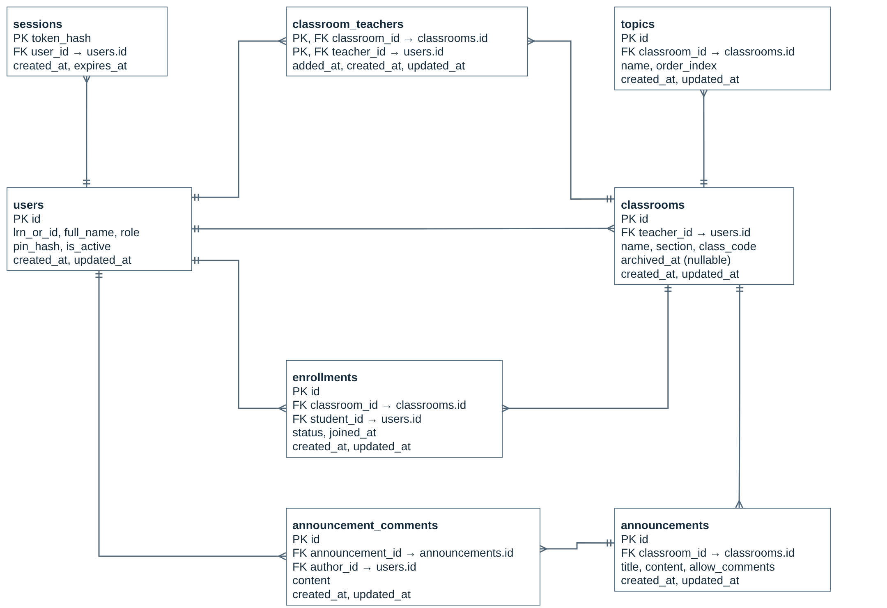
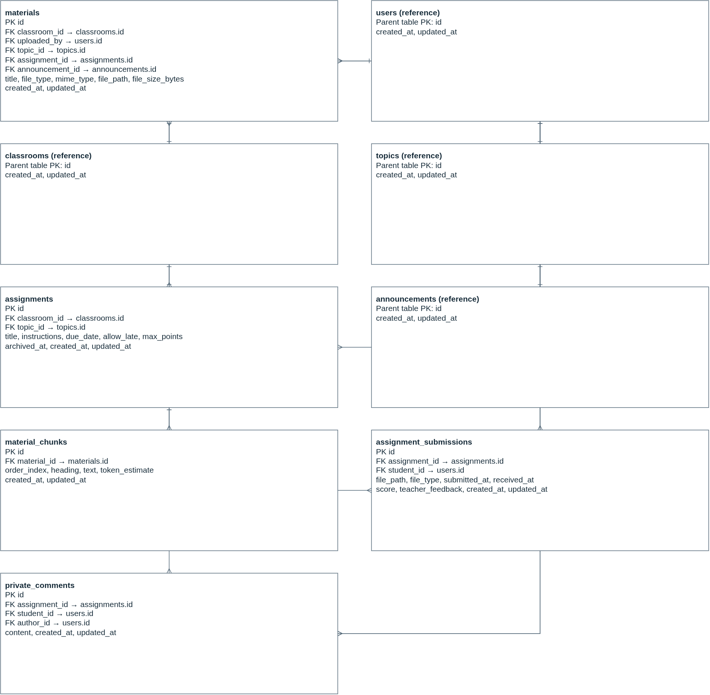
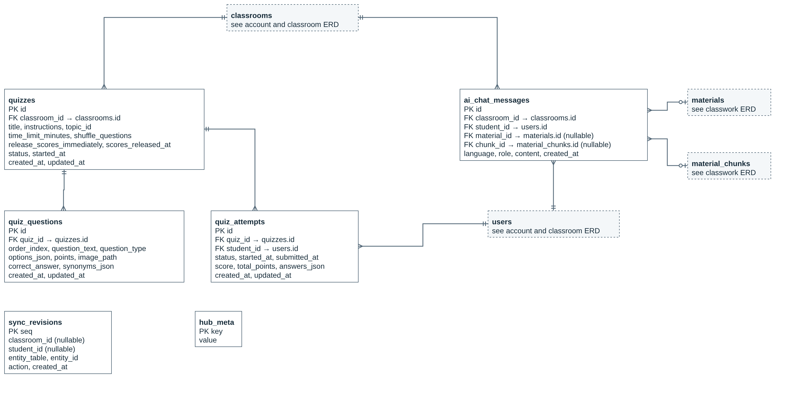

# 3.2.1.4 Entity-Relationship Diagram

The entity-relationship diagrams represent the 19 tables in the authoritative Hub schema, `contracts/schema/server_master.sql`, with the field updates specified by the separate schema-audit report. Every relationship appears on its child table as an `FK` column with the referenced parent table and key, and a connector links the related tables. A foreign key whose parent table appears in another figure is shown as a dashed reference box naming the figure that defines it. `PK` marks a primary key and `FK` marks a foreign key. The reported timestamp columns and server-only `materials.uploaded_by` are shown to match that schema change.

*Figure 3.x. Entity-relationship diagram of account, classroom, enrollment, stream and topic records.*

*Figure 3.x. Entity-relationship diagram of material and classwork records, with dashed reference boxes for parent tables defined in other figures.*

*Figure 3.x. Entity-relationship diagram of quiz, tutoring and synchronization records, with dashed reference boxes for parent tables defined in other figures.*

| Table | Parent table(s), by foreign key | User who creates or owns the row |
|---|---|---|
| `users` | None | The row represents the account; the schema has no separate creator column. |
| `sessions` | `users` via `user_id` | `user_id` identifies the account for which the session was issued. |
| `classrooms` | `users` via `teacher_id` | `teacher_id` identifies the owning Teacher. |
| `classroom_teachers` | `classrooms` via `classroom_id`; `users` via `teacher_id` | `teacher_id` identifies the Teacher associated with the class. |
| `enrollments` | `classrooms` via `classroom_id`; `users` via `student_id` | `student_id` identifies the Learner requesting membership; the deciding Teacher is not recorded on this row. |
| `announcements` | `classrooms` via `classroom_id` | No author column is defined; `classroom_id` leads to the class owner's `teacher_id`. |
| `announcement_comments` | `announcements` via `announcement_id`; `users` via `author_id` | `author_id` identifies the comment author. |
| `topics` | `classrooms` via `classroom_id` | No creator column is defined; the row is associated with its classroom. |
| `materials` | `classrooms` via `classroom_id`; `users` via `uploaded_by`; optional `topics`, `assignments` and `announcements` via their corresponding IDs | `uploaded_by` identifies the authenticated uploader; `classroom_id` scopes the material to its class. |
| `material_chunks` | `materials` via `material_id` | The parent `materials.uploaded_by` identifies the uploader; the parent also carries the classroom association. |
| `assignments` | `classrooms` via `classroom_id`; optional `topics` via `topic_id` | No creator column is defined; the row is associated with its classroom. |
| `assignment_submissions` | `assignments` via `assignment_id`; `users` via `student_id` | `student_id` identifies the submitting Learner; the grading Teacher is not recorded on this row. |
| `private_comments` | `assignments` via `assignment_id`; `users` via `student_id` and `author_id` | `author_id` identifies the message author; `student_id` identifies the Learner whose private thread contains it. |
| `quizzes` | `classrooms` via `classroom_id` | No creator column is defined; the row is associated with its classroom. |
| `quiz_questions` | `quizzes` via `quiz_id` | No author column is defined; the parent quiz carries classroom association. |
| `quiz_attempts` | `quizzes` via `quiz_id`; `users` via `student_id` | `student_id` identifies the Learner who owns the attempt. |
| `ai_chat_messages` | `classrooms` via `classroom_id`; `users` via `student_id`; optional `materials` via `material_id`; optional `material_chunks` via `chunk_id` | `student_id` identifies the Learner who sent or received the message. |
| `sync_revisions` | None (nullable `classroom_id` and `student_id` are synchronization scope fields, not declared foreign keys) | No initiating user column is defined; `student_id` scopes a revision to a Learner when applicable. |
| `hub_meta` | None | Not applicable; key/value Hub metadata. |

*Table 3.x. Data dictionary of parent relationships and available user-identifying columns in the Hub schema.*

The schema-audit report adds `created_at` to `enrollments`, `material_chunks`, `assignment_submissions` and `quiz_attempts`; adds both timestamps to `classroom_teachers`; and adds the server-only `materials.uploaded_by` foreign key to `users.id`. Its timestamp classification leaves `ai_chat_messages` and `sync_revisions` append-only with `created_at` only, `sessions` with issuance `created_at` only, and `hub_meta` without timestamps. The report says the corresponding server and client contract changes are pending their separate schema change; this thesis diagram records the reported target and should be checked against the merged schema before submission.

Sensitive values such as `pin_hash`, server-side `file_path`, and `quiz_questions.correct_answer` remain on the Hub and are not exposed to Learners. `materials.uploaded_by` is server-only metadata and is not part of the client schema or API response. The diagram describes database structure and does not imply that every foreign-key column is returned to every client role.
