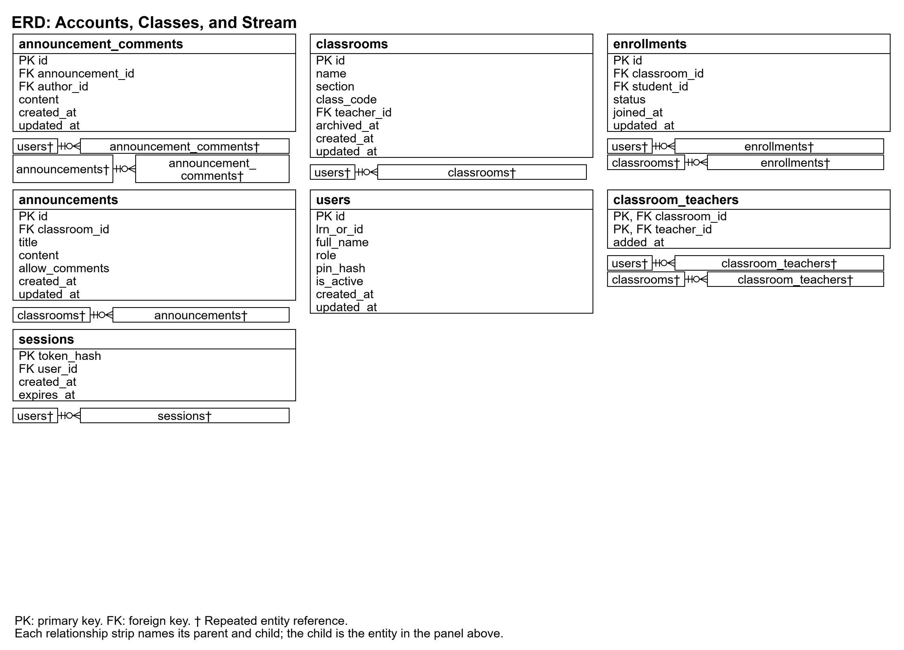
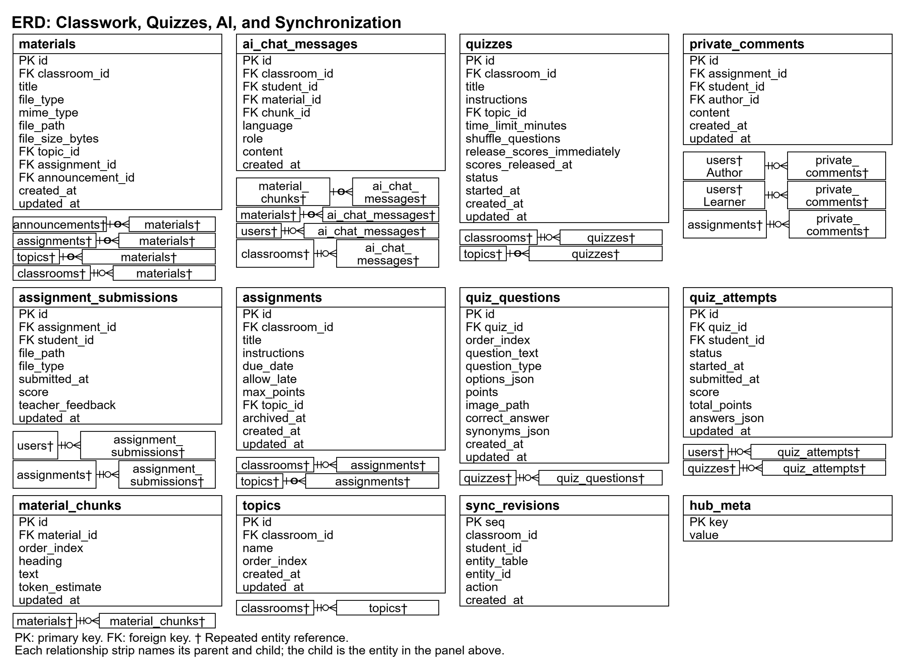

# 3.2.1.4 Entity-Relationship Diagram

The entity-relationship diagrams present the proposed Hub database in two landscape figures. The first groups account, classroom, and stream records; the second groups classwork, quizzes, tutoring, and synchronization records. Together, the figures contain 19 entities and their 147 attributes. Primary keys are marked PK and foreign keys FK. A dagger identifies a repeated entity reference used to keep a relationship close to its child entity.

*Figure 3.x. Entity-relationship diagram of accounts, classrooms, and the stream.*

*Figure 3.x. Entity-relationship diagram of classwork, quizzes, AI, and synchronization.*

Crow's Foot symbols distinguish a required parent from an optional parent and identify the many side of each relationship. A class can contain multiple enrollments, announcements, materials, assignments, topics, and quizzes. A quiz contains questions and records Learner attempts, while an assignment receives homework submissions and private comments. Materials supply ordered text chunks for grounding tutor responses. Topics organize materials, assignments, and quizzes through their topic references.

| Entity | Purpose |
|---|---|
| users | Stores Learner, Teacher, and Admin identities, roles, PIN hashes, and activation status. |
| sessions | Stores hashed session tokens and expiry information. |
| classrooms | Stores class identity, class code, owning Teacher, and archival status. |
| classroom_teachers | Associates co-teachers with their classrooms. |
| enrollments | Stores Learner membership and enrollment decisions. |
| announcements | Stores classroom announcements and comment permissions. |
| announcement_comments | Stores authored comments on announcements. |
| topics | Organizes classwork into named groups. |
| materials | Stores lesson-file descriptions and their classwork associations. |
| material_chunks | Stores ordered lesson text for grounded tutoring. |
| assignments | Stores instructions, due dates, maximum points, and archival status. |
| assignment_submissions | Stores homework-file references, scores, and Teacher feedback. |
| private_comments | Stores messages in the assignment thread of a particular Learner. |
| quizzes | Stores quiz settings, topic association, timing, and score-release controls. |
| quiz_questions | Stores questions, options, points, and authoritative answer keys. |
| quiz_attempts | Stores Learner answers, attempt status, submission times, and scores. |
| ai_chat_messages | Stores Hub-assisted dialogue and its lesson references. |
| sync_revisions | Stores ordered and scoped changes for synchronization. |
| hub_meta | Stores the Hub identity and synchronization epoch. |

*Table 3.x. Entities of the proposed Hub database.*

PIN hashes remain within the Hub. Answer keys are delivered only to the owning Teacher and never to a Learner device. Learners receive only their own submissions, attempts, grades, and private assignment threads. Accounts are deactivated and classrooms and assignments are archived so that graded records remain available. These measures preserve both classroom history and the confidentiality of Learner information.
