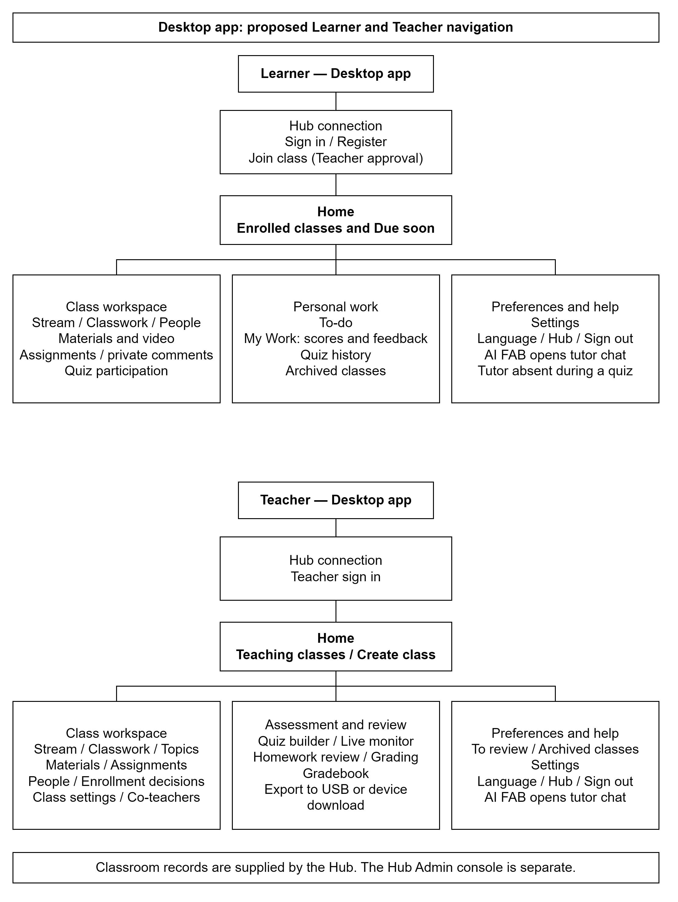

# 3.2.1.5 Sitemap: Desktop App

The proposed Desktop app provides role-based navigation for Learners and Teachers. Both roles use the same classroom services as the Mobile app, while the desktop layout uses a navigation drawer and a main content sheet. Figure 3.x presents the proposed navigation as two top-down trees. The figure describes the intended design and does not classify screens by implementation progress.

*Figure 3.x. Proposed Learner and Teacher navigation trees for the Desktop app.*

**Learner navigation.** Hub connection and account access lead to the Learner Home. Connection supports nearby-Hub discovery and manual address entry. First-time Learners register and request class access using a Teacher-provided class code; pending enrollment requires Teacher approval. A previously signed-in Learner can reopen the locally saved classroom view when the Hub is unavailable.

Home provides enrolled classes, upcoming work and links to To-do and archived classes. Selecting a class opens its workspace. Stream contains announcements and permitted class comments. Classwork groups materials, assignments and quizzes by topic. Materials provide handout and video access, with downloaded resources available for home study. Assignment details provide instructions, file submission and private comments with the Teacher. People displays the class participants within the access permitted to the Learner. My Work provides scores, feedback and quiz history; To-do organizes outstanding activities.

The quiz interface presents the questions, progress and countdown. It preserves answers during interruption and submits completed work through the supported synchronization path. Tutor controls and chat are removed while a quiz attempt is active. Outside an active attempt, the AI floating action button opens tutor chat for questions grounded in the lesson. Settings provides language selection, Hub connection information and sign-out with protection for unsynchronized work.

**Teacher navigation.** Teacher Home provides teaching classes, class creation, work awaiting review and archived classes. The class workspace provides Stream, Classwork, People, Grades and class settings. Stream supports announcement authoring and comment moderation. Classwork supports topics, materials and assignments; People supports enrollment decisions and learner removal without deleting historical scores. Owner-only class settings cover renaming, archiving and co-teacher management.

Assessment functions provide quiz preparation, start/close controls and the live submission monitor. Homework review provides the submitted file, manual grading, feedback and private comments. The gradebook displays points for assignments and quizzes. A class record can be exported in the supported format either to USB storage connected to the Hub or as a download to the Teacher's device. Settings provides the same language and connection preferences as the Learner interface. The Hub Admin console remains outside the Desktop app sitemap.
