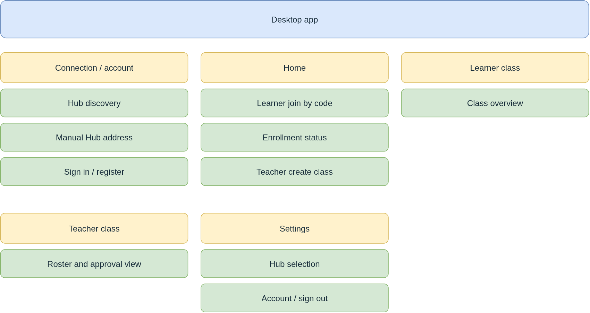

# 3.2.1.5 Sitemap: Desktop App

The sitemap follows the screens and dialogs routed by the current Desktop app. The app discovers or accepts a Hub address, then provides account access and role-specific class actions. Its current classroom destinations are narrower than the full product contract and are represented accordingly.

*Figure 3.x. Hierarchical sitemap of the current Desktop app screens, dialogs and role-based class destinations.*

The shared entry flow provides Hub discovery, manual address entry, sign-in and Learner registration. Learners can request a class by code and see enrollment status on Home; Teachers can create a class and open its roster to review enrollment requests. Selecting a Teacher's class opens the current roster view, while selecting a Learner's class opens the current class overview. Settings provides Hub selection, account information and sign-out controls. The current Desktop UI does not yet expose the full set of contracted stream, classwork, quiz, gradebook, export or tutor screens; those functions are not drawn as implemented pages.
