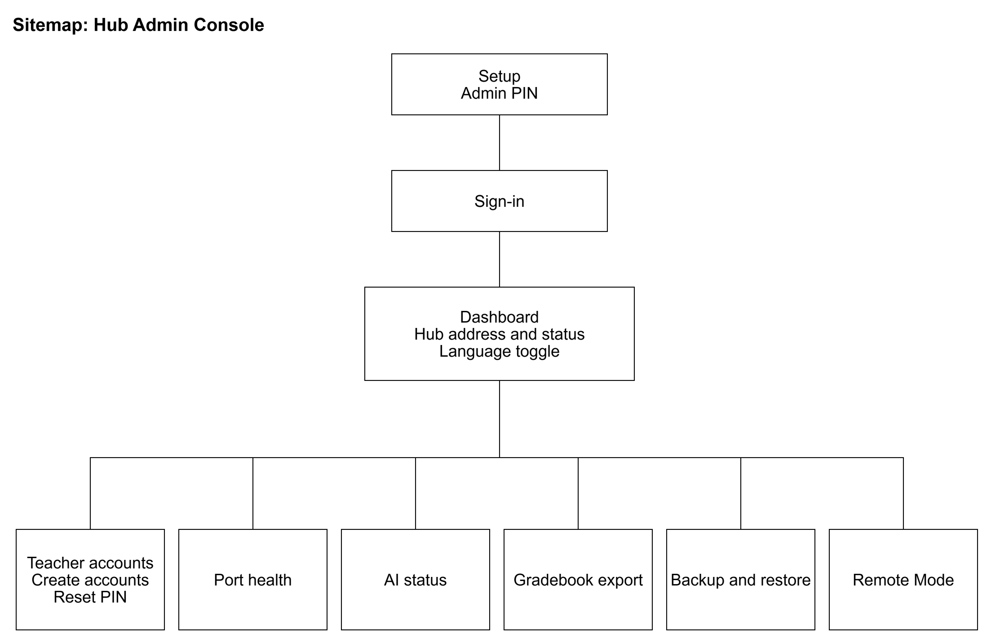

# 3.2.1.5 Sitemap: Hub Admin Console

The sitemap presents the proposed navigation of the Hub Admin console. First-run setup establishes the single Admin account and its PIN. Sign-in then provides access to the Dashboard and the Hub's administrative functions.

*Figure 3.x. Sitemap of the proposed Hub Admin console.*

The Dashboard displays the Hub address and status and provides a language toggle. Its destinations are Teacher accounts, Port health, AI status, Gradebook export, Backup and restore, and Remote Mode. Teacher accounts supports account creation and PIN reset. Port health supports classroom-network checks, while AI status identifies the availability of the optional tutor. Gradebook export provides spreadsheet or comma-separated files. Backup and restore manages the Hub's saved archive, and Remote Mode enables or disables the Hub's opt-in remote transport. The Admin uses the same protected console to manage these functions.
