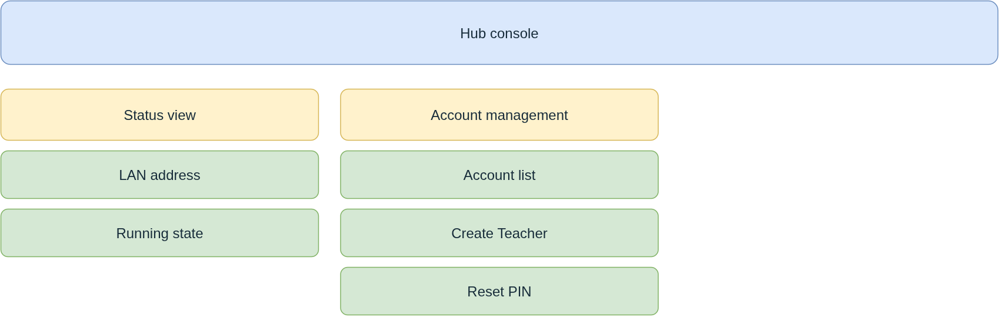

# 3.2.1.5 Sitemap: Hub Admin Console

The sitemap follows the current Hub window UI. The main screen displays the Hub's local address and running state, then provides the account-management panel. The panel supports account listing, teacher creation and PIN reset. The contract defines additional Hub operations, but a corresponding navigation screen is not present in the current window code and is therefore not represented as an implemented destination.

*Figure 3.x. Hierarchical sitemap of the current Hub window status and account-management screens.*

The Hub window currently exposes the local address and service running state and embeds the account-management view. Port-health detail, backup and restoration, class-record export, and Remote/Suspension Mode configuration are product and contract responsibilities but do not appear as screens in the current Hub UI. The Hub account remains separate from Teacher and Learner access clients.
