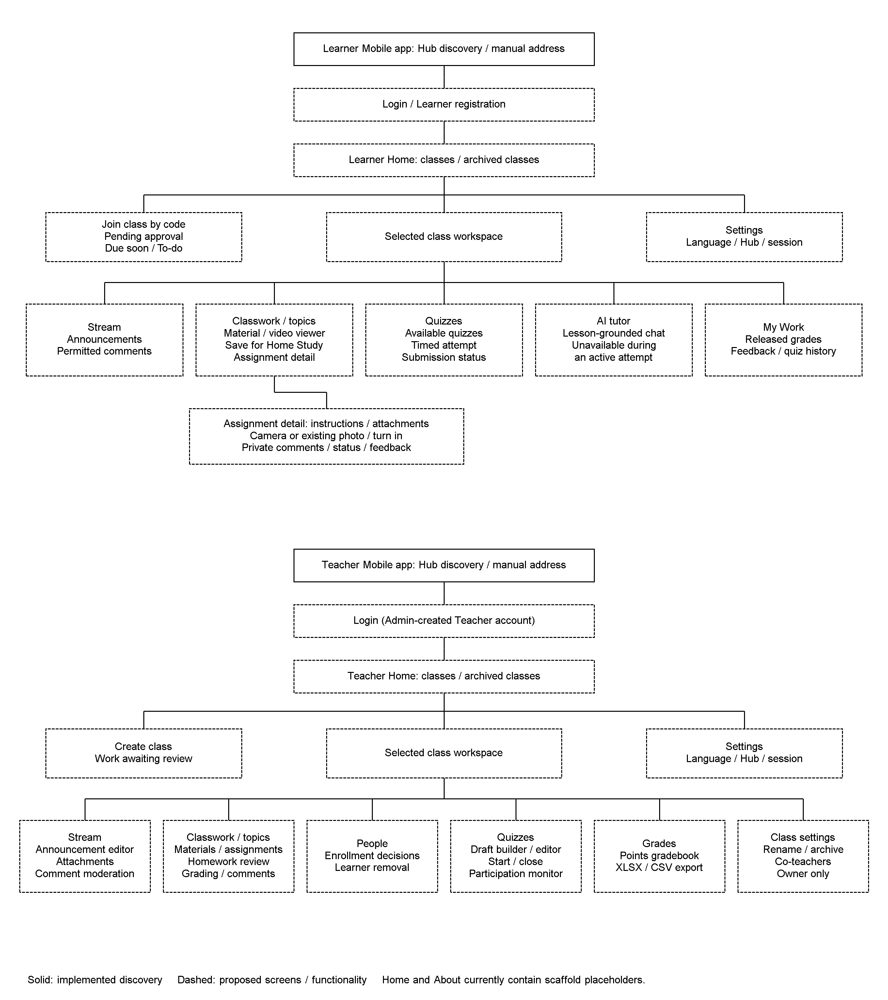

# 3.2.1.5 Sitemap: Mobile App

The Mobile app provides separate proposed navigation trees for the Learner and Teacher. Figure 3.x combines the navigation present on the documentation branch with the classroom screens required by the PRD. It distinguishes implemented navigation from planned screens rather than presenting the proposed system as a completed application.

*Figure 3.x. Top-down Learner and Teacher navigation trees for the Mobile app. Solid borders identify the implemented Hub discovery screen; dashed borders identify proposed screens or classroom functionality not yet implemented on this branch.*

**Implementation boundary.** The current `LaraNavigation.kt` declares Discovery, Home and About routes. Discovery is the startup destination and provides nearby-Hub discovery and manual address entry. Home and About are scaffold placeholders, not the Learner Home or Teacher Home represented in the figure. The role-specific Home screens are therefore dashed. The scaffold About page is not a classroom destination and is omitted from the proposed role trees. Separate `StudentNavGraph` and `TeacherNavGraph` implementations are specified in the Mobile technical specification but are not present on this branch. The repeated discovery node denotes the same shared connection screen, not two implementations. Grouped lines within a node identify related destinations or actions, not additional existing routes.

**Learner navigation.** Hub connection leads to account access. A first-time Learner registers with the required identity details and PIN, then signs in; a returning Learner uses the existing account. Home provides enrolled classes, Due soon, To-do, class-code entry and the pending-approval view. Class access remains subject to Teacher approval. A previously authenticated Learner can reopen locally saved classroom content without reconnecting to the Hub; connection and login are not mandatory steps for every offline launch.

Selecting a class opens its workspace. Stream provides announcements and permitted comments. Classwork organizes materials, assignments and quizzes under topics. A material opens a handout or video viewer and provides Save for Home Study. Assignment detail provides instructions, attachments, camera capture or an existing photo, submission status, private comments and returned feedback. To-do lists outstanding work. My Work and quiz history show only the Learner's own released scores and feedback.

Quizzes provides available assessments, a timed attempt and the resulting submission status. An attempt begun while connected can continue after disconnection; answers and completion are retained locally for synchronization. The AI tutor destination is available only outside an `IN_PROGRESS` attempt. During such an attempt, its controls and chat are not composed, and the Hub also rejects requests with `QUIZ_IN_PROGRESS`. Outside lockout, tutor access remains subject to model availability and lesson grounding. Phones below 6 GB RAM use the Hub; a local model on eligible phones is optional.

**Teacher navigation.** Teachers sign in using accounts created by the Admin. Home provides teaching classes, class creation and archived classes. The class workspace provides Stream, Classwork, People, Quizzes, Grades and class settings. Stream supports announcement authoring, attachments and comment moderation. Classwork supports topic, material and assignment management, homework review, points, feedback and private comments. People provides pending enrollment approval or decline and Learner removal while retaining historical scores. Owner-only settings provide renaming, archiving and co-teacher management.

Quizzes provides draft authoring, editing, start and close controls and participation monitoring. Grades provides a points-based gradebook and class-record export in XLSX or CSV format. Teachers have the same classroom features on the phone as on the Desktop app; the phone layout presents dense tables as cards. The export contract permits a download to the Teacher's device when `target_path` is omitted. USB writing occurs through the Hub workflow; the figure does not invent a phone interface for listing Hub drives. The Mobile technical specification's prohibition on phone export is outdated relative to this contract and is retained as a review discrepancy rather than applied as a product restriction.

**Shared navigation and disconnected operation.** Settings provides language selection, Hub connection information and session controls. The phone uses a top app bar and one column of cards, with class navigation within thumb reach. The tree represents containment and access to functions rather than prescribing that every destination be a bottom-navigation item. Hub administration, Teacher-account creation, backup, restore and Remote/Suspension Mode configuration remain outside the Mobile app. A saved remote Hub address is a connection fallback after LAN discovery fails; it does not create another role or another classroom tree.

Screens that read classroom information use the local mirror, with loading, empty and disconnected states. Cached materials and downloaded videos remain readable at home. Supported homework, private-comment and completed-quiz writes are retained as `QUEUED_FOR_SYNC`; actions requiring an available Hub show an explanation instead of reporting success. The dashed destinations are design scope, not evidence that these persistence and recovery paths are implemented.

**Project source notes.** The implementation baseline is [Mobile navigation](../../../mobile/app/src/main/java/org/lara/app/ui/navigation/LaraNavigation.kt) and the [Mobile README](../../../mobile/README.md). Proposed destinations follow [PRD Sections 4 and 5](../../PRD.md), [design-system Sections 9.12 and 9.13](../../../design-system/design-system.md#912-phones), [Mobile technical specification](../../../mobile/docs/TECH_SPEC.md) and [OpenAPI](../../../contracts/openapi.yaml), particularly `POST /api/export/class-record`. The editable figure is [sitemap-mobile.drawio](diagrams/sitemap-mobile.drawio).
