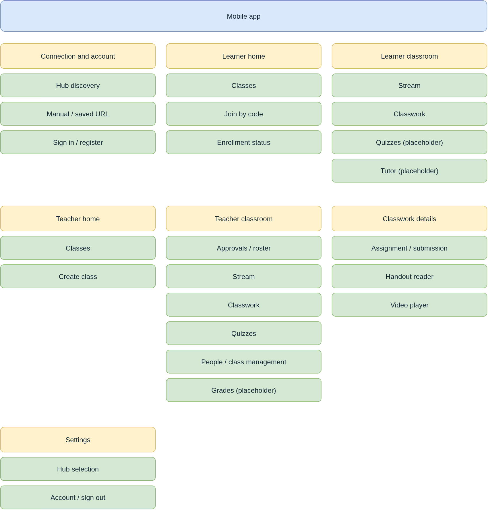

# 3.2.1.5 Sitemap: Mobile App

The sitemap follows the destinations currently connected by the Android navigation and screen hosts. The application begins at Hub discovery and account access, then routes by role. It includes both completed screen surfaces and navigation destinations whose current content is a placeholder; the latter are labelled in the figure so that a route is not mistaken for a completed feature.

*Figure 3.x. Hierarchical sitemap of the current Mobile app navigation and its Learner and Teacher destinations.*

The Learner path includes sign-in or registration, class enrollment, class selection and the classroom Stream and Classwork views. Classwork opens an assignment submission view, a handout reader or a video player. The Teacher path includes class creation and the class roster/approval panel, followed by the shared classroom navigation. Quiz, tutor and grade destinations are present in the classroom navigation code, but the current shell renders placeholder content for those destinations. Teacher People opens the class-management view. Settings provides Hub selection and account/session controls. The app uses English-only interface strings and Hub-hosted tutor access; there is no local-model path or language selector.
