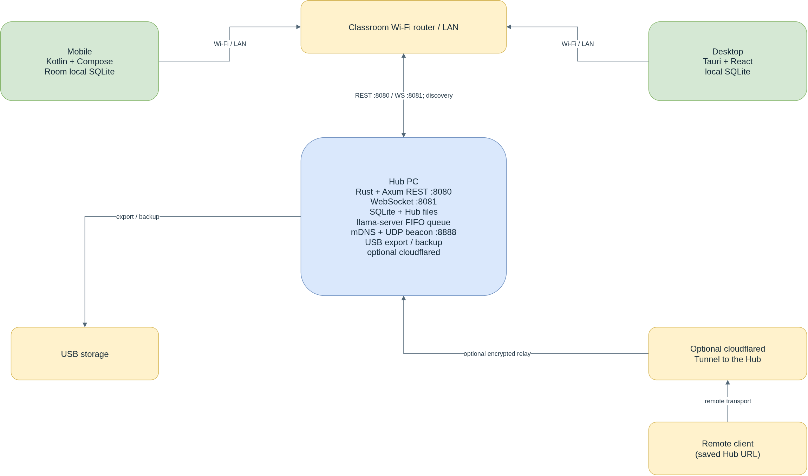

# 3.2.1.6 System Architecture

The system architecture places the Hub on a dedicated school PC and connects Mobile and Desktop clients through the classroom router. The Hub runs the Rust services, SQLite master database, managed files, discovery services, and optional inference queue. Android clients use Kotlin, Jetpack Compose and Room. Desktop clients use Tauri, React and local SQLite. Optional Remote/Suspension Mode adds a Cloudflare Tunnel path to the same Hub; ordinary classroom operation remains on the LAN.

*Figure 3.x. System architecture showing the Hub, offline-first clients, classroom LAN, local export target and optional remote transport.*

| Component | Main implementation | Responsibility |
|---|---|---|
| Hub PC | Tauri 2 window; Rust, Axum and Tokio services | Runs the Hub and its local Admin console. The Hub is the authoritative server for accounts, classes and classroom records. |
| REST and file service | Axum on TCP port 8080 | Handles contract REST requests, downloads, homework file transfer and HTTP byte-range video streaming. |
| WebSocket service | Tokio WebSocket broker on TCP port 8081 | Carries contracted real-time events and the streamed tutor response. |
| Hub persistence and files | SQLx with SQLite; Hub-managed file storage | Stores the master schema, database records and uploaded classroom files. |
| Hub discovery | mDNS `_lara._tcp.local` and UDP beacon on port 8888 | Announces the Hub on the classroom LAN. A client can also use a manually entered address. |
| Hub tutor service | `llama-server` managed by the Hub with a bounded FIFO queue | Runs optional lesson-grounded inference on the Hub; clients do not download or run the model. Final model selection depends on the required evaluation. |
| Mobile client | Kotlin, Jetpack Compose, Room and Android networking | Provides Learner and Teacher classroom access with account-scoped local persistence and queued work. |
| Desktop client | Tauri 2, React 19, TypeScript and `@tauri-apps/plugin-sql` | Provides Learner and Teacher classroom access with local SQLite persistence. |
| Classroom network | Wi-Fi router and Hub Ethernet connection | Carries local client traffic and discovery without requiring an external network connection. |
| USB storage | Mounted removable drive | Receives class-record exports and Hub backup archives; may provide a backup archive for restoration. |
| Optional Cloudflare Tunnel | Hub-managed `cloudflared` process | Relays the Hub's own REST and WebSocket traffic when an Admin explicitly enables Remote/Suspension Mode. |

*Table 3.x. System components and their principal responsibilities.*

The architecture separates persistent data from access clients: the Hub's SQLite database is authoritative, while Mobile and Desktop databases hold account-scoped offline mirrors. A client can continue reading cached material when the Hub is unreachable. Supported writes remain queued until a Hub receipt is received. Discovery is limited to the LAN; the saved remote address is used only as a fallback when LAN discovery does not find the Hub.
