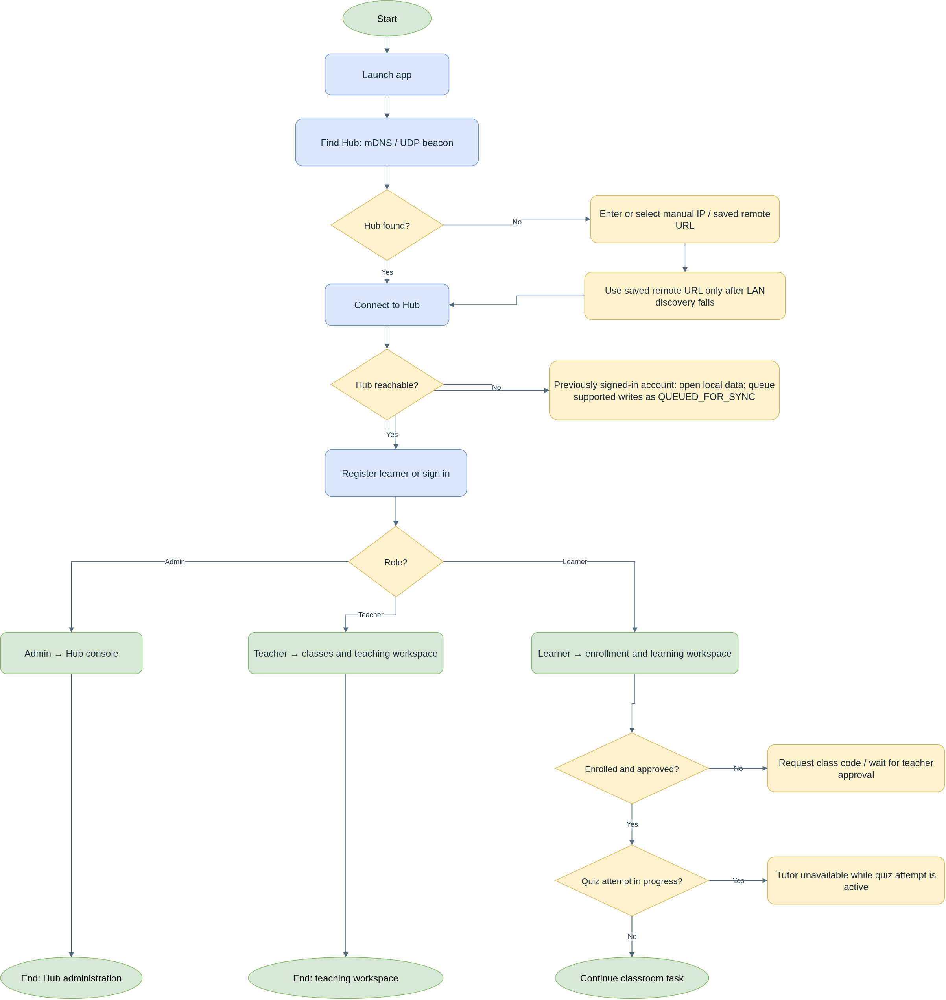

# 3.2.1.7 System Flowchart

The flowchart follows one user from application launch through Hub discovery, account access and role-specific routing. Rounded terminators mark the beginning and completion of the flow, rectangles show actions, and diamonds show decisions. A disconnected client can open locally stored information and queue supported work; operations requiring the Hub wait until a connection is available.

*Figure 3.x. System flowchart of Hub discovery, account access, role routing, enrollment checks, offline behavior and quiz tutor lockout.*

The client first checks LAN discovery through mDNS and the UDP beacon. If discovery does not find the Hub, the user can enter a manual address or select a saved remote Hub URL. A saved remote URL is a fallback after LAN discovery failure. When the Hub is unreachable, a previously signed-in account can open its local database; supported writes are marked `QUEUED_FOR_SYNC` for later delivery. New registration and sign-in require the Hub.

After account access, the client routes the Admin to the Hub console, the Teacher to classroom management, or the Learner to classroom enrollment and learning. A Learner without an active enrollment requests access by class code and waits for Teacher approval. Once an attempt is `IN_PROGRESS`, tutor access is unavailable until that attempt is submitted or closed. This restriction is enforced in the client interface and by the Hub.
