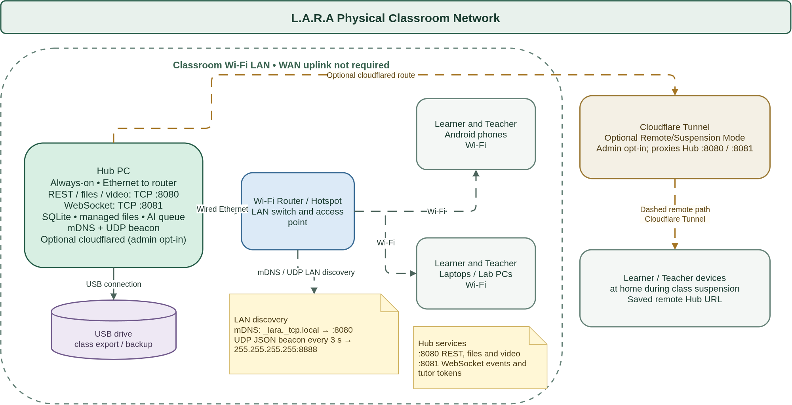

# 3.2.1.9 Network Diagram

*Figure 3.x. Physical classroom network showing the wired Hub, Wi-Fi clients, local discovery, USB storage and optional remote tunnel.*

The Hub PC connects to the classroom Wi-Fi router or hotspot by Ethernet and serves clients over the local network without requiring a WAN uplink. Learner and Teacher phones and computers connect by Wi-Fi. The optional Cloudflare Tunnel is enabled on the Hub for Remote/Suspension Mode and provides a dashed path to devices at home during class suspension.

See [System Architecture](3.2.1.6-system-architecture.md) for the software components and their responsibilities.
