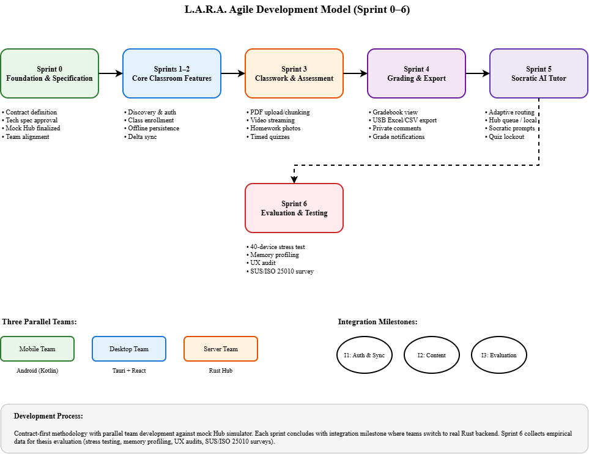

# 3.1.1 Research Design

This study employs a descriptive-developmental research approach to design, implement, and evaluate the L.A.R.A. (Localized Augmented Resource & Assessment) offline classroom management system. [ASK LEAD: Confirm the required research design terminology and adviser expectations for the research type classification.] The research is developmental in that it involves the systematic creation of a functional software system addressing the connectivity constraints faced by Philippine public schools. It is descriptive in that it documents and evaluates the system's technical performance, usability, and pedagogical effectiveness through structured data collection methods detailed in sections 3.1.2 and 3.1.3.

The study follows an Agile development methodology adapted for academic software engineering. The development model, illustrated in Figure 3.x, organizes work into six time-boxed sprints, each culminating in an integration milestone where the three parallel development teams synchronize their work. This iterative approach enables continuous refinement based on technical constraints discovered during implementation, particularly concerning offline-first architecture, memory limitations on budget Android devices, and local area network performance under classroom conditions.

**Figure 3.x.** Agile development model showing six sprints from contract definition through field evaluation, with parallel mobile, desktop, and server teams converging at integration points.

## Development Phases

**Sprint 0: Foundation and Specification** establishes the technical contracts that define the interfaces between the three client-server components. During this phase, the development teams produce detailed technical specifications documenting architectural decisions, technology stack selections, and file organization conventions. The sprint concludes when the OpenAPI REST specification, WebSocket event schemas, SQLite database schemas, and all three team technical specifications receive Lead Developer approval. The mock Hub simulator (`scripts/mock_hub.py`) is finalized to serve as the acceptance reference for subsequent client development.

**Sprints 1 and 2: Core Classroom Features** implement the foundational learner and teacher workflows: network discovery via mDNS and UDP broadcast, bearer-token authentication, class creation and code-based enrollment with manual teacher approval, offline-first data persistence using local SQLite mirrors, and delta synchronization using a monotonically increasing sequence cursor. The mobile and desktop clients are developed against the mock Hub to enable parallel work streams. Integration occurs when clients successfully authenticate, join classes, and synchronize announcements against the real Rust backend running on the Hub PC.

**Sprint 3: Classwork and Assessment** adds the pedagogical content delivery and formative assessment features: teacher upload and chunking of PDF handouts, HTTP Range-based video streaming with per-client bandwidth limiting, camera-based homework photo submission with offline queueing, and the synchronized timed quiz engine with live countdowns, instant auto-grading, and strict anti-cheating lockouts. Integration validates that 40 concurrent learners can stream video and submit work without router saturation.

**Sprint 4: Grading and Data Export** implements the teacher gradebook view and one-click Excel and CSV export to USB flash drives, enabling direct transfer to school record-keeping systems without internet-dependent cloud storage. Private commenting on assignments and real-time grade notifications via WebSocket complete the feedback loop between teachers and learners.

**Sprint 5: Socratic AI Tutor** integrates the Small Language Model inference engine with adaptive routing based on device capabilities. Learners on phones with less than 6 GB RAM use the Hub's `llama-server` queue, while capable devices run the quantized GGUF model locally via `llama.cpp`. The Socratic system prompt is loaded identically across all execution paths to ensure consistent pedagogical behavior: the tutor provides one guiding clue and one leading question at a time, grounded strictly in the teacher's uploaded lesson chunks, without revealing final answers. Hard lockout enforcement prevents AI access during active quiz attempts.

**Sprint 6: Evaluation and Stress Testing** collects the empirical data required for thesis defense. The server team simulates 40 concurrent connected devices on a classroom Wi-Fi router to measure quiz synchronization accuracy and video streaming stability. The mobile team profiles memory consumption and battery drain on representative 3 GB and 4 GB Transsion and realme phones. The desktop team audits click target sizes, color contrast ratios, and loading skeleton implementations against accessibility guidelines. The QA Lead conducts an end-to-end offline audit with the WAN cable physically unplugged, and administers the System Usability Scale and ISO/IEC 25010 quality questionnaires to participating teachers and learners at the pilot school.

[CONFIRM WITH MOBILE: The research design described above must align with Mobile team's sections 3.1.2 (Data Gathering Technique) and 3.1.3 (Population and Sample Size). Coordinate the research approach, evaluation instruments, and respondent descriptions to ensure consistency across all Chapter III documentation.]

This phased development model balances the academic requirement for rigorous documentation with the practical need for iterative problem-solving in a system with novel constraints: zero internet dependency, budget hardware compatibility, and Socratic AI pedagogy for Grades 1 through 12.
