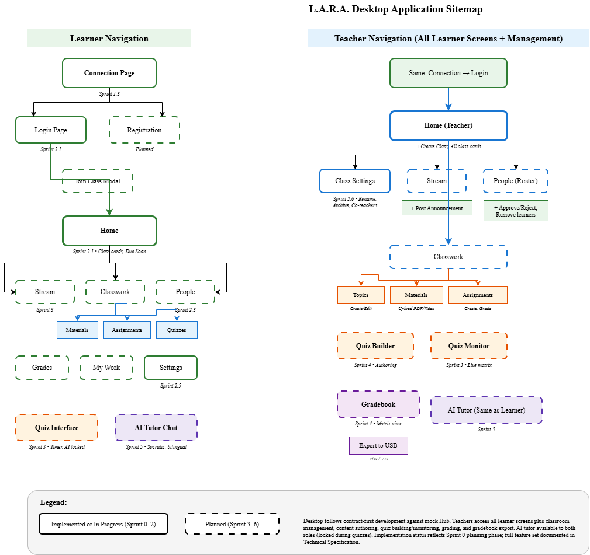

# 3.2.1.5 Sitemap — Desktop Application

The L.A.R.A. desktop client provides parallel navigation hierarchies for learners and teachers, implemented as a cross-platform Tauri application with React frontend. The application architecture supports both student laptop and teacher desktop usage scenarios, with teacher accounts accessing an expanded feature set for classroom management, content authoring, and assessment administration. The sitemap diagrams below document the complete planned navigation structure based on the product requirements and technical specifications, with implementation status indicated for features under active development.

**Figure 3.x.** Desktop application navigation hierarchy showing separate learner and teacher flows. Screens outlined with dashed borders indicate planned features not yet implemented in Sprint 0; solid borders indicate screens with functional prototypes or completed implementations.

## Learner Navigation Structure

The learner navigation follows a drawer-and-sheet layout pattern where the persistent left navigation drawer provides access to primary views, and the main content sheet displays contextual tabs and detail screens.

**Connection and Authentication.** Upon launch, learners without a saved Hub connection reach the Connection Page, which provides mDNS/UDP automatic discovery of available Hubs on the local network, manual IP address entry for fallback connectivity, and Hub status indicators showing online/offline state. After selecting a Hub, learners proceed to the Login Page for authentication using their 12-digit LRN and 4-digit PIN, or to the Registration Page for first-time self-enrollment. The Join Class Modal allows entry of the 6-character class code, after which the learner enters a pending approval state until a teacher accepts the request.

**Home.** The Home page serves as the primary dashboard, displaying cards for all enrolled classes with visual indicators for unread announcements and approaching due dates. A "Due Soon" widget highlights upcoming assignment and quiz deadlines ordered by proximity. Tapping a class card navigates to that class's Stream view.

**Stream.** The Stream displays the chronological announcement feed for the selected class, including teacher posts with optional file attachments and toggled comment threads. Learners can read announcements offline from the local SQLite cache and compose comments that queue for synchronization when the Hub is reachable.

**Classwork.** The Classwork view organizes course content hierarchically by teacher-defined topics. Learners navigate through topics to access three content types: Materials (PDF handouts, images, embedded videos with streaming or download-for-offline options), Assignments (instructions, due dates, submission status, and camera or file upload controls for homework photos), and Quizzes (scheduled assessments, past attempts, and score history). The Private Comments thread within each assignment enables one-on-one teacher-learner discussion invisible to classmates.

**People.** The People page lists the class roster showing the teacher and all enrolled learners, with visual presence indicators during active sessions.

**Grades.** The Grades view presents the learner's personal gradebook as a table of assignments and quizzes with earned points, maximum possible points, and submission status. Late submissions and pending work are visually distinguished. Scores are read from the local mirror and remain accessible offline.

**My Work.** The My Work page aggregates the learner's incomplete assignments and quizzes across all enrolled classes, sorted by due date, providing a unified to-do list derived from locally cached class data.

**Settings.** The Settings page provides controls for language toggle (English ↔ Filipino), Hub connection preferences, theme selection, and account sign-out with warning about unsynchronized queued work.

**Quiz Taking Interface.** When a learner begins a quiz, the application enters a full-screen focused mode displaying the countdown timer with color-coded urgency (green, yellow at 5 minutes remaining, red and pulsing at 2 minutes), question cards with large 56px tap targets for multiple-choice options, and a progress indicator. The AI tutor floating action button is completely removed from the interface during the quiz session to enforce the anti-cheating lockout. Auto-submission occurs at timer expiration or upon explicit learner submission.

**AI Tutor Chat.** The AI tutor is accessible via a floating action button present throughout the application (except during active quizzes). Tapping the button opens a split-view drawer where the left pane displays the current lesson material and the right pane contains the chat interface. The tutor responds in the learner's selected language (English or Filipino) with Socratic guiding questions grounded in the teacher's uploaded lesson chunks, executing either via the Hub's `llama-server` queue or on-device via the `llama.cpp` sidecar if the laptop has sufficient RAM and the model is downloaded.

## Teacher Navigation Structure

Teachers access the complete learner feature set plus additional classroom management, authoring, grading, and administrative capabilities. The teacher navigation drawer includes all learner screens plus teacher-specific views.

**Class Creation and Management.** Teachers create new classroom sections from the Home page, generating unique 6-character class codes automatically. The Class Settings page (accessible via a gear icon on the class card or stream header) provides controls for renaming the class, archiving it at year-end, adding co-teacher collaborators by teacher ID, and removing learners while preserving their historical scores.

**Roster Approval.** The People page includes a Pending Requests section where teachers review learner join requests, viewing the learner's name and LRN before approving or declining access. Real-time WebSocket events notify teachers of new requests without requiring manual refresh.

**Content Authoring.** Teachers create Announcements from the Stream view, with rich text editing, file attachments, and comment moderation toggles. In the Classwork view, teachers author Materials by uploading PDF documents (which the Hub automatically chunks for AI grounding), images, and MP4 videos (up to 250 MB, served via HTTP Range for instant seeking). Assignment creation includes title, instructions, due date, maximum points, and optional file attachments. The Topic Management interface allows teachers to organize classwork into collapsible sections.

**Quiz Builder.** The Quiz Builder (planned implementation, not yet built) provides a form-based interface for creating assessments with configurable title, instructions, and global time limit. Teachers define questions in three types: Multiple Choice (single answer, up to 4 options, optional question image), True or False, and Identification (case-insensitive keyword matching). Options include question order shuffling and score visibility control (immediate release or held until quiz closure).

**Quiz Monitor.** When a teacher starts a quiz, the Quiz Monitor view (planned implementation) displays a live matrix of participating learners with status indicators (Not Started, Answering, Submitted) and real-time presence updates via WebSocket. Teachers can manually close the quiz to release held scores and end the time limit.

**Grading Interface.** Teachers navigate to individual learner submissions from the assignment detail view, where they review uploaded homework photos, assign point values, and write short feedback comments. The grading interface remains accessible offline, with grade assignments queuing for synchronization.

**Gradebook.** The Gradebook view presents a spreadsheet-style matrix with learners as rows and assignments/quizzes as columns, displaying earned points and maximum possible points in each cell. The One-Click Export function generates Excel (.xlsx) and CSV files directly to a connected USB flash drive, formatted for immediate import into school record-keeping systems.

## Implementation Status Notes

The desktop client is currently in Sprint 0 (technical specification phase), with the navigation shell, offline SQLite schema, and type-safe service layer under active development. The following screens have functional prototypes or implementation plans documented in the technical specification:

- **Implemented or In Progress (Sprint 0–2):** Connection Page, Login Page, Registration Page, Home, Settings, and foundational synchronization engine.
- **Planned (Sprint 3–4):** Stream with comments, Classwork tabs, Assignment submission and grading, Quiz taking and monitoring interfaces.
- **Planned (Sprint 5):** AI Tutor chat drawer with dual-mode inference routing.
- **Planned (Sprint 6):** Gradebook export, accessibility audit, and production optimization.

Screens outlined with dashed borders in Figure 3.x represent planned features with detailed technical specifications and contract definitions, but not yet visible in the user interface. The desktop team follows a strict contract-first development methodology, building all features against the mock Hub simulator (`scripts/mock_hub.py`) before switching to the real Rust backend during integration milestones. This approach ensures that the sitemap accurately reflects the system's ultimate capability while acknowledging the phased implementation timeline inherent to academic software engineering projects.
