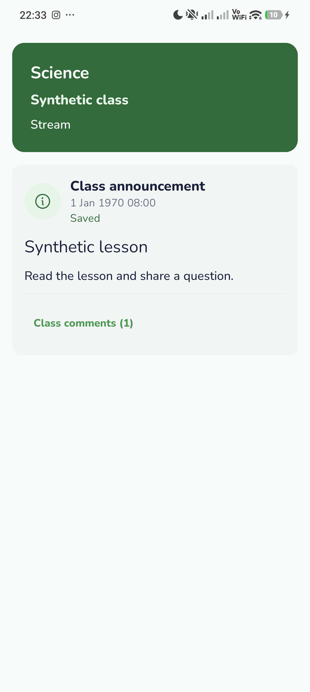
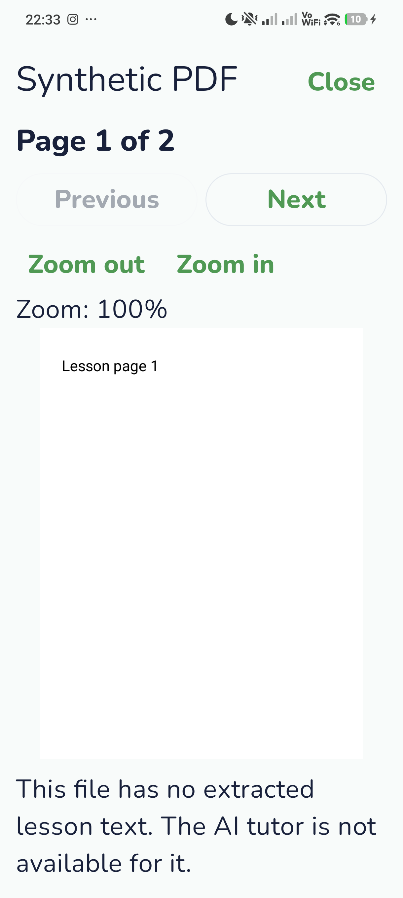
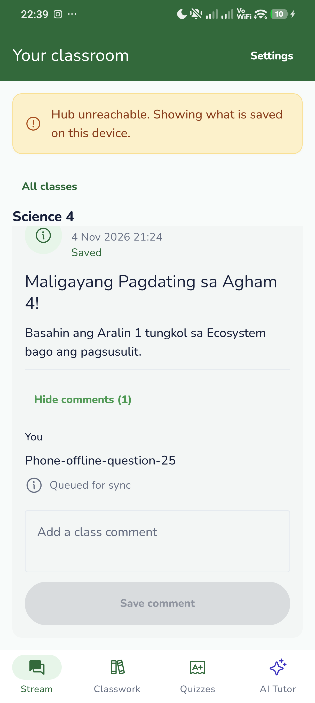

# MOBILE 3.1 final verification

Branch: `codex/25-mobile-3.1-stream-reader`, from staging `7444312` including merged #231. Earlier MOBILE Sprint 0–2 files/dependencies were inspected; see [stream-reader.md](../../stream-reader.md).

## Final automated results

- `gradlew.bat --max-workers=2 test lint assembleDebug assembleDebugAndroidTest`, with `LARA_SYNC_MOCK=1`, `LARA_APPROVAL_MOCK=1`, `LARA_SETTINGS_MOCK=1`: **BUILD SUCCESSFUL in 2m38s**, **146 tests per Debug/Release variant**, no failures/errors/skips.
- Lint: zero errors, 24 existing warnings. Shared contract/mock tests: 66 passed. Offline invariants passed again after the final fix.
- Six file/comment regressions cover fresh HubEndpoint objects on every address reload, offline cache reopening, refused redirects, oversize/truncated transfers, renamed-file retention, tombstone cleanup and disabled comments.
- Windows JVM testing uses the normal app ID. The longer isolated phone ID caused file-backed SQLite-open errors; every case remains enabled and passes under the normal package.

## Final physical-phone results — 2026-11-04

Xiaomi 2311DRK48G, separate `org.lara.app.sprint31reading`; original `org.lara.app` was not replaced, cleared or uninstalled.

Final instrumentation: **OK (2 tests), 20.437s**. These two scenario groups exercise native bounded PDF/image decoding, corrupt-PDF failure, actual Stream/Classwork components, first-name-only peer display, offline queued comments, two PDF pages, zoom buttons, a real injected two-finger pinch (150% to about 382%), sampled images, DOCX Room chunks, loading/empty states and 200% text. Valid PDF/image files and DOCX chunks are local synthetic fixtures; they are not described as shared-mock binary downloads.

Full learner flow against the unmodified shared mock: sign in, open approved class, read Stream and Classwork, download the mock handout, close/reopen it, and display extracted text when native PDF parsing rejects the mock placeholder. Live verification found and fixed an address-object identity comparison: HubEndpointStore reloads equivalent but distinct address objects, so download completion now compares session and REST address values. The regression test also reloads a fresh endpoint each time.

The real learner UI saved `Phone-offline-question-25` with USB routes removed and showed **Queued for sync**. Restoring the routes delivered it automatically, changed the badge to **Saved**, and a teacher-session comments GET confirmed exactly one matching row. The phone was at 9–10% battery: the existing battery-not-low constraint correctly deferred WorkManager. Android's reported battery was briefly set to 100% to satisfy that constraint, then `dumpsys battery reset` restored real reporting. No production constraint was changed.

With routes removed again, force-stop/cold launch opened the cached learner session and class. Classwork still showed **Saved on this device**; the downloaded placeholder and extracted lesson text reopened offline without a blocking dialog. Teacher sign-in also reached Stream and Classwork through the existing shell and saved-class selector.

Temporary battery reporting, USB stay-awake and forwarding routes were restored. Font size/system locale were not changed in this run; 200% screenshots use the test composition's density override. Screenshots were inspected for layout and synthetic data only. The test app remains installed.

## Evidence map

- `full-checks.txt`, `test-counts.txt`, `address-regressions.txt`, `shared-checks.txt`, `invariants.txt`: final automated output.
- `device-tests.txt`: final phone scenario output; `initial-device-tests.txt` is explicitly historical.
- `final-phone-build.txt`: isolated APK build after the address fix.
- `live-reconnect.txt`: teacher-side exactly-once assertion.
- `stream.png`, `queued-comment.png`, `classwork.png`, `*-200-*.png`, `pdf-*.png`, `image-zoom.png`, `docx-text.png`, `empty-*.png`, `loading.png`: production components with synthetic local fixtures.
- `live-mock-pdf-fallback.png`, `live-offline-queued.png`, `live-reconnected-saved.png`, `live-cold-offline-*.png`, `teacher-*.png`: full app against the unchanged mock, including offline/cold-launch evidence.

## Shared limits and remaining integration coverage

1. Announcements have no author ID in the contract. The screen uses a neutral class icon and **Class announcement** source instead of inventing the posting teacher. Actual author avatars need a Lead-owned contract change.
2. The shared mock returns a non-renderable `%PDF-1.4 mock lesson handout` placeholder for every material download. Valid binary rendering against that unchanged mock cannot be claimed; native valid-file fixtures pass and the real mock fails kindly into cached chunks.
3. Binary files download when opened. Sync alone caches metadata/chunks, not every file's bytes. File cache is account-private and persists across metadata renames; deleted files are pruned only after successful sync commits.
4. Real Rust Hub integration, a physical WAN-disconnected router, low-RAM/vendor battery certification and an exhaustive TalkBack audit are not claimed by these USB/mock tests.

