# #266 Group 3 evidence

Part of #266. Captured on 10 November 2026 using a USB-connected Infinix X6731, Android 14. All L.A.R.A images are unedited physical-phone screenshots with synthetic accounts. The separate `org.lara.app.group3` package preserved the user's installed app and data. Reference images are the repository's genuine Classroom screenshots; they were inspected directly, not recreated.

BEFORE is untouched `staging` `0199e34`, rebuilt in a detached worktree. AFTER is that base plus the uncommitted Group 3 changes. [Source/APK hashes](source-manifest.txt) identify the tested files. These captures precede the publication commit; publication was subsequently authorized as a draft PR only.

The [review-fix evidence](review-fixes/README.md) supersedes the original two-line 200% tab labels and purple locked-Tutor captures below. Original captures remain as historical evidence.

## Reference / BEFORE / AFTER

The populated AFTER examples use the mock Hub. The [real-Hub folder](after/realhub) separately shows the existing routes on the actual Rust Hub built from `staging`; that fresh Hub has no posted classwork.

| Screen | Classroom reference | BEFORE | AFTER |
| --- | --- | --- | --- |
| Learner Stream/banner |  | 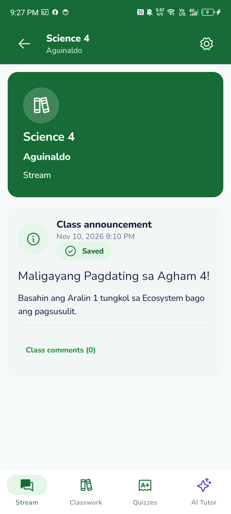 | 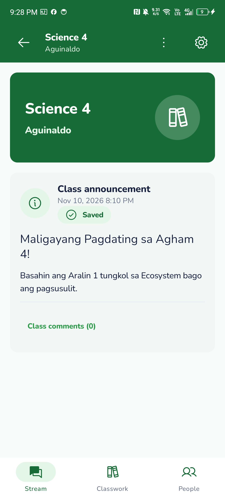 |
| Learner Classwork |  | 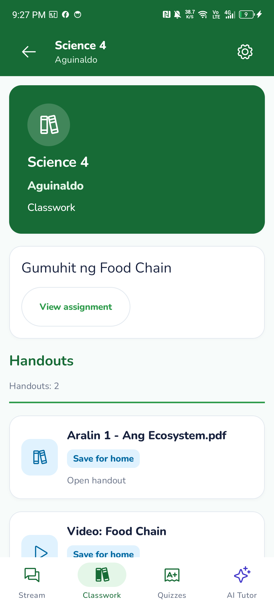 | 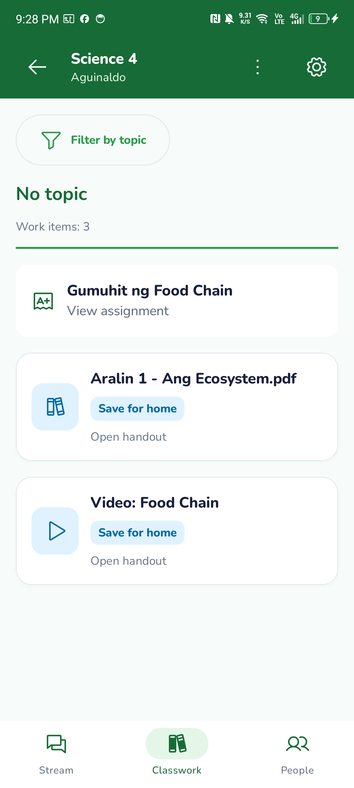 |
| Learner People |  | No learner People destination existed; see the four-tab Stream capture above. | 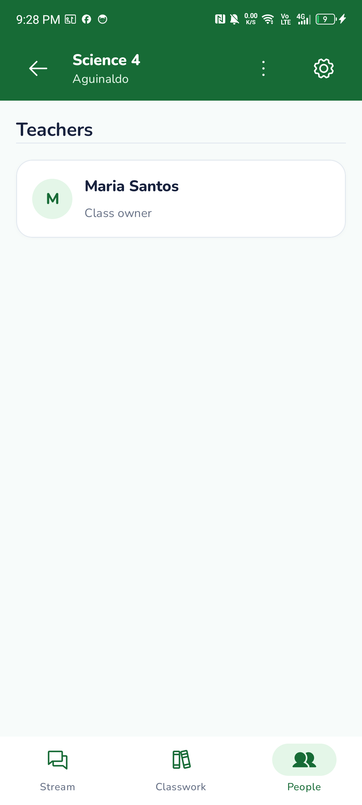 |
| Teacher Stream/banner |  | 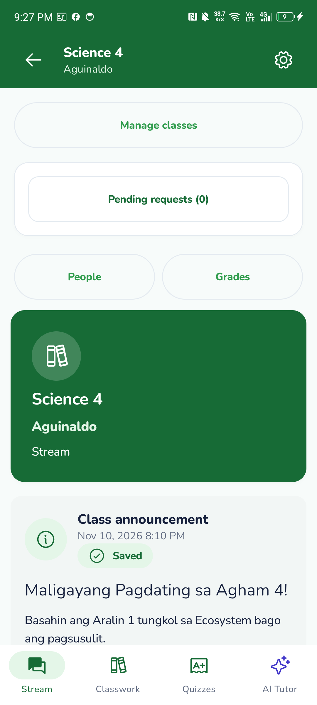 |  |
| Teacher Classwork |  | 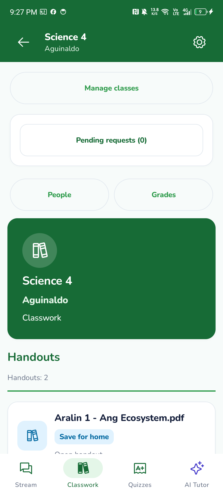 | 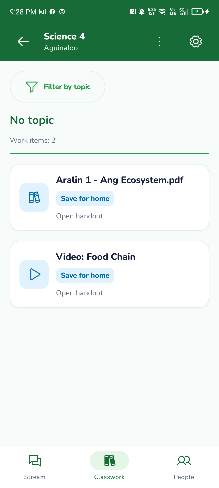 |
| Teacher People |  | 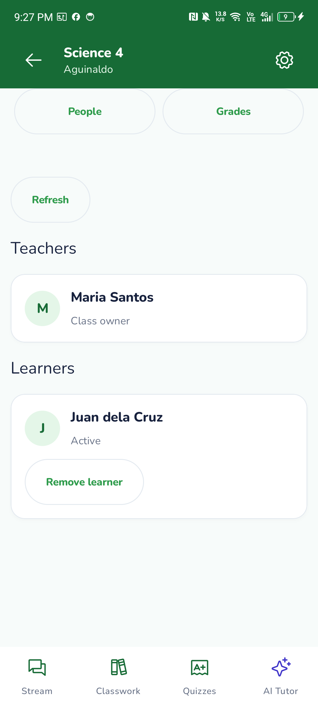 | 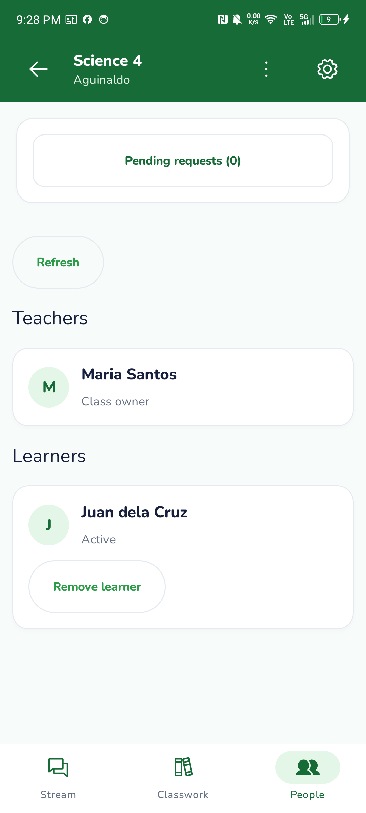 |
| Learner topic selector |  | No topic selector existed; see Classwork above. | 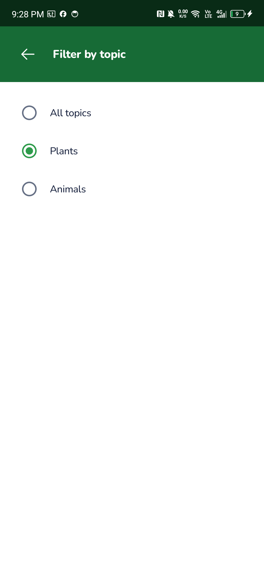 |
| Teacher topic selector |  | No topic selector existed; see Classwork above. | 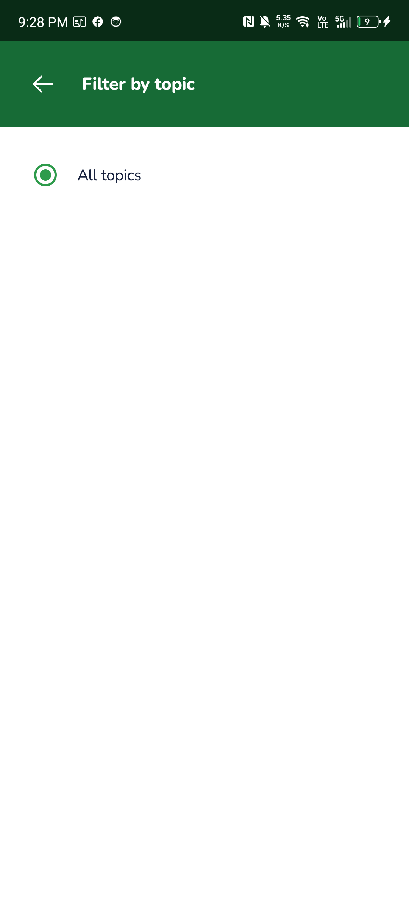 |

Also inspected: [Student 15](<../../../../design-system/mobile/google-classroom-reference/student/15- STREAM.jpg>), [Student 21](<../../../../design-system/mobile/google-classroom-reference/student/21- FILTER_.jpg>), and [Teacher 41](<../../../../design-system/mobile/google-classroom-reference/teacher/41- STREAM.jpg>). Student 21's individual-person work list is not a new feature in this group. Google-only actions and other learners' identities are intentionally omitted. Mock lesson content is seeded data, including Filipino lesson titles; all newly added UI strings are English resources.

## State evidence

- Live real-Hub normal states: [learner Stream](after/realhub/learner-stream.png), [Classwork](after/realhub/learner-classwork.png), [People](after/realhub/learner-people.png), [teacher People](after/realhub/teacher-people.png).
- Actual disconnected transport after real-Hub synchronization and cold launch: [learner Stream](after/disconnected/learner-disconnected-stream.png), [People](after/disconnected/learner-disconnected-people.png), [topic selector](after/disconnected/learner-disconnected-topics.png), [teacher People](after/disconnected/teacher-disconnected-people.png). Both USB Hub ports were forwarded to closed port 9 and then restored; no app endpoint or auth implementation was changed.
- Actual Android 200% text: [learner Stream](after/font200/learner-stream.png), [teacher Classwork](after/font200/teacher-classwork.png), [learner People](after/font200/learner-people.png), [topic selector](after/font200/learner-topics.png). Original Android `font_scale=0.85` was restored.
- Explicit Room/presentation fixtures: [filtered Animals](after/mock/fixture-selected-topic.png), [retained Plants selection](after/mock/fixture-topic-retained.png), [offline mixed assignments/materials](after/mock/fixture-offline-classwork.png), [teachers-only People](after/mock/fixture-offline-people.png), [empty Stream](after/mock/fixture-empty-stream.png), [empty Classwork](after/mock/fixture-empty-classwork.png), [loading](after/mock/fixture-loading.png), [quiz lockout](after/mock/fixture-quiz-lockout.png), [200% content scrolled into view](after/mock/fixture-stream-font200-bottom.png). These images are genuine captures of explicitly supplied states, not claims of live Hub failures. The fixture filter image inherits the phone's normal density; the separate `after/font200` folder proves actual system scaling, including the dialog.

## Results

| Check | Result | Output |
| --- | --- | --- |
| Normal APK build and final lint | Pass; lint 0 errors, 43 warnings | [Build/lint](build-lint.txt), [lint detail](lint.txt) |
| Device-test APK build | Pass | [Device build](device-test-build.txt) |
| Debug unit tests | 194 pass, 6 opt-in skips, 1 existing schema failure | [Full unit command](unit-tests.txt), [failure](schema-parity-failure.xml) |
| Release unit tests | 194 pass, 6 opt-in skips, same schema failure | [Full unit command](unit-tests.txt) |
| Untouched staging schema parity | Same failure reproduced independently | [Baseline build/test](baseline-verification.txt) |
| Repository tests | 69 pass | [Output](repository-tests.txt) |
| Invariants and changed/untracked source checks | Pass | [Output](invariants.txt), [review checks](review-checks.txt) |
| Settled baseline phone capture run | 1 pass | [Output](before-device.txt) |
| Mock live roles + cached filter/privacy/lockout/large-text checks | 2 pass | [Output](mock-device.txt) |
| Real staging Hub learner/teacher main flow | 1 pass covering both roles | [Hub build](realhub-build.txt), [setup](realhub-setup.txt), [phone](realhub-device.txt) |
| Actual 200% Android font, both roles | 1 pass; original setting restored | [Output](font200-device.txt) |
| Real cache preparation and disconnected cold launches | 4 pass: preparation + offline run per role | [Output](disconnected-device.txt) |

The combined `gradlew test lint assembleDebug --continue` command and final `gradlew test --continue` rerun correctly fail because `SchemaParityTest` finds `enrollments.created_at` in the contract but not Room. This predates Group 3, introduced by the schema contract update in PR #273; the UI branch does not suppress or change the test. The final standalone build/lint command passes. A separate mobile schema update is needed before merge. Windows runs used `JAVA_TOOL_OPTIONS=-Djava.io.tmpdir=C:\Temp` and `PYTHONUTF8=1` for the repository scripts.

The real Hub answers `POST /api/topics` with HTTP 404, rather than the mock's supported route. Populated-topic filtering is therefore covered by deterministic Room fixtures, not claimed as a real-Hub authoring pass. No client workaround was added. The draft PR discloses this discrepancy to the server team; no client workaround was added.

## Reproduction

Use the existing mock Hub and seed accounts from the root guide. For the real Hub, build `server/backend` from staging, use `LARA_TEST_SEED=1` and a new `LARA_DATA_DIR`, then create a Science 4 class and approve the seed learner through the existing API/app. Never point these checks at school data.

From `mobile/`, build an isolated APK with `gradlew.bat -I docs/evidence/266-group-3/device.init.gradle assembleDebug assembleDebugAndroidTest`. Install the arm64 debug APK and test APK, forward 8080/8081 over USB, then run:

```text
adb shell am instrument -w -e class org.lara.app.reading.ClassTabsDeviceTest -e tabsHub true -e tabsStates true -e tabsPhase after org.lara.app.group3.test/androidx.test.runner.AndroidJUnitRunner
```

The live check requires the Science 4 synthetic class. `tabsRole=learner|teacher` restricts it; `tabsKeepSession` may retain that synthetic role for the separate `cachedLiveClassWithoutHub` check using `tabsCachedRole`. Restore USB forwarding afterward. State fixtures use unique account caches inside the isolated app and do not clear any installed app's data.

## Not verified

Spoken TalkBack traversal, a 3–4 GB memory profile, WAN-unplugged classroom router/discovery, real-Hub topic authoring/populated content, and unrelated camera/video/quiz execution were not repeated. The Infinix is real hardware but this is not a budget-memory qualification. Lint retains 43 warnings. Existing quiz/tutor screens remain their prior implementations; no new quiz or chat UI was built.

See [implementation and design deviations](../../classroom-layout-group3.md) and [PR #279](https://github.com/BootlegYouki/L.A.R.A/pull/279).
