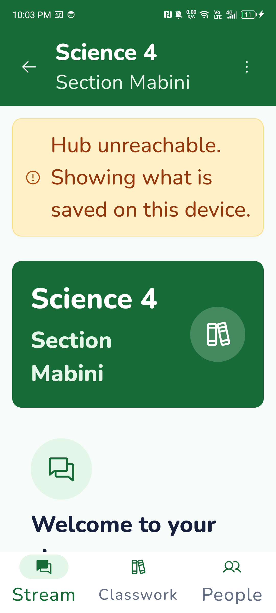
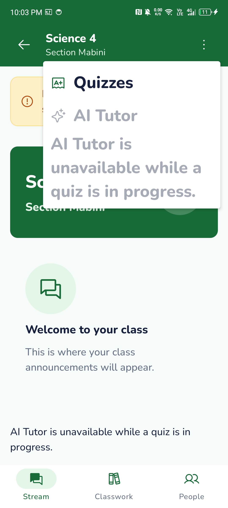

# PR #279 review fixes

Only the two requested visual fixes, on the existing Group 3 branch based on `ff63ad5`. The user's unrelated mobile-skill edit is excluded. No dependencies, schemas, contracts, Hub behavior or quiz-lockout rules changed.

- Locked Tutor text uses the menu's disabled text color; its icon inherits the disabled LocalContentColor. AiDark applies only when state.allows(destination).
- Navigation labels use maxLines = 1, softWrap = false and shrink in 0.5sp steps only on width overflow, bounded at 8sp. They reset when label, density/font scale or window width changes. Foundation resolves to 1.7.6, which predates native TextAutoSize (introduced in 1.8); this small local fallback avoids a dependency upgrade.
- The device assertion requests Android accessibility character bounds for every Classwork character, checks that all nine are visible and share one line, and retains the 52dp target checks. Existing fixture checks also cover Tutor disabled state, unlocking, tab navigation and local filtering.

## Updated genuine phone screenshots

Infinix X6731, Android 14, 10 November 2026. Unedited captures from the existing isolated `org.lara.app.group3` test package with synthetic Room fixtures. Actual Android font_scale was set to 2.0 and restored to its original 0.85 in a finally block. The class-tab fixture also uses font scale 2; the locked-menu fixture uses its existing normal content density while the system menu uses the actual 200% setting.

| Single-line labels at 200% | Disabled Tutor text and icon |
| --- | --- |
|  |  |

[Scrolled 200% content](font200-class-tabs-scrolled.png). Original reference and pre-review captures remain in the parent evidence index.

## Checks

- Debug APK and device-test APK builds: pass.
- lintDebug: pass, zero errors and 43 existing warnings.
- ShellStateTest: 2 passed, zero skipped/failures.
- Physical-phone cachedFiltersPrivacyAndLargeText: 1 passed, including every visible Classwork character on a single line, minimum tab targets and Tutor lockout.
- Repository invariant scanner and whitespace checks: pass.
- Full unit suites, real-Hub rebuilding and unrelated endpoint checks were not repeated: #276's schema-parity failure and #122's topic-creation 404 are already acknowledged by the Lead and remain untouched. Earlier full-suite/real-Hub evidence remains in the parent index.

[Build/lint/unit output](build-lint-navigation-tests.txt), [final targeted checks](final-checks.txt), [actual font/device output](device-font200.txt), [resolved Compose version](compose-version.txt), [tested source/APK hashes](tested-files.txt).
