# Group 5 phone evidence

[11 November review fixes, final accent screenshots and real-staging-Hub verification](review-2026-11-11/README.md) supersede the original touched-screen captures and pending-Hub notes below.

Part of #266. Base: `origin/staging` **88f12b9**. Implementation on `feat/266-mobile-classroom-layout-part-5`. Genuine, unedited screenshots from the USB-connected **Infinix X6731, Android 14**, 10 November 2026. All tests use a separate **org.lara.app.group5** installation and synthetic accounts/data. The normal installed app was not replaced or cleared.

BEFORE images were captured from the staging production UI before installation of the redesign. The baseline fixture test was corrected to update the same Room instance observed by the screen; the final baseline run passed. AFTER uses the same states and production components. `after/live-mock-*` uses synchronized mock-Hub data and an actual upload/receipt; all other state images are explicitly synthetic Room fixtures with the Hub set to unreachable port 9. They are not claims of real-Hub or classroom-router verification. The mock's seeded Filipino assignment content is lesson data; all UI additions are English resources.

## Reference / BEFORE / AFTER

| Screen | Classroom reference | BEFORE | AFTER |
| --- | --- | --- | --- |
| Assignment details |  | 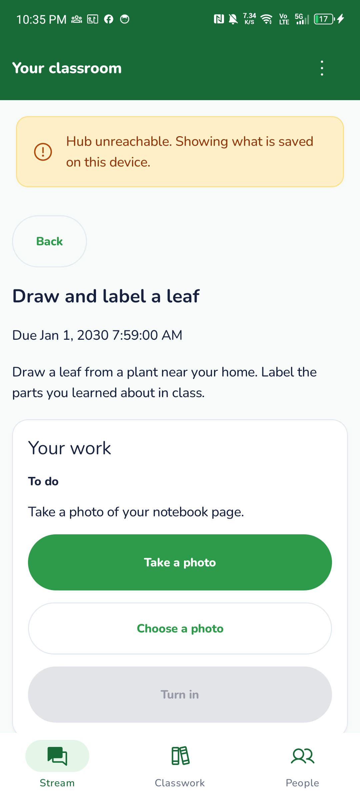 | 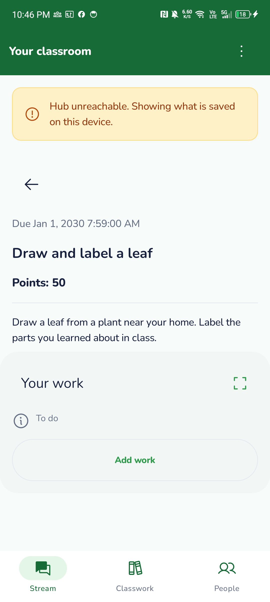 |
| Your work / empty |  |  | 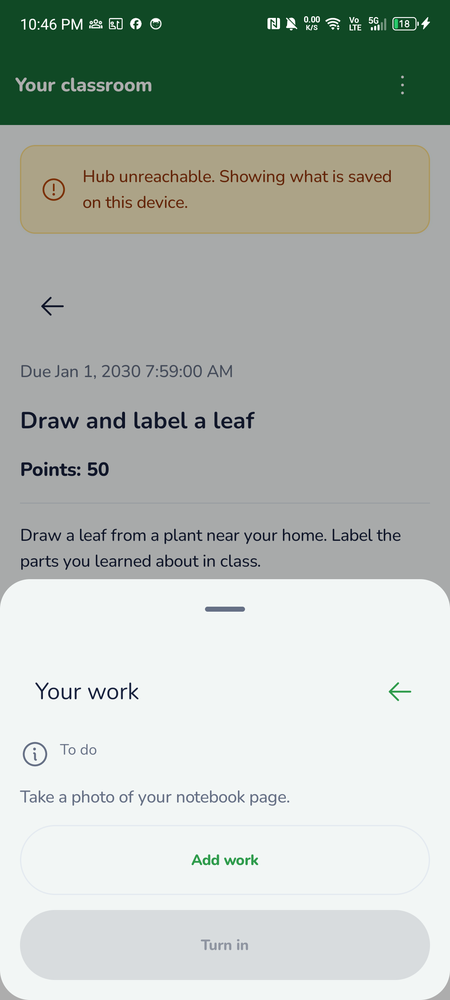 |
| Add work sources |  |  | 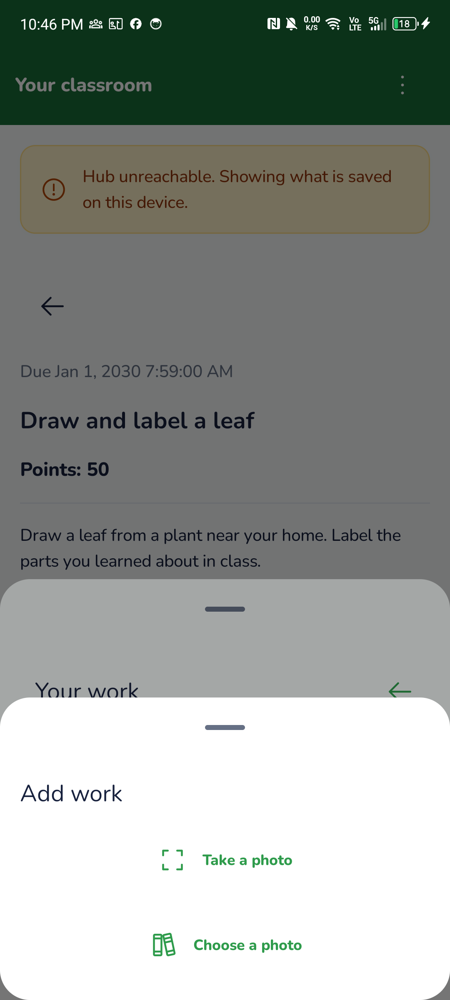 |
| Photo / confirmation |  | 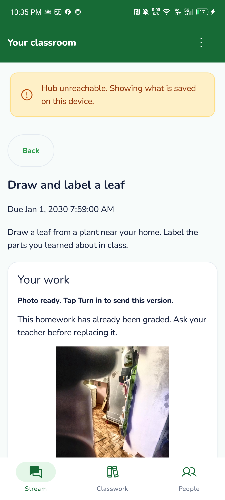 | 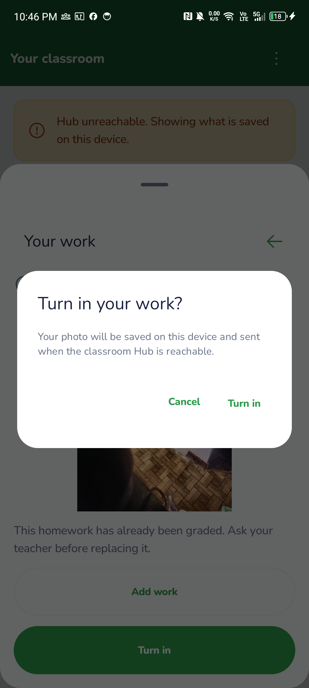 |
| Submitted work |  | 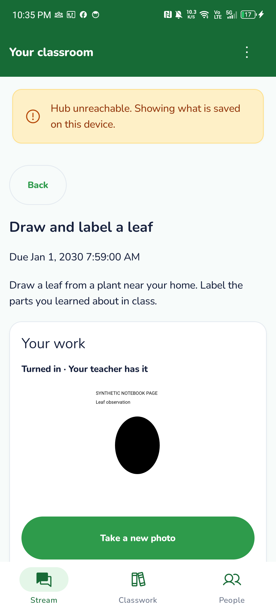 | 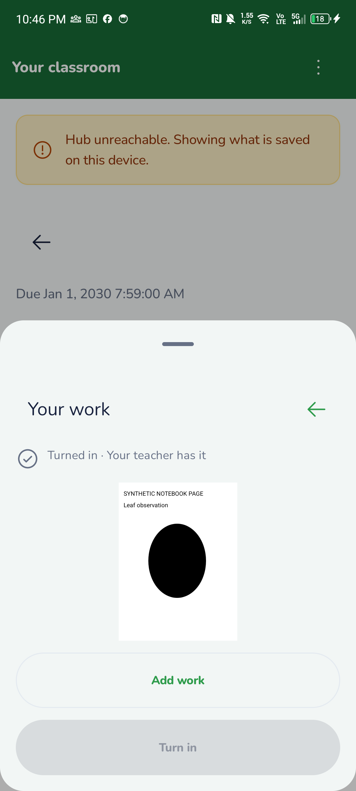 |
| Submitted summary |  |  | 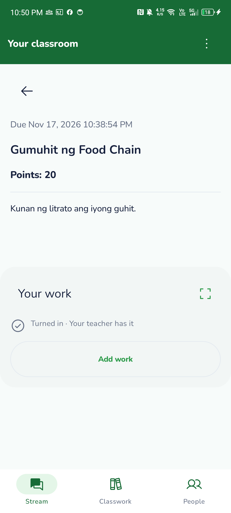 |

There was no separate Add work sheet or Turn in confirmation before this change: the BEFORE panel shows the original inline photo actions and direct Turn in. The submitted summary AFTER image uses live mock data, while its BEFORE is the corresponding synthetic submitted state. Student 24/26/27's private comments and Student 27's Unsubmit are intentionally omitted.

| L.A.R.A camera/scanner | BEFORE | AFTER |
| --- | --- | --- |
| Camera and framing guide | 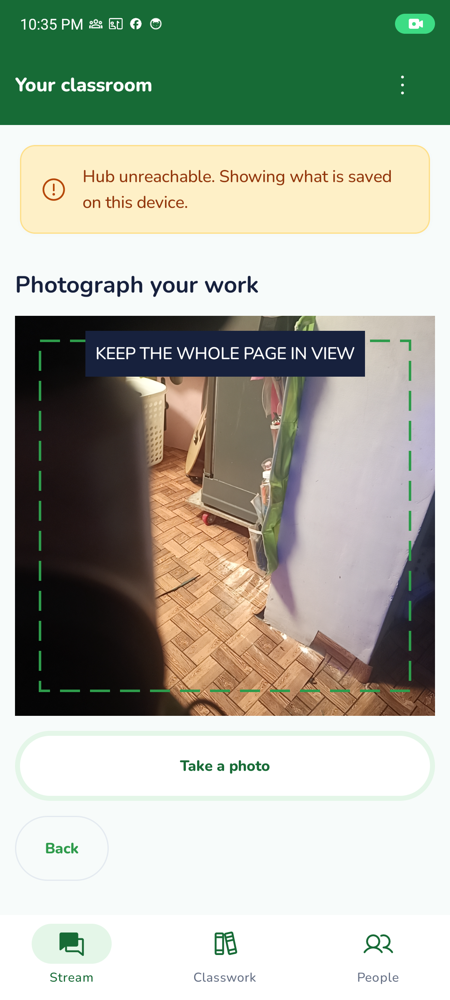 | 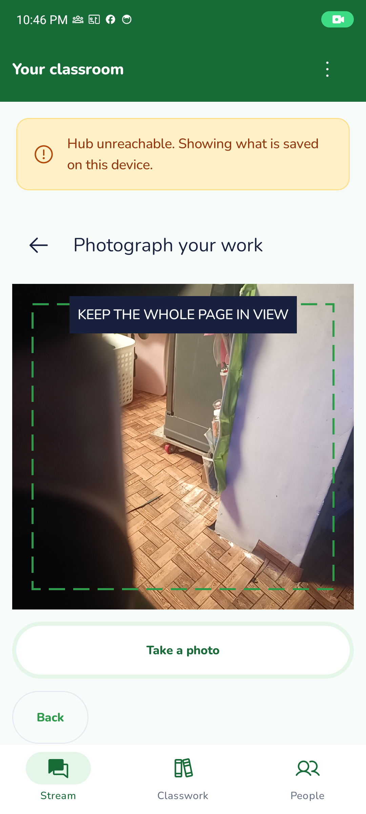 |
| Scan preview | 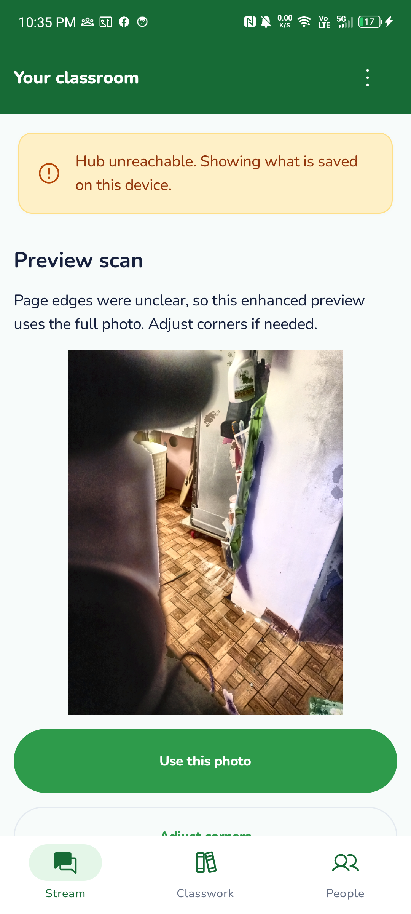 | 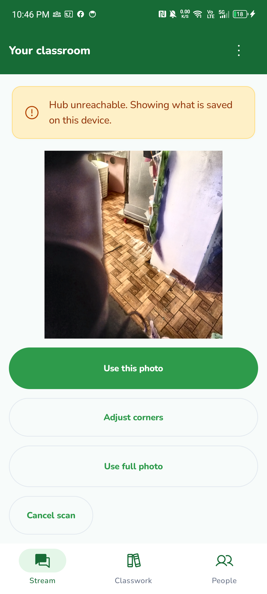 |

## Other supported states

- [Queued](after/state-QUEUED_FOR_SYNC.png), [submitted fixture](after/state-SYNCED.png), [late rejection](after/state-LATE_SUBMISSION.png), [already-graded rejection](after/state-ALREADY_GRADED.png).
- [Draft photo preview](after/photo-ready.png), [durably queued offline turn-in](after/turned-in-offline.png), [imported-photo review](after/import-preview.png), [imported draft](after/import-ready.png). Importing a replacement draft is asserted not to overwrite the queued Room row before Turn in.
- [Actual mock-Hub assignment](after/live-mock-assignment.png), [successful uploaded submission](after/live-mock-submitted.png), [collapsed submitted summary](after/live-mock-submitted-collapsed.png). The test explicitly asserts SYNCED, a non-null received_at and retention of the local photo.
- [Actual 200% assignment](font200/assignment-empty.png), [Your work](font200/work-empty.png), [Add work](font200/add-work.png), [confirmation](font200/turn-in-confirm.png), [offline queued state](font200/turned-in-offline.png). The full fixture camera/import/turn-in flow passed with Android font_scale=2.0; original 0.85 was restored in finally. Each state's equivalent file is also in font200/.

Photo selection verification opens the actual Android image selector and cancels it without capturing the user's photo library. A synthetic URI is then passed to the existing ViewModel image-import callback to exercise normalization, scan review and draft preservation. This does not claim a manual tap on a personal gallery image. Camera capture is actual CameraX on the phone. No image was generated or fabricated as phone evidence.

## Results

| Check | Actual result | Evidence |
| --- | --- | --- |
| Staging baseline phone flow | 1 passed | [Output](before-device.txt), [build](before-build.txt) |
| Final Room fixtures + live mock flow | 2 passed | [Output](after-device.txt) |
| Additional submitted-summary capture | 1 passed | [Output](final-mock-device.txt) |
| Actual Android 200% fixture flow | 1 passed; 0.85 restored | [Output](font200-device.txt) |
| Targeted homework/scanner unit tests | 20 passed, no failures/skips; live HomeworkMockTest enabled | [Output](targeted-tests.txt) |
| Required normal assembleDebug | Passed within combined command | [Build/test/lint](build-test-lint.txt) |
| Full Debug unit tests | 194 passed, 6 opt-in skips, 1 known #276 failure | [Build/test/lint](build-test-lint.txt), [failure XML](schema-parity-failure.xml) |
| Full Release unit tests | 194 passed, 6 opt-in skips, same #276 failure | [Build/test/lint](build-test-lint.txt) |
| Lint | Passed: 0 errors, 43 existing warnings | [Detail](lint.txt) |
| Final isolated debug and instrumented APKs | Passed | [Build](final-device-build.txt) |
| Repository tests | 69 passed | [Output](repository-tests.txt) |
| Invariants and whitespace/source scope | Passed | [Invariants](invariants.txt), [final review](review-checks.txt) |

[Counts](results.txt), [tested working-source and installed-APK hashes](tested-files.txt).

The combined `assembleDebug test lint --continue` exits unsuccessfully because SchemaParityTest fails in both unit variants: contracts have enrollments.created_at, Room v3 does not (#276). This is the Lead-acknowledged staging baseline from PR #279, not suppressed or independently reinvestigated. Build and lint tasks succeed. #122's unfinished real-Hub authoring was not reinvestigated or worked around.

## Reproduction

Build isolated APKs from mobile/:

```text
gradlew.bat -I docs/evidence/266-group-5/device.init.gradle assembleDebug assembleDebugAndroidTest
```

Install the arm64 debug and debug-androidTest APKs. Grant CAMERA only to org.lara.app.group5. Start the existing mock with REST 18080 and WS 18081; forward phone 8080/8081 to those host ports. Then run:

```text
adb shell am instrument -w -e class org.lara.app.reading.AssignmentUiDeviceTest -e assignmentUi true -e assignmentHub true -e assignmentPhase after org.lara.app.group5.test/androidx.test.runner.AndroidJUnitRunner
```

`assignmentUi` enables synthetic Room/camera/import checks; `assignmentHub` enables the existing mock's seeded learner/class/assignment flow. Tests are opt-in and reject any target package except the isolated group5 app. For the baseline use staging production sources and assignmentPhase=before. For large text set Android font_scale=2.0, run only assignmentStatesAndPhotoFlow with phase=font200, and restore the original setting in finally. TakeScreenshot images are saved to the isolated app's files directory; retrieve with adb exec-out run-as. Temporary mock-Hub USB mappings were removed after verification.

Targeted unit command, with the mock on 18080/18081: `LARA_SYNC_MOCK=1 gradlew.bat testDebugUnitTest --tests '*Homework*' --tests '*DocumentCornersTest'`. Required final command: `gradlew.bat assembleDebug test lint --continue`. Windows builds used JAVA_TOOL_OPTIONS=-Djava.io.tmpdir=C:\Temp. Root checks used PYTHONUTF8=1. No dependencies or build configuration were added to the product; the init script only isolates the test installation.

## Design deviations and pending verification

[Implementation, data flow, deferred Group 4 rationale and proposed PR details](../../classroom-layout-group5.md).

**Real-staging-Hub main flow remains pending before PR submission.** No running Hub was available and the found binary's current-staging provenance could not be verified. It was not rebuilt. This is an incomplete mandatory #242 check, not an approved deferral. Do not mark the PR's real-Hub checkbox complete from these mock/Room results.

Also not verified here: WAN-unplugged classroom-router discovery, spoken TalkBack traversal, landscape, process-death/cold-launch device rerun and a new 3-4 GB peak-memory qualification. Existing scanner/repository tests were reused; this UI pass makes no new memory qualification claim. Camera/gallery originals, durable queue and graded/read-only rules retain their existing implementations. No Group 6, private comments, general attachments or teacher posting functionality was built.

Final readiness review: evidence links, tested working-source hashes and diff scope were rechecked successfully. The separately authorized skill-only commit is `69f514d`; implementation/evidence are included in the separately authorized Group 5 publication commit. Real-Hub verification is still pending; #276 remains disclosed without reinvestigation. See the implementation notes for the reuse check and PR readiness decision.

Publication authorized as a Draft PR targeting staging. Real-Hub verification remains pending and #276 remains a disclosed baseline failure; draft publication does not mark either check passed. The earlier working-tree records describe the pre-publication verification state.
