# Group 7 evidence — Part of #266

Base: `origin/staging` **16dd2e7**. Branch: `mobile/266-group7-class-menu-settings`. Captured 13 November 2026 on **Infinix X6731, Android 14**, USB device `10620253AI003793`. Isolated application ID **org.lara.app.group7**; the regular app was not replaced or cleared. Original phone font scale **0.85**; accessibility runs temporarily use **2.0** and restore the original value in `finally`.

The BEFORE run used unchanged staging production UI and passed before any production source edits. AFTER uses the same production entry points and mock teacher/class data. Screenshots are genuine, unedited phone captures. Class management uses authenticated mock Hub data mirrored into Room. Settings loading/offline/no-Hub/queued states and the class-shell overflow use explicit synthetic UI state. Offline control checks inject unreachable state into the same reachability flow; they do not claim a physical router-disconnection test.

## Reference / BEFORE / AFTER

| Surface | Classroom reference | BEFORE | AFTER |
| --- | --- | --- | --- |
| Class details and teachers |  | 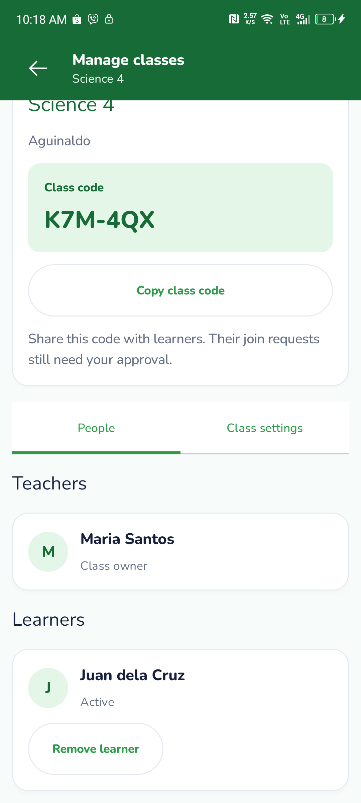 | 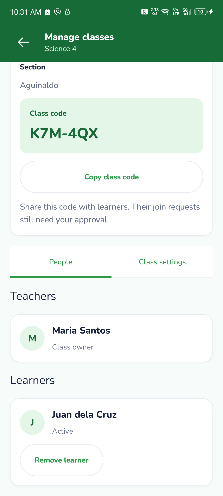 |
| Owner controls |  | 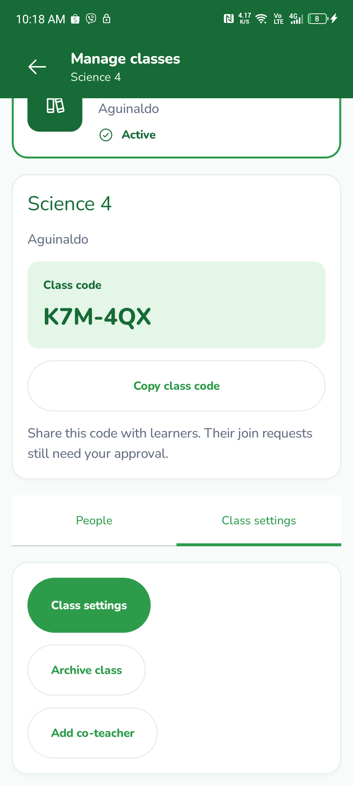 | 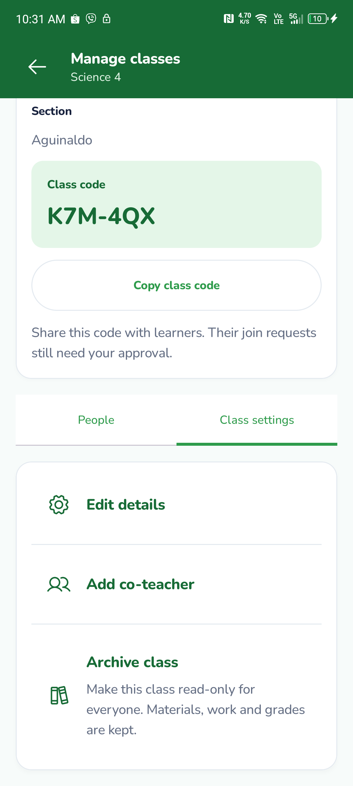 |
| Rename |  | 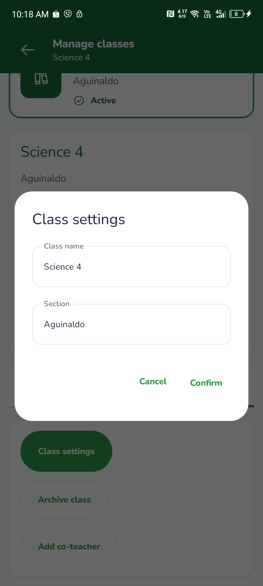 | 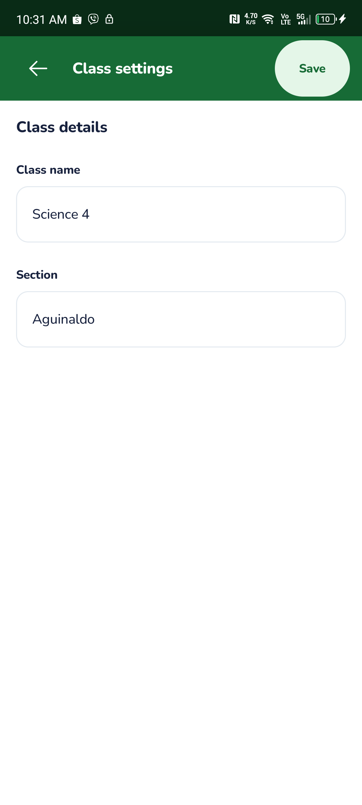 |
| Archive confirmation |  | 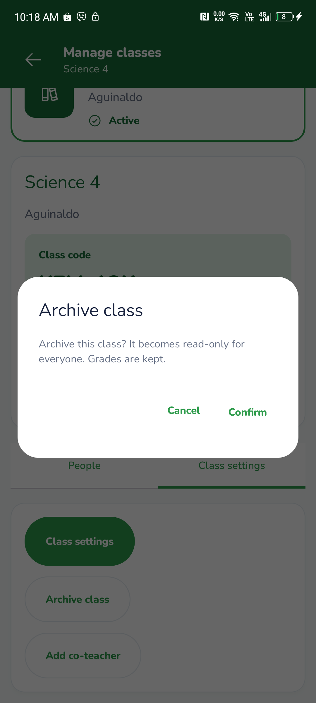 | 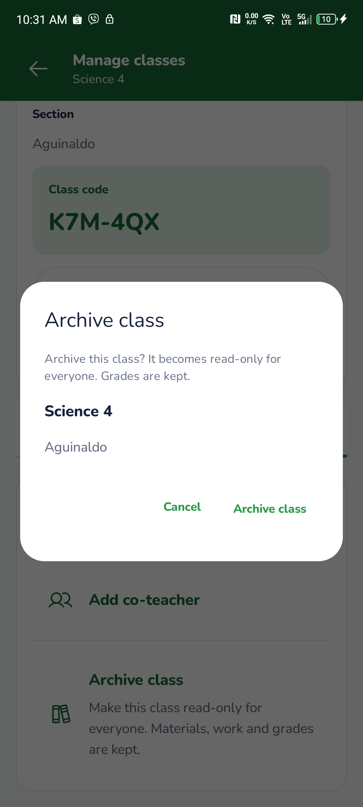 |
| Add co-teacher |  | 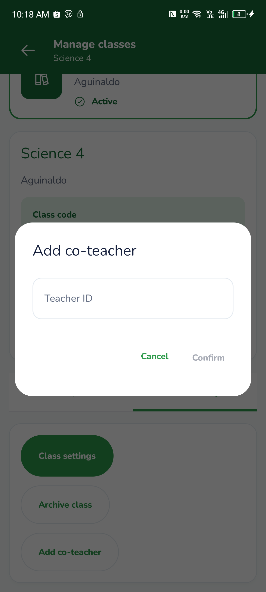 | 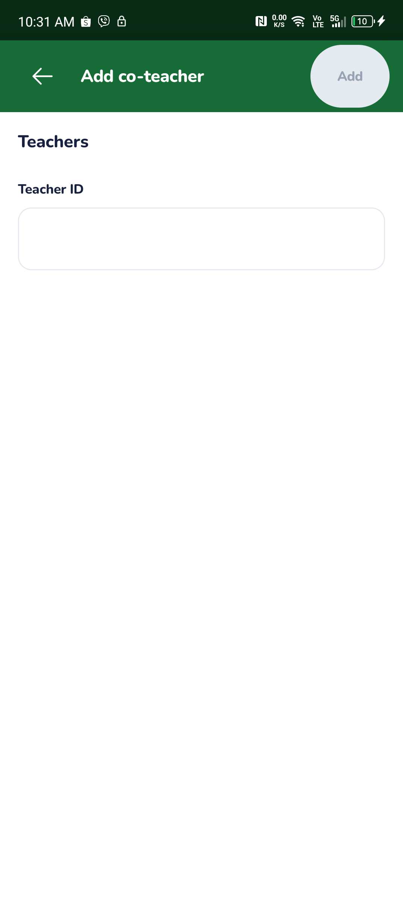 |
| Existing class overflow |  | 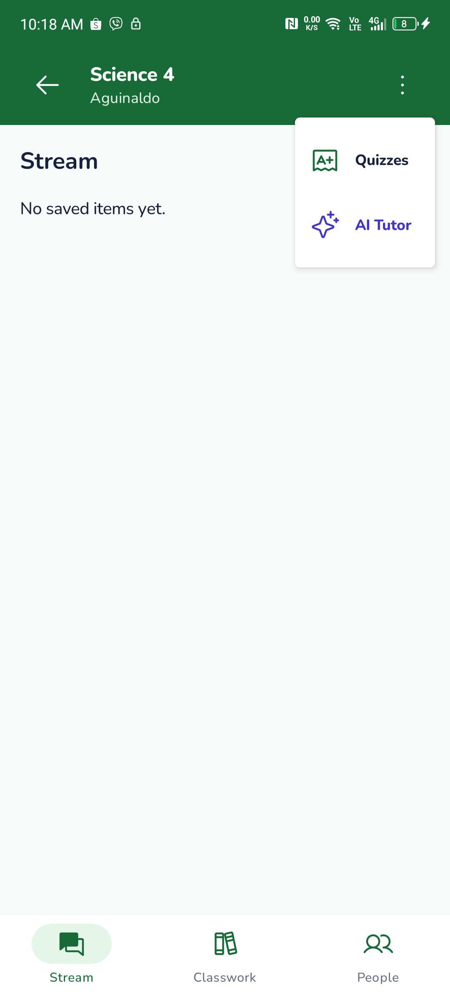 | 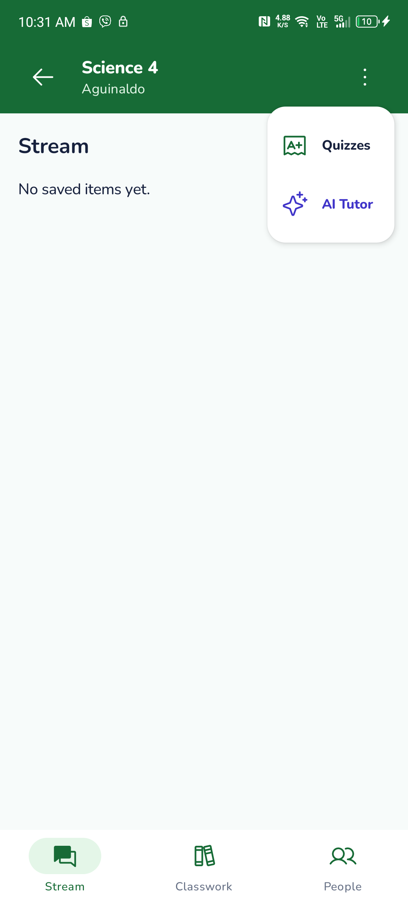 |
| Settings / inline About |  | 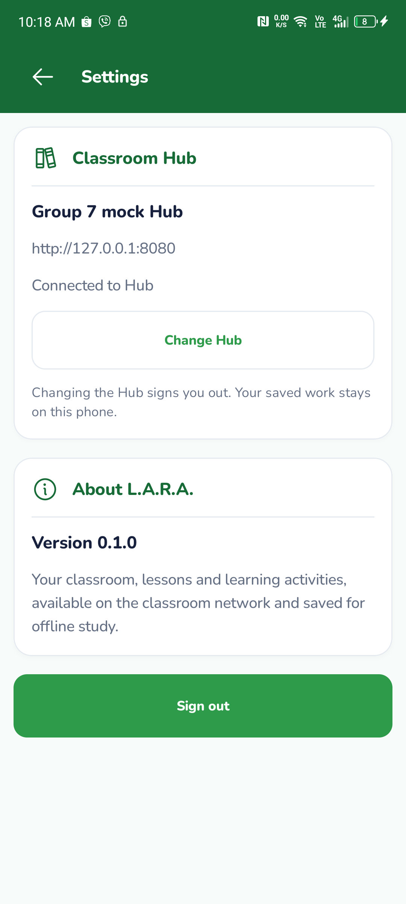 | 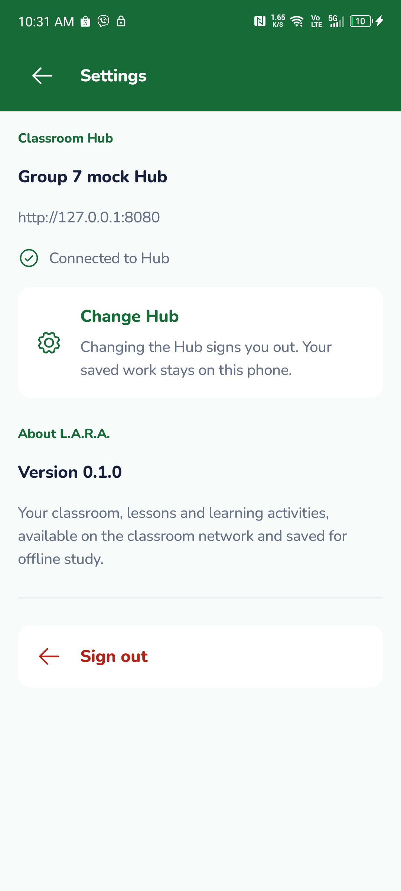 |

The co-teacher input has no exact Classroom equivalent: L.A.R.A. uses teacher IDs and the Teacher 12 form anatomy. Class detail captures show a scrolled view of the original existing management page; the original class name is partly above the visible area. No standalone learner About, Archived or new Settings destination exists.

## Other states

- Settings [offline/no saved Hub](after/settings-offline.png), [loading](after/settings-loading.png), [queued sign-out confirmation](after/settings-queued.png); equivalent genuine BEFORE captures are in `before/`.
- [Offline class controls](after/class-offline-controls.png), with Edit details asserted disabled. [Archived/read-only disposable class](after/archived-read-only.png).
- `landscape200/` contains matching 200% landscape captures; each image is asserted wider than tall, and font/rotation settings are restored afterward.
- `font200/` contains the same primary surfaces at Android font scale 2.0. The first review found a squeezed co-teacher title; final captures supersede that layout after shortening the action to Add. An assertion checks readable title width.
- Existing Settings device tests verify English fallback and no language option, plus cancel/confirm of queued-work sign-out at large font without deleting the queued Room row.
- The production-controls test creates a disposable mock class, edits its name through Save, archives it through confirmation, and checks read-only state. No school data is used.

## Checks

| Check | Actual result | Evidence |
| --- | --- | --- |
| Staging BEFORE phone captures | Passed, 1 test | [Phone](before-device.txt), [build](before-build.txt) |
| Final normal phone checks | Passed, 4 tests | [Output](after-device.txt) |
| Final 200% phone captures and offline controls | Passed; 1 capture test, 1 opt-in mutation test skipped | [Output](font200-device.txt) |
| Final 200% landscape captures | Passed; 1 capture test, 1 opt-in mutation test skipped; landscape dimensions asserted | [Output](landscape200-device.txt) |
| Final isolated debug and instrumentation APKs | Passed | [Build](final-device-build.txt) |
| Required normal debug build | Passed within combined run | [Output](final-build-test-lint.txt) |
| Full Debug unit tests | 194 passed, 6 opt-in skipped, 1 known #276 failure | [Counts](test-counts.json), [failure](debug-schema-parity.xml) |
| Full Release unit tests | 194 passed, 6 opt-in skipped, same #276 failure | [Counts](test-counts.json), [failure](release-schema-parity.xml) |
| Final lint | Passed, 0 errors; 46 warnings and 1 informational finding | [Output](final-lint.txt) |
| Invariants | Passed | [Output](invariants.txt) |
| Shared Python suite | 61 passed; 2 module-import errors because PyYAML is missing | [Output](shared-tests.txt) |

The combined build/test/lint command exits unsuccessfully because the Room schema lacks `enrollments.created_at` required by the contract, the known staging issue #276 already documented in Group 5 evidence. No schema files were changed or tests suppressed. The first run also hit four `/var` versus `/private/var` path assertions on macOS. Pointing test JVMs at canonical `/private/tmp/lara-group7-unit-tests` resolves those four without changing application code or test assertions. The initial log is retained in [build-test-lint.txt](build-test-lint.txt).

The Python suite's `test_contracts` and `test_contract_coverage` modules cannot import `yaml`; no package installation was performed. The other 61 tests pass. [Source hashes](tested-source-sha256.json) identify the reviewed production and phone-test files.

## Reproduction

Run the existing mock Hub on host HTTP 18080 / WebSocket 18081. Forward phone 8080/8081 to those ports with `adb reverse`. Build from `mobile/` using the existing Android SDK and Gradle cache:

```text
./gradlew -I docs/evidence/266-group-7/device.init.gradle assembleDebug assembleDebugAndroidTest --max-workers=2
```

Install `app-arm64-v8a-debug.apk` and `app-debug-androidTest.apk`, then:

```text
adb shell am instrument --user 0 -w -e class org.lara.app.reading.ClassMenuDeviceTest,org.lara.app.settings.SettingsScreenDeviceTest -e menuMutations true org.lara.app.group7.test/androidx.test.runner.AndroidJUnitRunner
```

Use `-e menuPhase font200` after temporarily setting Android `font_scale=2.0`; restore the original setting afterward. Capture files are in the isolated target app's files directory, prefixed `menu266-<phase>-`.

Required final checks use `unit.init.gradle` to point test JVMs at a canonical `/private/tmp` directory on macOS. This changes only the test environment, not assertions or application code:

```text
./gradlew -I docs/evidence/266-group-7/unit.init.gradle assembleDebug test lint --continue --max-workers=2
python3 scripts/verify_invariants.py
python3 -m unittest discover tests
```

## Not verified

Real Hub: deferred at the user's explicit direction to use mock-only UI testing. No cargo toolchain or prebuilt Hub was available at the standard location, and no Rust build/install was attempted. This does not satisfy the Lead's real-Hub pre-PR gate. Classroom router/WAN isolation, another device, TalkBack exploration and low-memory profiling are not claimed by these UI captures.

See [implementation and design deviations](../../classroom-layout-group7.md). Evidence is prepared for **Part of #266**, not issue closure. No commit, push or PR was made.
