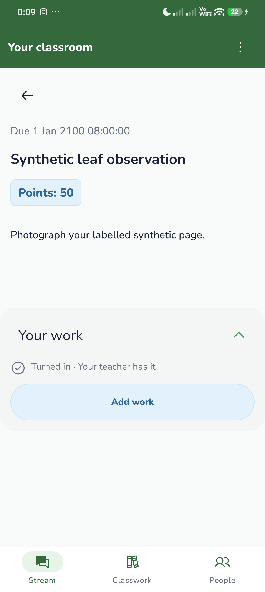
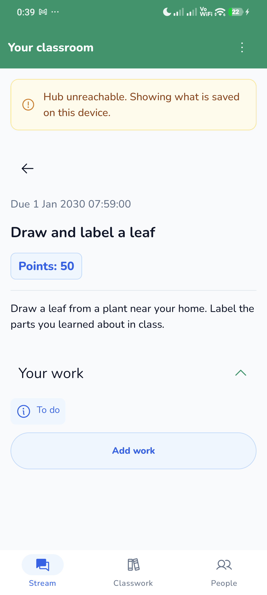

# Emerald / sky / amber palette proposal evidence

Prototype branch `codex/266-palette-proposal`, based on checkpoint e9738e7. PR #280 reverted this checkpoint in 702644a and retains the approved canonical palette. This branch is a discussion prototype pending Lead approval and a shared design-system change first.

## Before and after

Both captures are genuine, unedited Android screenshots on physical Xiaomi 2311DRK48G / Android 16 using the isolated org.lara.app.group5 app. The BEFORE uses the approved df5532d theme and a real-Hub assignment. The AFTER uses the palette prototype and synthetic Room fixtures with the Hub unreachable. Fixture titles/statuses differ, so these compare palette roles rather than identical content pixels.

| Before, approved current palette | After, prototype palette |
| --- | --- |
|  |  |

Other prototype states are in after-work-empty.png, after-add-work.png, after-state-QUEUED_FOR_SYNC.png, after-state-SYNCED.png, after-state-LATE_SUBMISSION.png and after-state-ALREADY_GRADED.png.

## Checks

- Isolated prototype app/test build passed. See prototype-build.txt.
- One physical screen-state test passed in 15.312 seconds. It covers empty, source-sheet, queued, synced and rejected states. assignmentReviewOnly=true skips camera/import/turn-in processing after those states. See prototype-device-test.txt.
- PaletteTest passed. See PaletteTest.xml. It checks essential text at 4.5:1, warning icons at 3:1, and the existing project's primary-action 3:1 threshold.
- contrast.json contains calculated WCAG relative-luminance ratios for the actual prototype colors.

White on #059669 is about 3.77:1. That meets the large-text threshold, but normal-sized white button labels need the darker #047857 variant (about 5.49:1), a larger bold label, or dark text. This must be resolved in the shared specification before production adoption. The prototype's default Material primary still uses #059669, so the existing 3:1 project rule is not a claim of 4.5:1 normal-text compliance.

Phone font_scale 1.0 and USB stay-awake 0 were restored after copying these captures. Production org.lara.app was not replaced or cleared.

## Remaining work before adoption

Lead decision, canonical shared token update, matching Desktop/Hub mappings, normal-sized button contrast choice, full screen-state/200% and accessibility review across all three apps, and final client test/CI evidence. New API/database behavior is outside this proposal.
